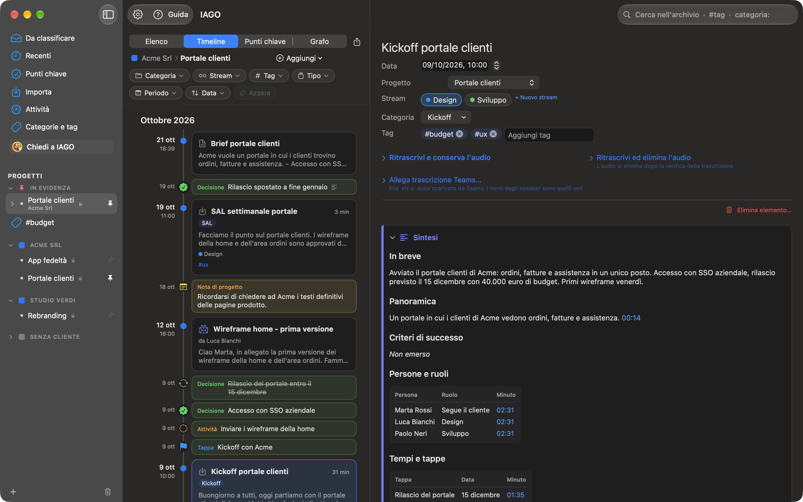

<!-- icona: sparkles -->
# Primi passi

IAGO è la **memoria del tuo lavoro**. Raccoglie quello che succede in ogni progetto e te lo restituisce quando ti serve:
- le call che registri;
- le email, i PDF, i documenti e le trascrizioni che importi;
- le note e i momenti che segni.

Puoi chiedergli cosa si è deciso, chi deve fare cosa, com'è cambiata una scelta nel tempo: risponde con i tuoi contenuti e ti porta alla fonte, fino al minuto della call.

## Cosa fa per te
1. **Raccoglie.** Registra le call con un clic sull'icona di IAGO {{icona}} nella barra dei menu (il nostro pappagallo con la memoria di ferro). Importa email, PDF, documenti, immagini, audio e trascrizioni di Teams, anche da sola da una cartella.
2. **Ordina.** Ogni cosa trova il suo cliente, progetto e stream. La categoria dice che tipo di riunione era e i tag la rendono trasversale.
3. **Capisce.** Trascrive, scrive la **sintesi** nella forma giusta per il tipo di riunione, ed estrae **decisioni, attività e tappe**, collegate tra loro quando una supera l'altra.
4. **Risponde.** Cerca per parole o per significato, oppure chiedi a IAGO (⌘K): risponde solo con i tuoi contenuti e cita le fonti.

## Dove si trova cosa
- **Icona di IAGO** {{icona}} nella barra dei menu, in alto a destra dello schermo:
  - un clic avvia o mette in pausa una registrazione (durante mostra il tempo, durante una trascrizione la percentuale);
  - con il clic destro si apre il menu: *Segna momento*, *Nota vocale*, *Importa file…*, Guida, Impostazioni.
- **Finestra principale:** a sinistra le viste e i progetti, al centro elenco o timeline, a destra la scheda dell'elemento.
- **Impostazioni** (⌘,): tutto ciò che si configura, compresi i **Permessi**.
- **Guida:** il pulsante **? Guida** in alto a sinistra nella finestra, accanto alle Impostazioni, o il menu dell'icona di IAGO {{icona}}.

## I tuoi dati, le tue scelte
Niente lascia il tuo Mac se non sei tu a deciderlo:
- l'archivio è cifrato e il **motore locale** lavora sul Mac;
- se vuoi più potenza puoi collegare **Claude** ai progetti che scegli;
- per lavorare in gruppo potrai condividere i progetti in **spazi che controlli tu o la tua azienda**, come OneDrive, SharePoint o Google Drive.

Vedi il capitolo *Privacy, Claude e condivisione*.
