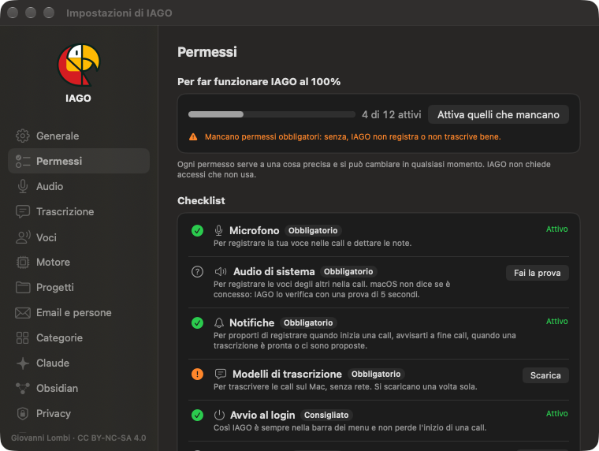

<!-- icona: arrow.down.app -->
# Installazione

Serve un Mac con Apple Silicon (M1 o successivi) e macOS 15 o più recente. Spazio: 1,6 GB per la trascrizione, da 2 a 7 GB in più per il motore locale.

## Installare
1. Scarica `IAGO-x.y.z.dmg` dalla pagina delle release e aprilo.
2. Trascina **IAGO** sulla cartella **Applicazioni** che vedi accanto, poi aprilo da Applicazioni.

## "Apri comunque" (solo la prima volta)
IAGO non è distribuito tramite l'App Store e non è notarizzato da Apple. Al primo avvio macOS può bloccarlo:
1. Premi **Fine**, non "Sposta nel cestino".
2. Apri **Impostazioni di Sistema › Privacy e sicurezza**, scorri fino a **Sicurezza** e premi **Apri comunque** accanto a IAGO.
3. Conferma con password o Touch ID, poi **Apri**.

## Configurazione guidata
Al primo avvio IAGO chiede prima di tutto la **lingua**, italiano o inglese (la cambi quando vuoi in Impostazioni › Generale), poi il tuo nome (diventa "Io" nelle trascrizioni), prova microfono e audio del Mac, chiede le notifiche e scarica i modelli di trascrizione. Poi si apre l'introduzione (vedi Primi passi).

## Permessi
In **Impostazioni › Permessi** vedi cosa è attivo; **Attiva quelli che mancano** ti accompagna una voce alla volta.

| Permesso | Serve per | Livello |
| --- | --- | --- |
| Microfono | la tua traccia | obbligatorio |
| Audio di sistema | la traccia degli altri | obbligatorio |
| Notifiche | avvisi di fine trascrizione, sintesi pronte | consigliato |
| Avvio al login | essere pronto a ogni call | consigliato |
| Calendario | titolo delle riunioni | facoltativo |
| Accessibilità | seguire il mute di Teams | facoltativo |
| Motore locale | sintesi, proposte, Chiedi | facoltativo |
