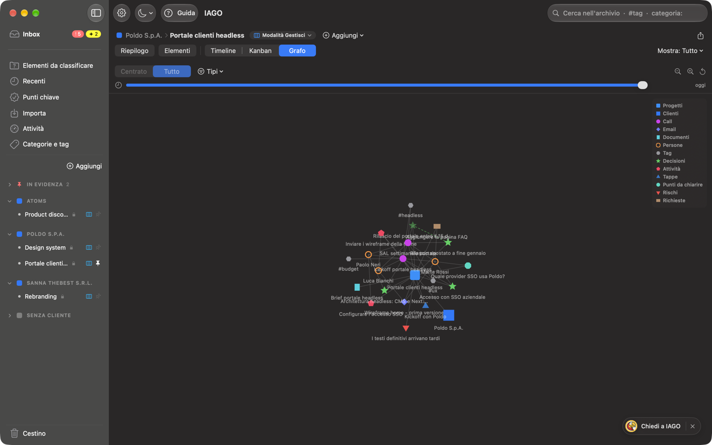

<!-- icona: folder -->
# Organizzare

## La barra laterale
- **In cima, l'Inbox**, in grassetto e separata dal resto: il lavoro aperto che aspetta te. Ha due bollini: il **rosso** (!) conta ciò che chiede un'azione adesso, il **giallo** (✦) le proposte da confermare (vedi Punti chiave e lavoro aperto).
- **Sotto, fisse:** *Elementi da classificare*, *Recenti*, *Punti chiave*, *Importa*, *Attività*, *Categorie e tag*.
- **Clienti e progetti** (l'unica parte che scorre). In cima, a destra, **Aggiungi** apre il menu *Aggiungi:* con **Cliente…** e **Progetto…**. Se un nome è troppo lungo per la barra, resta **due secondi** sul nome: compare il nome intero.
  - **In evidenza** (pin rosso): progetti, stream, categorie e tag che fissi.
  - **I clienti**, ognuno con i suoi progetti. Accanto a ogni progetto una piccola icona dice la sua modalità: una scatola arancione per la *Modalità Raccogli*, un quaderno verde per la *Modalità Traccia*, tre colonne blu per la *Modalità Gestisci*; un clic sull'icona ti fa sceglierne un'altra, come la pillola accanto al nome del progetto. Un clic sul nome apre o chiude il cliente; **⌥-clic** apre solo quello e chiude gli altri. Passando sopra compare **+**: crea un progetto di quel cliente, già scelto e non modificabile. Tutti gli elementi del cliente si aprono con il tasto destro › *Apri*.
  - **Senza cliente** (quadratino grigio), sempre ultimo, con **Non definito** in fondo: gli elementi classificati senza progetto.
- **In fondo:** il **Cestino**, con il numero di elementi e di progetti.
- Con più di 15 progetti compare **Filtra progetti**.

**Le colonne.** Accanto alla barra laterale, la colonna centrale (l'elenco) e quella di destra (ciò che apri) partono a metà e metà. Trascina il divisore tra le due per cambiarle: la larghezza resta per quella sezione soltanto, anche alla prossima apertura. Inbox, Elementi da classificare, Recenti, Punti chiave e le altre ne hanno ognuna una sua; i progetti, i clienti, gli stream, le categorie e i tag ne hanno una in comune per ogni vista.

## Progetti e stream
Un progetto appartiene a un cliente (o a nessuno). Uno **stream** è una linea di lavoro dentro il progetto (es. Design, Sviluppo, Legale): elementi, note e punti chiave possono appartenere a uno o più stream. Trascina un progetto su un cliente per spostarlo. Tasto destro: impostazioni, nuovo stream, rinomina, sposta, fissa, elimina. Anche uno stream si fissa in alto con il tasto destro.

## Eliminare progetti, clienti e stream
Si elimina con il tasto destro nella barra laterale (*Elimina progetto…*, *Elimina cliente…*, *Elimina stream…*) oppure da **Impostazioni › Progetti** e **Clienti**.
- **Un progetto:** IAGO dice cosa contiene ed elenca gli stream che se ne vanno con lui. Poi scegli:
  - **Sposta nel Cestino:** il progetto sparisce dalla barra laterale, dalle ricerche, dall'Inbox e da Claude, ma resta sul Mac. Per **30 giorni** lo ripristini dal **Cestino** così com'era, con elementi, stream, note, punti chiave e checklist; poi viene eliminato per sempre.
  - **Elimina definitivamente:** tutto il contenuto viene distrutto subito. Per sicurezza scrivi **DELETE** e confermi un'ultima volta. Non si può recuperare, nemmeno dal Cestino.
- **Un cliente:** IAGO elenca i suoi progetti, con i loro stream. I progetti non vengono eliminati: passano in **Senza cliente** con tutto il loro contenuto. Per rimetterli in un cliente trascinali sul cliente, oppure tasto destro › *Sposta nel cliente*.
- **Uno stream:** IAGO dice quanti elementi, punti chiave e note lo usano. Restano nel progetto: perdono solo l'etichetta.

Nel **Cestino** i progetti hanno la loro sezione, con *Ripristina* ed *Elimina*. Un elemento del progetto messo nel Cestino da solo, se lo ripristini mentre il progetto è ancora nel Cestino, torna tra gli *Elementi da classificare*.

## L'esempio iniziale
In un archivio nuovo IAGO crea dei **progetti di esempio** di un'agenzia digitale inventata, per far vedere ogni parte dell'app: i clienti **Poldo S.p.A.** (*Portale clienti headless*, con gli stream *UX/UI* e *Sviluppo*, e *Design system*), **Sanna TheBest s.r.l.** (*Rebranding*) e **Atoms** (*Product discovery*), con call trascritte, email, documenti, sintesi, punti chiave e proposte. Gli esempi non contano nei primi passi dell'introduzione. Quando non ti servono più, **Impostazioni › Progetti › Rimuovi l'esempio** li elimina con tutto il loro contenuto. Non ricompaiono.

## Elementi da classificare
Tutte le call, le email e i documenti che non hanno ancora un progetto. Le proposte del motore possono suggerire il progetto giusto. Se importi da dentro un progetto (*Aggiungi › Importa file ed elementi…*), gli elementi vanno direttamente lì e non passano da qui.

## Categorie
La **categoria** è il tipo di riunione (1to1, Kickoff, SAL, Workshop, Review/Demo, Client/Sales, Customer discovery, Interna, Altro) e decide la **forma della sintesi**. In **Impostazioni › Categorie** puoi rinominarle, colorarle, ordinarle, archiviarle e crearne di nuove; altre **famiglie** (Agile, Direzione, Persone, Operazioni) si accendono quando servono e compaiono come sottomenu.

## Tag
Etichette libere, trasversali ai progetti (es. `#budget`, `#fornitore-x`). Si aggiungono nella scheda di un elemento.

## Categorie e tag, trasversali
La vista **Categorie e tag** ha tre colonne:
- **a sinistra** le etichette, in due riquadri che si aprono e si chiudono: *Categorie*, con il numero di elementi, e *Tag*, dal più usato. Scegli una categoria e uno o più tag: gli elementi devono averli tutti. Il campo di ricerca dei tag aggiunge con Invio il primo che corrisponde; i tag scelti diventano tessere blu con la ✕, e **Azzera** toglie tutto. Con il tasto destro fissi un'etichetta **in evidenza**;
- **al centro** gli elementi di tutti i progetti con quelle etichette;
- **a destra** la scheda dell'elemento scelto.

Le colonne si allargano trascinando i divisori; un doppio clic su un divisore le riporta com'erano. Nella ricerca scrivi `#` o `categoria:` per aprire un'etichetta al volo; nella scheda un clic su un tag fa lo stesso.

## Le viste: come guardare e cosa mostrare
Un progetto ha una storia sola (call, email, documenti, note, punti chiave); in alto scegli come guardarla.
- **Riepilogo**: la pagina del progetto, con il lavoro aperto, le scadenze e le ultime decisioni. In *Modalità Traccia* è il Riepilogo breve.
- **Elementi**: tutte le call, le email e i documenti del progetto, con i filtri per categoria, tag, tipo e periodo.
- Poi, separate da una linea, le forme della storia: **Timeline** (giorno per giorno), **Kanban** (il lavoro aperto in colonne, solo in *Modalità Gestisci*) e **Grafo** (persone, elementi e punti chiave collegati; in *Modalità Traccia* si può spegnere dalla pillola della modalità).
- A destra, per Timeline e Grafo, **Mostra**: *Tutto*, solo gli *Elementi* o solo i *Punti chiave*. In *Modalità Traccia* non c'è: si vede tutto.
- In *Modalità Raccogli* ci sono solo **Elementi** e **Timeline**, con i soli elementi.

Riepilogo, Kanban e Grafo occupano tutta la finestra: ciò che apri compare nel pannello a destra, che chiudi con ✕ o Esc. IAGO ricorda per ogni progetto l'ultima vista scelta.

## Aggiungere e importare in un progetto
**Aggiungi**, accanto al nome del progetto, crea una nota o un punto chiave. L'ultima voce, **Importa file ed elementi…**, apre una finestra con un'area dove trascinare file, cartelle o email e il pulsante *Scegli dal Mac…*; sotto, *Dagli appunti*, *Da testo* (si apre il campo per scrivere o incollare) ed *Email senza file*. Tutto va nel progetto (e negli stream) indicati in *Vanno in*.

