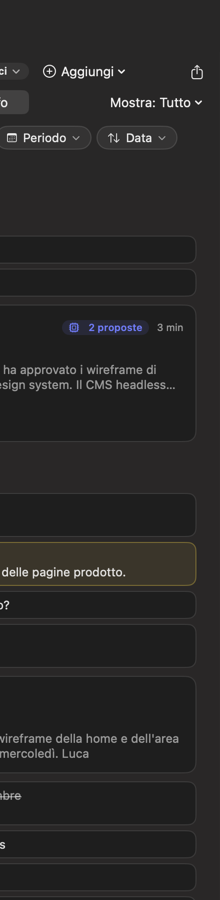
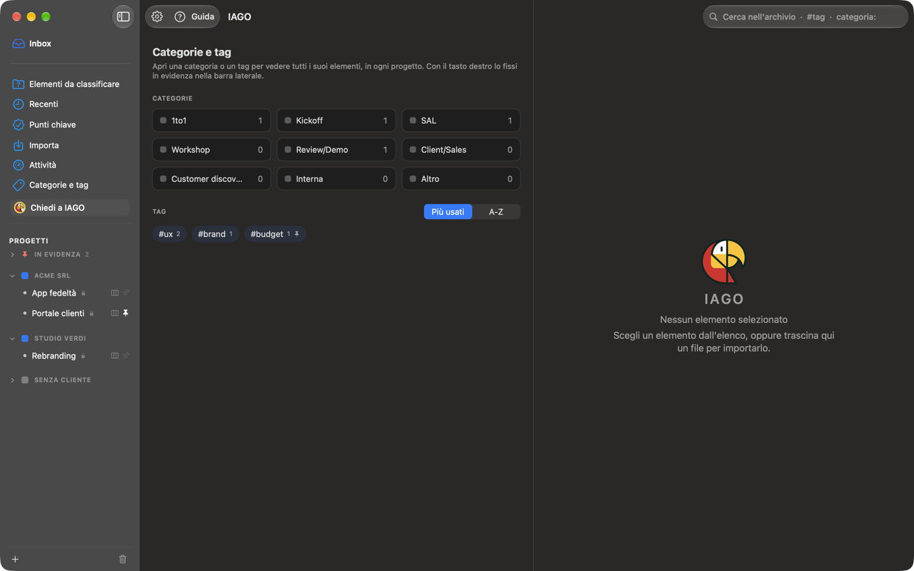
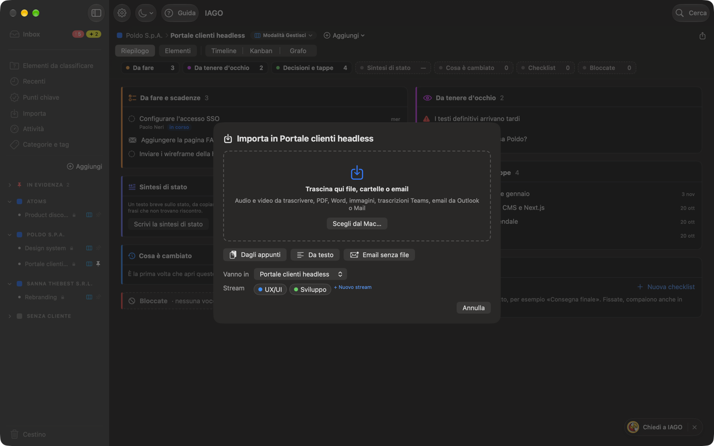

<!-- icona: folder -->
# Organizzare

## La barra laterale
- **In cima, l'Inbox**, in grassetto e separata dal resto: il lavoro aperto che aspetta te. Ha due bollini: il **rosso** (!) conta ciò che chiede un'azione adesso, il **giallo** (✦) le proposte da confermare (vedi Punti chiave e lavoro aperto).
- **Sotto, fisse:** *Elementi da classificare*, *Recenti*, *Punti chiave*, *Importa*, *Attività*, *Categorie e tag*.
- **Progetti** (l'unica parte che scorre):
  - **In evidenza** (pin rosso): progetti, stream, categorie e tag che fissi.
  - **I clienti**, ognuno con i suoi progetti. Accanto a ogni progetto una piccola icona dice la sua modalità: un quaderno verde per la *Modalità Traccia*, tre colonne per la *Modalità Gestisci*. Un clic sul nome apre o chiude il cliente; **⌥-clic** apre solo quello e chiude gli altri. Passando sopra: **→** apre tutti gli elementi del cliente, **+** crea un progetto.
  - **Senza cliente** (quadratino grigio), sempre ultimo, con **Non definito** in fondo: gli elementi classificati senza progetto.
- **In fondo:** **＋** per un nuovo progetto o cliente, e il **Cestino** con il numero di elementi.
- Con più di 15 progetti compare **Filtra progetti**.

## Progetti e stream
Un progetto appartiene a un cliente (o a nessuno). Uno **stream** è una linea di lavoro dentro il progetto (es. Design, Sviluppo, Legale): elementi, note e punti chiave possono appartenere a uno o più stream. Trascina un progetto su un cliente per spostarlo. Tasto destro: impostazioni, nuovo stream, rinomina, sposta, fissa. Anche uno stream si fissa in alto con il tasto destro.

## L'esempio iniziale
In un archivio nuovo IAGO crea un esempio di come si organizza il lavoro: il cliente **Cliente Test** con i progetti **Pj. Test 1** (con gli stream **Pj1 - Stream 1** e **Pj1 - Stream 2**) e **Pj. Test 2**. *Pj1 - Stream 1* e *Pj. Test 2* sono in evidenza. È vuoto: rinominalo per usarlo, oppure eliminalo (tasto destro sul cliente). Non ricompare.

## Elementi da classificare
Tutte le call, le email e i documenti che non hanno ancora un progetto. Le proposte del motore possono suggerire il progetto giusto. Se importi da dentro un progetto (*Aggiungi › Importa file ed elementi…*), gli elementi vanno direttamente lì e non passano da qui.

## Categorie
La **categoria** è il tipo di riunione (1to1, Kickoff, SAL, Workshop, Review/Demo, Client/Sales, Customer discovery, Interna, Altro) e decide la **forma della sintesi**. In **Impostazioni › Categorie** puoi rinominarle, colorarle, ordinarle, archiviarle e crearne di nuove; altre **famiglie** (Agile, Direzione, Persone, Operazioni) si accendono quando servono e compaiono come sottomenu.

## Tag
Etichette libere, trasversali ai progetti (es. `#budget`, `#fornitore-x`). Si aggiungono nella scheda di un elemento.

## Categorie e tag, trasversali
La vista **Categorie e tag** mostra tutte le categorie con il numero di elementi e tutti i tag: un clic apre l'elenco di tutti gli elementi in tutti i progetti. Con il tasto destro li fissi **in evidenza**. Nella ricerca scrivi `#` o `categoria:` per aprirli al volo; nella scheda un clic su un tag fa lo stesso.

## Le viste: come guardare e cosa mostrare
Un progetto ha una storia sola (call, email, documenti, note, punti chiave); in alto scegli come guardarla.
- **Riepilogo**: la pagina del progetto, con il lavoro aperto, le scadenze e le ultime decisioni. In *Modalità Traccia* è il Riepilogo breve.
- **Elementi**: tutte le call, le email e i documenti del progetto, con i filtri per categoria, tag, tipo e periodo.
- Poi, separate da una linea, le forme della storia: **Timeline** (giorno per giorno), **Kanban** (il lavoro aperto in colonne, solo in *Modalità Gestisci*) e **Grafo** (persone, elementi e punti chiave collegati; in *Modalità Traccia* si può spegnere dalla pillola della modalità).
- A destra, per Timeline e Grafo, **Mostra**: *Tutto*, solo gli *Elementi* o solo i *Punti chiave*. In *Modalità Traccia* non c'è: si vede tutto.

Riepilogo, Kanban e Grafo occupano tutta la finestra: ciò che apri compare nel pannello a destra, che chiudi con ✕ o Esc. IAGO ricorda per ogni progetto l'ultima vista scelta.

## Aggiungere e importare in un progetto
**Aggiungi**, accanto al nome del progetto, crea una nota o un punto chiave. L'ultima voce, **Importa file ed elementi…**, apre una finestra con un'area dove trascinare file, cartelle o email e il pulsante *Scegli dal Mac…*; sotto, *Dagli appunti*, *Da testo* (si apre il campo per scrivere o incollare) ed *Email senza file*. Tutto va nel progetto (e negli stream) indicati in *Vanno in*.

