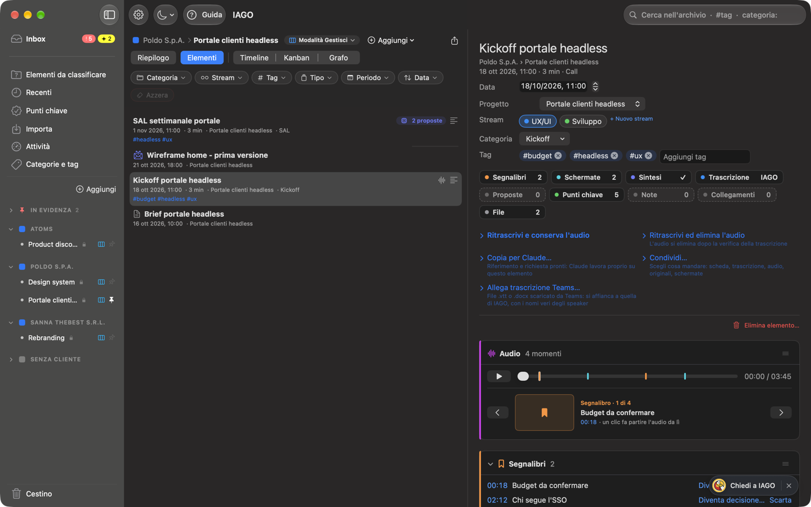
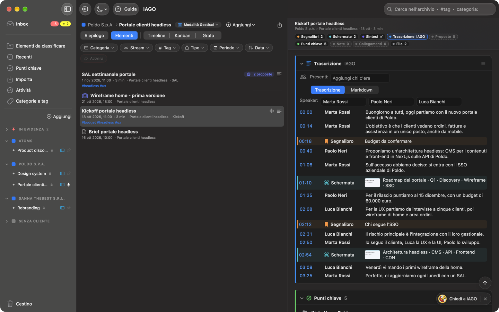
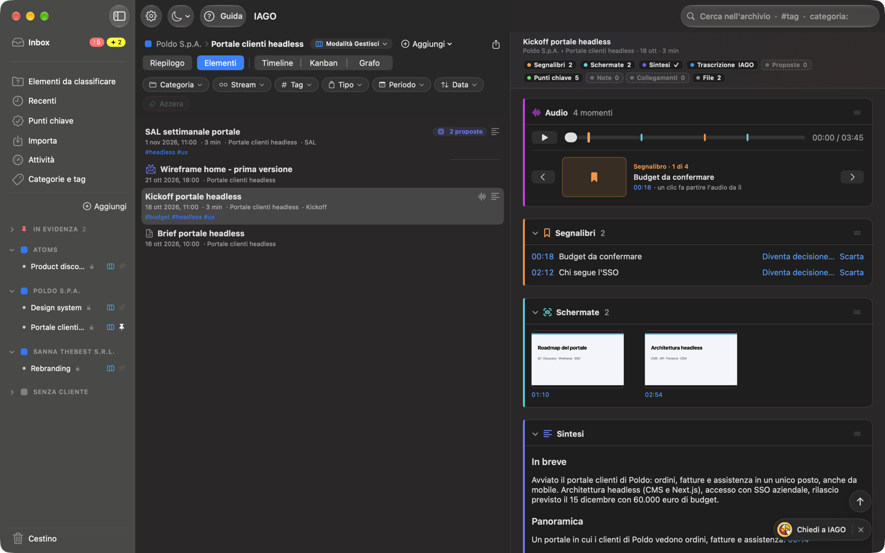
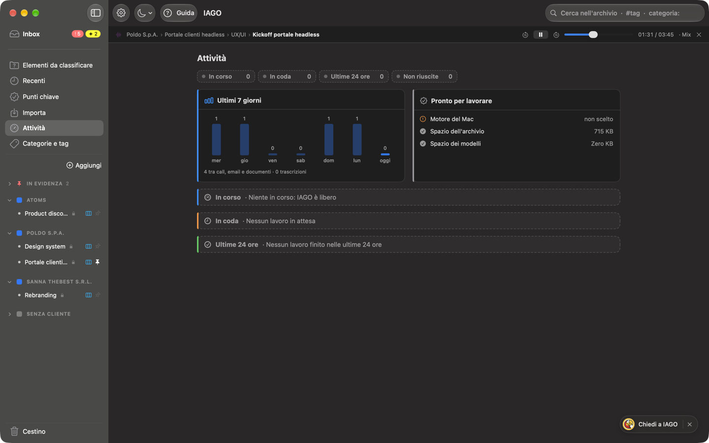

<!-- icona: doc.richtext -->
# La scheda di un elemento

Un elemento è una **call**, un'**email** o un **documento**. La scheda raccoglie tutto:

- **Intestazione:** titolo, sotto cliente › progetto e data · durata · tipo; poi data, progetto, stream, categoria, tag, tutti modificabili.
- **Azioni:** trascrivi, ritrascrivi, **Condividi…**, esporta, elimina, **Copia per Claude** (vedi il capitolo *Claude*).
Poi le sezioni, in quest'ordine se non lo cambi tu:
- **Audio:** lettore con scelta della traccia (entrambe, solo microfono, solo sistema) e i **momenti** della call (vedi sotto).
- **Segnalibri** dei momenti segnati durante la call.
- **Schermate** catturate con *Segna momento con screenshot*, con il minuto e il testo letto.
- **Sintesi:** vedi il capitolo *Sintesi*.
- **Trascrizione** con chi parla e il minuto: un clic su un minuto fa partire l'audio da lì; tasto destro su una frase per farne un punto chiave. Segnalibri e schermate compaiono al loro minuto, su un velo leggero del loro colore (per le schermate anche la miniatura). Per documenti ed email al suo posto c'è il **Contenuto** (con immagine originale e testo riconosciuto).
- **Proposte:** ciò che il motore suggerisce, da confermare o scartare.
- **Punti chiave** nati da questo elemento.
- **Note** datate, anche dettate a voce.
- **Collegamenti** ad altri elementi (risposte, allegati, documenti correlati).
- **File:** gli asset dell'elemento, con dimensione.

## Tile e barra fissa
Sotto il titolo ci sono le **tile**: una per sezione, con un solo dato. Il numero di segnalibri, schermate, note, punti chiave, proposte, collegamenti e file; **✓** se c'è la sintesi; per la trascrizione da dove viene: **IAGO**, **Teams** o **IAGO + Teams** («…» mentre trascrive). Un clic apre la sezione e ti porta lì. Una tile tratteggiata è una sezione vuota.

Quando scendi, in alto compare una **barra fissa**: titolo, cliente › progetto · data · durata e le stesse tile in piccolo, con evidenziata la sezione in cui sei. In basso a destra, sopra *Chiedi a IAGO*, compare **↑** per tornare in cima.

## Cambiare l'ordine delle sezioni
A destra del titolo di ogni sezione c'è una piccola maniglia (≡). **Trascina il titolo** di una sezione: tutte le sezioni si chiudono, così vedi l'ordine a colpo d'occhio, e le altre si spostano mentre passi. Rilascia dove la vuoi: le sezioni tornano aperte o chiuse come prima. L'ordine vale per **tutti gli elementi** e resta anche alla prossima apertura; anche le tile lo seguono. **Impostazioni › Generale › Dettaglio elemento › Ripristina l'ordine delle sezioni** torna a quello di base.

## Sezioni aperte e chiuse
- Un clic sul titolo apre o chiude una sezione. **Ogni elemento ricorda** le sue sezioni aperte e chiuse.
- Come partono quelle di un elemento che non hai ancora toccato lo scegli in **Impostazioni › Generale › Dettaglio elemento**; *Riapplica a tutti gli elementi…* dimentica le scelte fatte nei singoli elementi.
- **Audio** e **File** sono sempre aperte.
- Una sezione **vuota** è solo un'intestazione tratteggiata, con una frase che dice cosa manca e, quando serve, il pulsante per aggiungere (per esempio *Aggiungi nota* o *Collega a…*).

## I momenti sul player
Segnalibri e schermate sono i **momenti** della call. Sul player ogni momento è una **tacca** colorata (arancione i segnalibri, azzurro le schermate). Sotto c'è **un momento alla volta**, con la miniatura, il titolo e il minuto: all'apertura è il prossimo rispetto a dove sei, mentre ascolti segue l'audio, e con **‹ ›** passi agli altri. Un clic sul minuto fa partire l'audio da lì. Senza momenti resta solo il player.

Tacche sul player e momenti nella trascrizione si spengono in Impostazioni › Generale › Dettaglio elemento.

## Condividere un elemento
*Condividi…* tra le azioni apre l'elenco di ciò che l'elemento ha, con la dimensione: spunta cosa mandare.
- **Scheda (Markdown):** data, progetto, sintesi, punti chiave e note.
- **Trascrizione** (o il testo di email e documenti), l'**altra trascrizione** se la call ne ha due, l'**audio**, le **tracce separate**, il **file originale** (email, documento, trascrizione di Teams) e le **schermate**.
- *Condividi…* apre il menu Condividi del Mac: Mail, Messaggi, AirDrop e le altre app. *Salva in una cartella…* li copia dove scegli. Con *Un solo file .zip* arriva tutto in un file.
- I file condivisi non sono cifrati: chi li riceve può leggerli e ascoltarli. Le impronte delle voci non escono mai, e ogni condivisione resta nel registro accessi.

## La barra di ascolto

Quando fai partire un audio, sotto la barra in alto della finestra compare la **barra di ascolto**. Resta visibile in tutte le sezioni, così puoi spostarti mentre ascolti e fermare l'audio quando vuoi.

- **Cosa stai ascoltando:** Cliente › Progetto › Stream › Elemento. Un clic riapre l'elemento.
- **Controlli:** pausa e ripresa, 15 secondi indietro e avanti, posizione, traccia in ascolto.
- **X:** ferma l'audio e chiude la barra. Con la sola pausa la barra resta, per riprendere.
- Se registri mentre ascolti, la barra di registrazione sta sopra e quella di ascolto sotto.
- Chiudere la finestra di IAGO ferma l'audio.
- Se apri un altro elemento mentre ascolti, l'audio continua; premi Play in quell'elemento per passare al suo audio.
