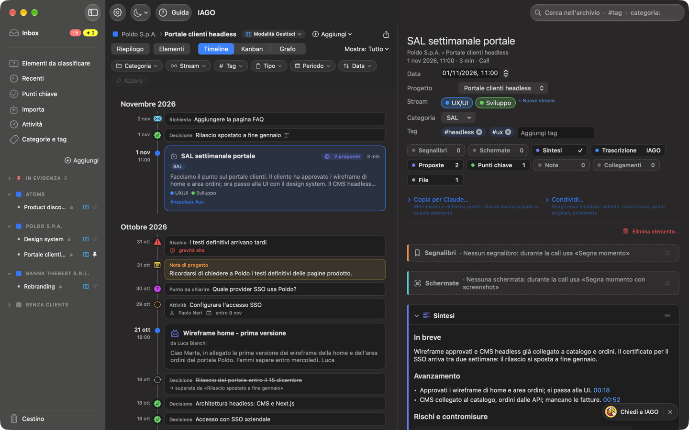

<!-- icona: text.alignleft -->
# Sintesi

Con il motore locale IAGO scrive la **sintesi** di una call nella forma della sua **categoria**: un 1to1 ha impegni e feedback, un SAL tappe, rischi e decisioni, una Client/Sales esigenze, obiezioni e prossimi passi.

## Come si ottiene
- **Da sola:** se la call ha già una categoria e le **sintesi automatiche** sono accese, la sintesi arriva a fine trascrizione, con una notifica. Sui Mac con meno di 32 GB di memoria sono spente di default: le accendi in Impostazioni › Motore.
- **A mano:** premi **Genera sintesi** nel blocco *Sintesi*. Senza categoria il blocco dice "non ancora disponibile": scegli prima la categoria.
- Mentre la scrive vedi l'avanzamento, anche in **Attività**.

## Come leggerla
- **In breve:** tre righe in cima, scritte solo dai punti verificati.
- **Data e partecipanti** vengono dai dati di IAGO.
- **Ogni punto porta il minuto** da cui viene: un clic e riascolti quel passaggio. IAGO verifica che la frase citata ci sia davvero e che i numeri siano identici; i punti che non trova vengono scartati.
- Una sezione senza contenuto dice **Non emerso**: il motore non riempie per forza.
- Fatti personali e chiacchiere restano fuori.

## Modificare e rigenerare
- **Modifica…** per correggerla a mano (resta segnata come "modificata").
- **Rigenera** la riscrive; se l'avevi modificata chiede conferma.
- Se cambi categoria, IAGO propone di rigenerare con il nuovo modello, ma non lo fa da solo.

## Modelli di sintesi
Ogni categoria ha un **modello** (le sezioni da riempire). I modelli vengono da due progetti open source, **Meetily** e **Hyprnote** (licenza MIT), tradotti e adattati. In **Impostazioni › Categorie** puoi scegliere il modello, modificarlo (sezioni, istruzioni, colonne delle tabelle), ripristinarlo, esportarlo o importarne uno nel formato di Meetily.

## Quale motore
Le sintesi richiedono almeno **Qwen 3.5 9B**; **Gemma 4 12B** (Mac con 32 GB) scrive le sintesi più ricche. Il 4B è troppo piccolo. Tempi per una call di 30 minuti: circa 1-1,5 minuti con il 9B, 2,5-4,5 minuti con Gemma.

Sotto la sintesi c'è sempre chi l'ha scritta: «Sintetizzata con Qwen 3.5 9B sul Mac», oppure «Sintetizzata da Claude» se l'hai fatta fare a Claude.

Sono **bozze da rileggere**: la qualità dipende dalla trascrizione.
