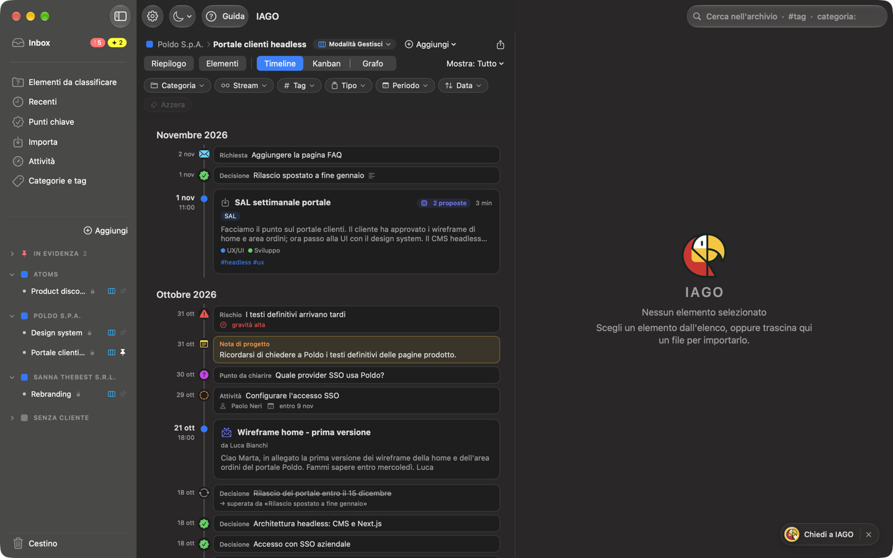
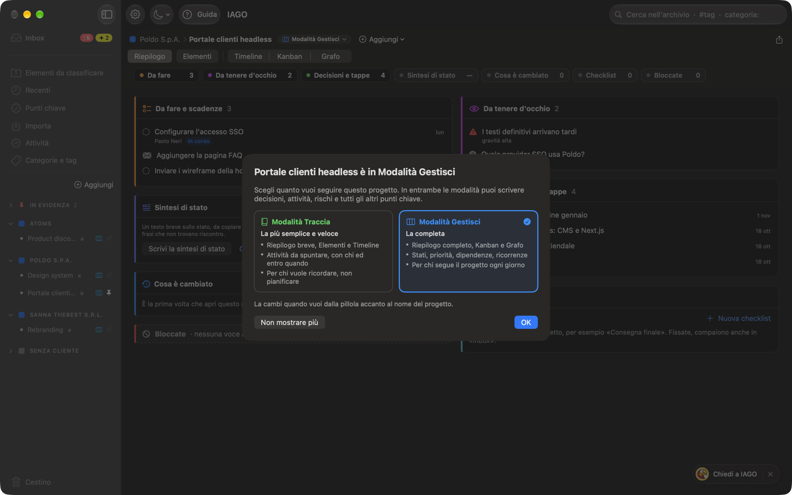
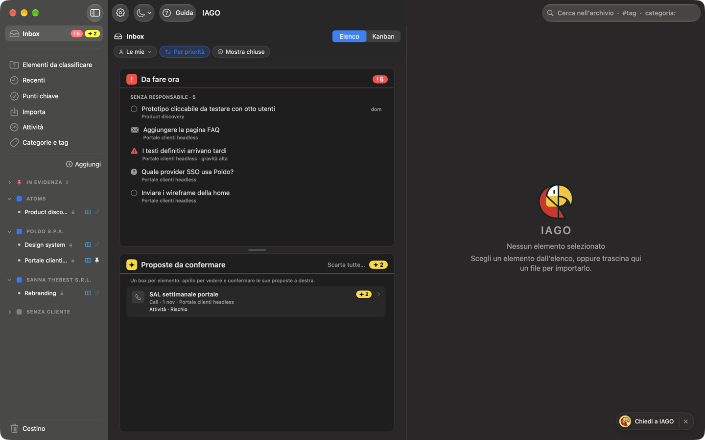
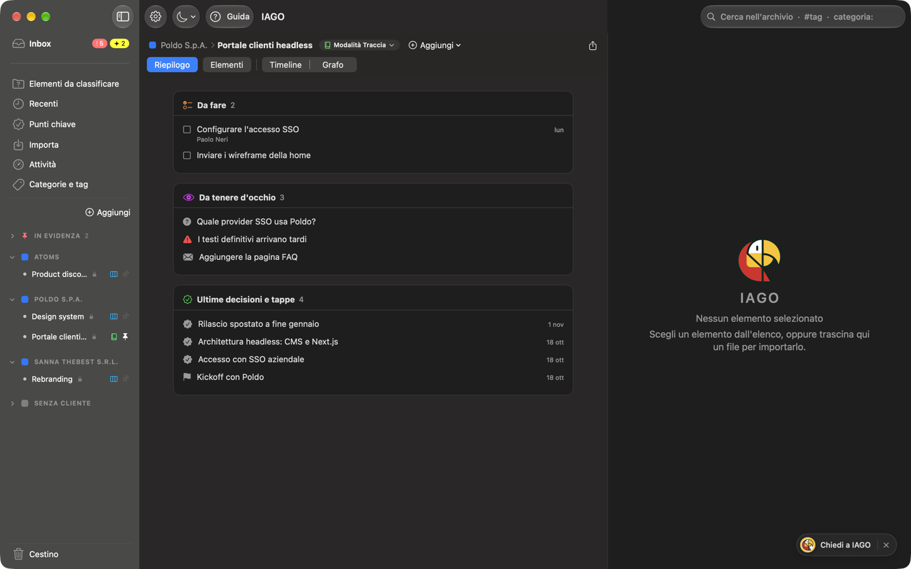
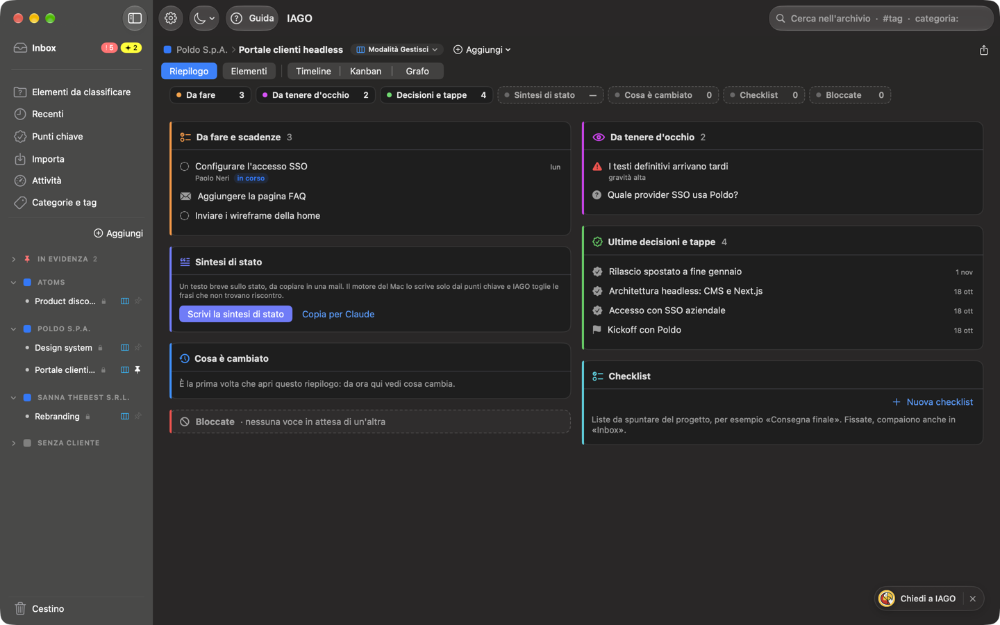
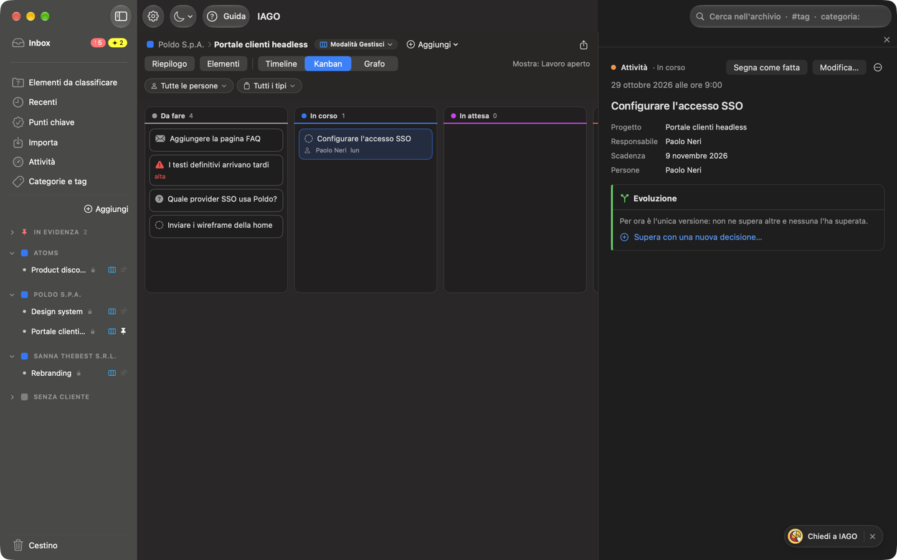

<!-- icona: checkmark.seal -->
# Punti chiave e lavoro aperto

I punti chiave sono di sei tipi, in due famiglie.

**Memoria:** cose avvenute, che restano.
- **Decisione:** qualcosa di deciso. Vale finché un'altra non la sostituisce.
- **Tappa:** un fatto importante (firma, consegna, kickoff).

**Lavoro aperto:** cose da chiudere.
- **Attività:** cosa fare, con chi e per quando; può avere una **checklist** di sotto-voci da spuntare.
- **Punto da chiarire:** una domanda che aspetta risposta.
- **Rischio:** cosa può andare storto, con la gravità (alta, media, bassa). Se succede, lo segni *Diventato problema*.
- **Richiesta:** cosa chiede il cliente; la accogli, la rifiuti o la trasformi.

## Modalità Traccia e Modalità Gestisci
Ogni progetto ha la sua modalità, scelta con la pillola accanto al nome del progetto (**Modalità Gestisci ▾**) o in Impostazioni › Progetti. In entrambe ci sono tutti i tipi; i dati sono gli stessi e passando dall'una all'altra non perdi nulla.
- **Modalità Traccia**, *semplice e veloce*: tieni il filo del progetto. Riepilogo breve, Elementi, Timeline e Grafo (che puoi spegnere dalla pillola). Un'attività è una **casella da spuntare**, con chi, entro quando, «in attesa di» e checklist; punti da chiarire, rischi e richieste si scrivono e si chiudono con l'esito. Niente Kanban e niente menu *Mostra*.
- **Modalità Gestisci**, *completa* (predefinita): tutti gli stati, anche *In corso* e *Bloccata*; priorità, dipendenze («dipende da»), gravità dei rischi, *Diventato problema*, «nata da», stima, data d'inizio, ricorrenze; la **Kanban** e il **Riepilogo** completo.

Un campo di Gestisci già compilato resta salvato anche in Traccia: una piccola icona lo dice, e torna visibile in Gestisci.

**La prima volta** che apri un progetto, una finestra dice in che modalità è e cosa cambia; un clic sull'altra scheda cambia modalità. *OK* la richiude e la finestra torna la volta dopo; *Non mostrare più* la toglie per quel progetto. Anche un **cliente** la mostra: lì scegli la modalità dei suoi progetti nuovi e di quelli a cui non l'hai scelta tu.

Inbox, Punti chiave e la Kanban di tutti raccolgono il lavoro di **tutti i progetti**, in qualsiasi modalità: ogni voce si vede nella modalità del suo progetto.

## Crearli
Da un segnalibro, da una frase della trascrizione (tasto destro), da un documento, da una nota (*Promuovi*), a mano (*Aggiungi* nella timeline), oppure confermando una **proposta** del motore o di Claude. Ognuno ha titolo, descrizione, data, persone, tag, stream e la **fonte** (con il minuto della call).

*Aggiungi* apre il foglio con il tipo che hai scelto in una tile, accanto al titolo: un clic sulla tile lo cambia. Stato, responsabile e scadenza compaiono solo per il lavoro aperto. In **Persone** e **Tag** ne aggiungi quante vuoi: scrivi e premi Invio o una virgola.

Per il **responsabile** scegli tra le persone che IAGO conosce, oppure ne scrivi una nuova; se somiglia a un nome noto IAGO chiede «Intendi Marco Rossi?». Quando scrivi qualcuno in **In attesa di**, la voce passa *In attesa*.

## Chiudere
- **Attività:** *Segna come fatta*. Una ricorrente (ogni giorno, settimana, mese, anno) crea da sola la successiva.
- **Punto da chiarire:** *Chiarisci…* con la risposta; con *Diventa decisione* la risposta diventa anche una decisione.
- **Richiesta:** *Accogli…* (crea una o più attività nate da lei), *Rifiuta…* con il motivo, *Trasforma in…* un altro tipo.
- **Rischio:** *Diventato problema*, *Risolto* o *Non più rilevante*.
- Su qualsiasi voce: *Riapri* e, in Gestisci, *Nuova attività da questo*.
- In **Modalità Traccia** un'attività si chiude spuntando la sua casella, nella timeline, nel Riepilogo o nell'Inbox; spuntata di nuovo, torna aperta.

## Superare e chiudere con un'altra voce
Una voce può **chiuderne altre**, anche di tipo diverso: una tappa «Firmato il contratto» completa un'attività, una decisione risponde a un punto da chiarire o accoglie una richiesta. La riga lo dice con il verbo giusto: *sostituisce*, *risponde a*, *accoglie*, *completa*. Le voci chiuse tornano aperte se togli il legame. La sezione **Evoluzione** mostra tutte le voci collegate in ordine; puoi dare un nome alla catena.

## Come si vedono
- Aperta: icona e colore del tipo, con responsabile e scadenza; la scadenza diventa rossa quando è passata.
- In attesa: «attende Anna · entro 5 nov». Bloccata: l'etichetta *bloccata*.
- Fatta: ✓ verde, testo grigio. Chiarita, accolta o rifiutata: una riga con l'esito.
- Superata o annullata: testo barrato.
- Una voce chiusa da un'altra dello stesso giorno sta sotto di lei.

## Inbox
L'**Inbox**, in cima alla barra laterale, raccoglie il lavoro aperto di tutti i progetti, in qualsiasi modalità. Accanto al nome ha due bollini, e ognuno conta un blocco dell'Inbox, con lo stesso colore e lo stesso segno nell'intestazione:
- **Da fare ora**, bollino **rosso** con il punto esclamativo: ciò che chiede un'azione adesso.
  - le tue voci **in ritardo** e quelle di **oggi**;
  - le voci **senza responsabile**, da assegnare;
  - le **attese scadute**: hai aspettato oltre la data promessa, è il momento di sollecitare.
- **Proposte da confermare**, bollino **giallo** con la stellina: le proposte del motore, con un box per ogni elemento da cui vengono: titolo, data, progetto, quali proposte ha e quante. Un clic sul box apre a destra tutte le sue proposte, ognuna con la frase da cui viene e il minuto: la confermi, la modifichi o la scarti lì. In alto a destra *Apri l'elemento*, *Conferma tutte* e *Scarta queste*; nel box *Scarta tutte…* scarta quelle di tutti gli elementi.
- **Più avanti**, senza bollino, in fondo al box *Da fare ora*: le tue voci di questa settimana, dopo e senza data, **Aspetto da altri** (le attese non ancora scadute) e le **checklist fissate** dei progetti, da spuntare qui.

*Da fare ora* occupa la metà alta della colonna e *Proposte da confermare* la metà bassa: trascina la piccola maniglia tra i due per dare più spazio all'uno o all'altro (resta così anche le volte dopo; doppio clic per tornare a metà e metà). Ognuna scorre per conto suo, con la barra sempre visibile quando sotto c'è altro; in basso a destra un piccolo *altre N* con tre puntini dice quante voci restano da vedere. Un box vuoto si riduce alla sua intestazione e l'altro prende tutto lo spazio. Un bollino a zero non compare.

*Mostra chiuse* fa vedere anche le voci chiuse da poco. In Gestisci puoi ordinare per priorità e filtrare per persona.

Se vuoi, una **notifica al mattino** (Impostazioni › Generale) ti dice quante voci scadono oggi, quante sono in ritardo e quante attese sono scadute; un clic apre l'Inbox.

## Riepilogo
Ogni progetto, cliente e stream ha il **Riepilogo**, il primo pulsante in alto: la prima volta il progetto si apre lì.

In **Modalità Traccia** è il **Riepilogo breve**, una colonna con tre blocchi: *Da fare* (le attività aperte, da spuntare lì), *Da tenere d'occhio* (rischi, punti da chiarire e richieste aperti) e *Ultime decisioni e tappe*. Un blocco vuoto non compare. A destra c'è sempre il pannello: vuoto finché non apri una voce.

In **Modalità Gestisci** occupa tutta la finestra ed è fatto di **box**: *Da fare e scadenze*, *Da tenere d'occhio* (rischi per gravità e punti da chiarire), *Attese da altri*, *Ultime decisioni e tappe*, *Prossime tappe*, *Sintesi di stato*, *Cosa è cambiato*, *Checklist* e *Bloccate*.

- I box stanno su due colonne e ognuno va nella più corta: un box lungo non lascia buchi accanto. Con la finestra stretta, o con il pannello a destra aperto, diventano una colonna.
- In alto, sempre visibili, le **tile** dei box con il loro numero: un clic porta al box e lo fa brillare un attimo. Una tile tratteggiata è un box vuoto, ridotto alla sua intestazione.
- Un clic su una voce la apre nel pannello a destra; il tasto destro ne cambia lo stato.
- La **Sintesi di stato** è un testo scritto dal motore locale a partire dai punti chiave, da copiare in una mail o da passare a Claude. *Cosa è cambiato* parte dall'ultima volta che hai aperto il riepilogo. Le **checklist del progetto** (per esempio «Consegna finale») le crei, le fissi in alto e le spunti.

## Kanban
In Gestisci, la **Kanban** di un progetto, cliente o stream (o di tutti, dall'Inbox e da Punti chiave) occupa tutta la finestra e mette il lavoro aperto in colonne: *Da fare*, *In corso*, *In attesa*, *Bloccata*, *Fatta*. Trascinare una scheda in un'altra colonna ne cambia lo stato; in *In attesa* IAGO chiede da chi e fino a quando.

Puoi aggiungere **colonne tue** (per esempio «Da discutere venerdì»): servono a raggruppare e non cambiano lo stato. Nella colonna *Fatta* le voci chiuse da più di 14 giorni vengono archiviate: *Mostra tutte* le fa riapparire, *Archivia* le nasconde di nuovo, e IAGO ricorda la scelta. Un clic su una scheda la apre nel **pannello a destra**; ✕ o Esc lo chiudono. Per tornare alla lista scegli *Elementi* o *Timeline*. La Kanban di tutti comprende anche i progetti in Traccia, con l'icona della modalità accanto al nome: un'attività spostata lì in *In corso*, nel progetto resta da spuntare. Si spegne in Impostazioni › Generale senza perdere colonne e posizioni.

## Dove vederli
- **Punti chiave** nella barra laterale: tutti, con filtri per tipo, stato, persona, responsabile, tag.
- In un progetto, **Mostra: Punti chiave** con la Timeline o il Grafo (vedi Organizzare).
- **Inbox**, **Riepilogo** e **Kanban**, come sopra.
- La **timeline**, insieme a call, email e note.
