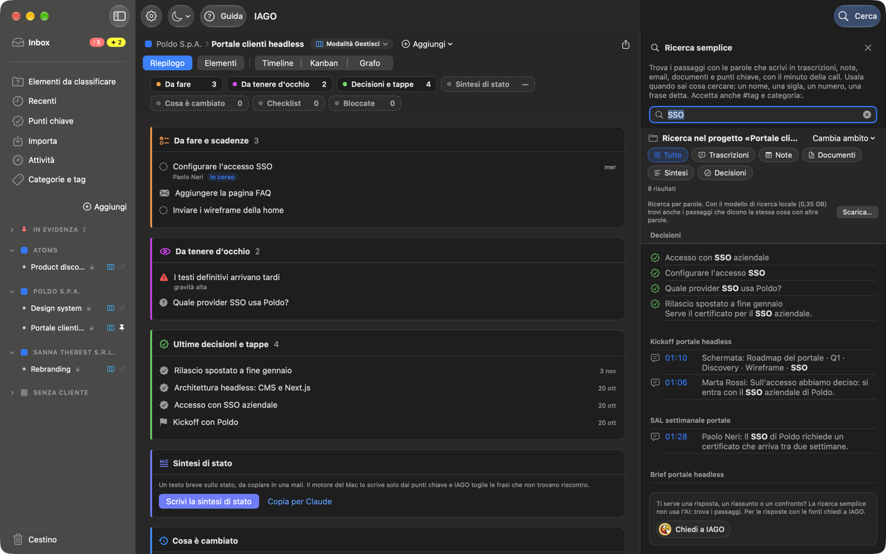
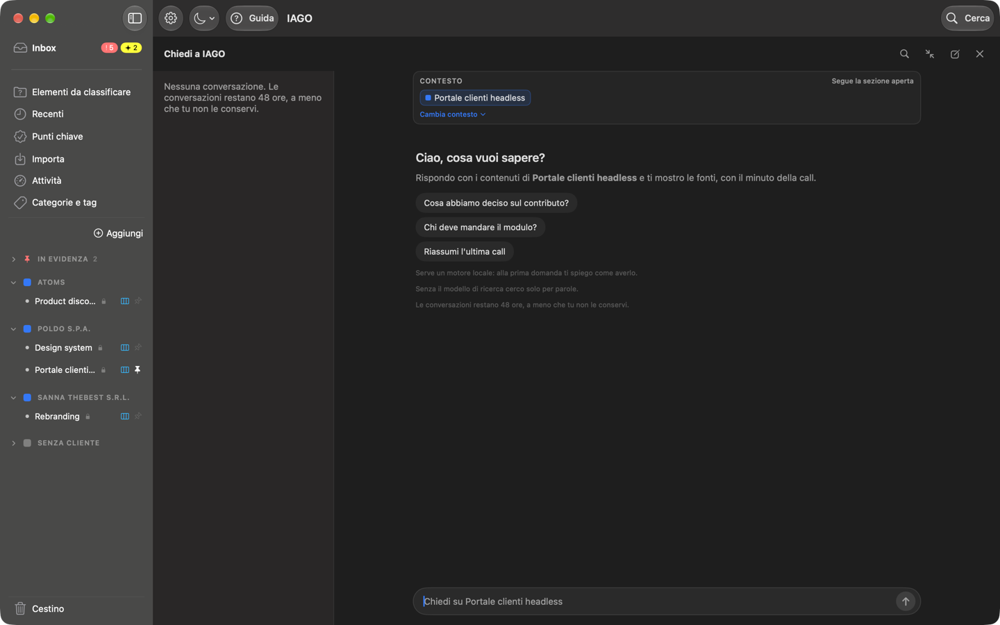

<!-- icona: magnifyingglass -->
# Cercare e chiedere

## Cerca
Il pulsante **Cerca** in alto a destra (o ⌘F) apre la **Ricerca semplice** nella spalla destra della finestra, con il cursore già nel campo. In cima dice cosa fa e quando usarla: trova i passaggi con le parole che scrivi in trascrizioni, note, email, documenti, sintesi e punti chiave, nel progetto che stai guardando o ovunque, con il minuto della call. Usala quando sai cosa cercare: un nome, una sigla, un numero, una frase detta.

- I risultati si filtrano per tipo. Un clic su un risultato apre l'elemento nella scheda accanto, e i risultati restano nella spalla finché non la chiudi; un clic su un passaggio di una call apre l'audio in quel punto.
- Con il **modello di ricerca** (Impostazioni › Motore) trova anche frasi dette con parole diverse ("quanto versa l'azienda" trova "il contributo del datore di lavoro").
- In una call con la trascrizione di IAGO e quella di Teams cerca in tutte e due. La call compare una volta; se le parole sono solo nell'altra trascrizione, il passaggio dice «nella trascrizione Teams» (o IAGO) e apre quella scheda.
- `#tag` e `categoria:Nome` suggeriscono e aprono un tag o una categoria.
- La ✕ in alto, o Esc, chiude la spalla.
- La ricerca semplice non usa l'AI: trova i passaggi. Se ti serve una risposta, un riassunto o un confronto, il riquadro in fondo ha il pulsante **Chiedi a IAGO**, che apre la conversazione nella stessa spalla.

## Chiedi a IAGO
Il pulsante **Chiedi a IAGO** in basso a destra (o ⌘K) apre una conversazione sulla sezione in cui sei: uno stream, un progetto, un cliente o tutta la memoria. Ricerca e conversazione occupano la stessa spalla, una alla volta: nell'intestazione della conversazione la **lente** (*Passa alla ricerca semplice*) torna alla ricerca.

### Il contesto
La striscia **Contesto** in alto dice da dove vengono le risposte: Cliente › Progetto › Stream, uno o più progetti, oppure Tutta la memoria. Sotto dice se **segue la sezione aperta** (cambia quando scegli un'altra voce nella barra laterale) o se è **scelto da te** (resta anche cambiando sezione, anche alla riapertura di IAGO).

Il menu **Cambia contesto** offre:
1. **Aggiungi progetti…**: spunti altri progetti, raggruppati per cliente, con una ricerca;
2. **Restringi contesto…**: togli la spunta ai progetti da escludere (serve più di un progetto);
3. **Contesto globale**: tutta la memoria, tutti i progetti;
4. **Segui la sezione aperta**: il contesto torna a cambiare con la barra laterale.

Con più progetti nel contesto, ognuno ha la sua tessera con la **✕** per toglierlo. Se hai già chiesto qualcosa, cambiando contesto IAGO apre una nuova conversazione e ripete la tua ultima domanda; quella di prima resta nell'elenco.

### A tutta finestra
Il pulsante con le due frecce nell'intestazione porta la conversazione **a tutta finestra**: restano la barra laterale, l'elenco delle conversazioni e la conversazione al centro. Una fonte si apre in un pannello a destra, con la sua ✕. **Riduci a pannello** la riporta nella spalla; un clic su una voce della barra laterale esce dalla vista a tutta finestra.

### Risposte e conversazioni
- Le risposte usano **solo i tuoi contenuti** e citano le fonti numerate, che si aprono all'elemento e al minuto giusti.
- Le conversazioni sono **temporanee** (48 ore): **Conserva** per tenerle, **Fissa** per averle in cima, **Elimina**.
- Chiudendo la spalla la conversazione aperta resta: riaprendo Chiedi a IAGO la ritrovi.
- Se nel frattempo aggiungi materiale, IAGO lo segnala e propone di chiedere di nuovo.
- **Salva come nota** mette la risposta tra le note del progetto.
