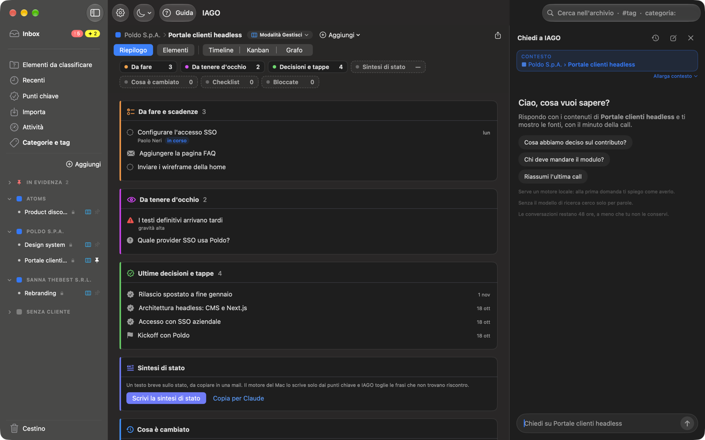

<!-- icona: magnifyingglass -->
# Cercare e chiedere

## Cerca
Il campo in alto a destra cerca in trascrizioni, note, documenti, email, sintesi e punti chiave, nel progetto che stai guardando o ovunque. I risultati si filtrano per tipo; un clic su un passaggio di una call apre l'audio in quel punto.
- Con il **modello di ricerca** (Impostazioni › Motore) trova anche frasi dette con parole diverse ("quanto versa l'azienda" trova "il contributo del datore di lavoro").
- In una call con la trascrizione di IAGO e quella di Teams cerca in tutte e due. La call compare una volta; se le parole sono solo nell'altra trascrizione, il passaggio dice «nella trascrizione Teams» (o IAGO) e apre quella scheda.
- `#tag` e `categoria:Nome` aprono un tag o una categoria.

## Chiedi a IAGO
Il pulsante **Chiedi a IAGO** in basso a destra (o ⌘K) apre una conversazione sulla sezione in cui sei: uno stream, un progetto, un cliente o tutta la memoria.

- La striscia **Contesto** in alto dice da dove vengono le risposte: Cliente › Progetto › Stream, oppure Tutta la memoria.
- **Allarga contesto** apre un menu con i livelli più ampi, dal più vicino a Tutta la memoria. Se hai già chiesto qualcosa, IAGO apre una nuova conversazione nel contesto scelto e ripete la tua ultima domanda; quella di prima resta nell'elenco.
- Dopo aver allargato, **Cambia contesto** ti riporta anche alla sezione da cui eri partito.
- Se una risposta non cita nessuna fonte, sotto compare lo stesso **Allarga contesto**.

- Le risposte usano **solo i tuoi contenuti** e citano le fonti numerate, che si aprono all'elemento e al minuto giusti.
- Le conversazioni sono **temporanee** (48 ore): **Conserva** per tenerle, **Fissa** per averle in cima, **Elimina**.
- Se nel frattempo aggiungi materiale, IAGO lo segnala e propone di chiedere di nuovo.
- **Salva come nota** mette la risposta tra le note del progetto.
