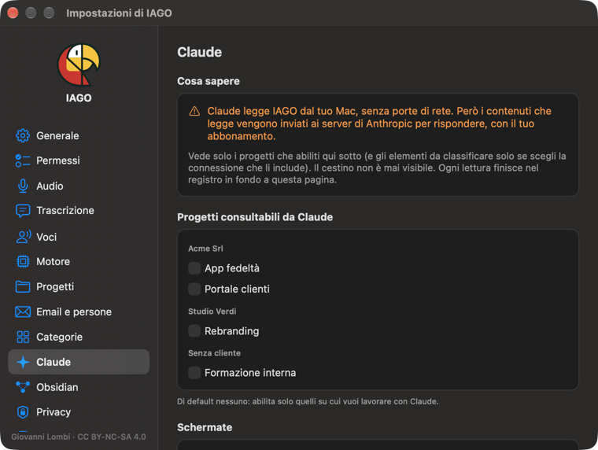

<!-- icona: bubble.left.and.text.bubble.right -->
# Claude

Puoi collegare **Claude Desktop** (o Claude Code) ai progetti che scegli. Claude non legge niente che tu non abbia abilitato.

1. **Impostazioni › Claude**: scegli i progetti (o un cliente) e premi **Aggiungi a Claude Desktop**; riavvia Claude.
2. Claude può **leggere**: cercare, aprire elementi, la timeline, i punti chiave, le note, esportare un progetto.
3. Con **Può scrivere** Claude può aggiungere note, punti chiave, documenti, email e file: ogni scrittura passa da un'**anteprima** e dalla tua conferma, compare con l'etichetta *tramite Claude* e si può **annullare** da Impostazioni › Claude.

## Sintesi e proposte fatte da Claude
Puoi chiedere a Claude la sintesi o le proposte di un elemento, al posto del motore del Mac.

**Sui Mac fino a 16 GB** il motore locale è lento, e nella scheda, sotto *Sintesi* e *Proposte*, compare un **consiglio**: *Chiedi a Claude la sintesi* copia la richiesta e apre Claude, e tu la incolli con ⌘V. Il consiglio dice anche cosa manca:
- Claude non ancora collegato a IAGO: *Collega Claude…* porta a Impostazioni › Claude;
- collegamento limitato ad altri progetti: va aggiunto un collegamento che includa questo;
- progetto non consultabile o non scrivibile da Claude: *Consenti e chiedi a Claude* lo abilita solo per quel progetto;
- elemento senza progetto: Claude scrive solo nei progetti, quindi va assegnato prima.

IAGO non abilita mai niente da solo. *Usa il motore del Mac* nasconde il consiglio su quel progetto, *Non mostrare più* su tutto il Mac. In **Impostazioni › Motore › Sintesi e proposte** puoi scegliere **Claude**: il motore del Mac non parte più da solo e il consiglio compare sempre, su qualsiasi Mac.

In ogni momento puoi anche fare così:
1. Nella scheda dell'elemento premi **Copia per Claude…** e scegli *Per la sintesi*, *Per le proposte* o *Solo il riferimento*. Se il progetto non è ancora consultabile (o scrivibile) da Claude, IAGO te lo dice e lo attiva con un clic.
2. Incolla in Claude: lavora proprio su quell'elemento, senza cercarlo.
3. Claude ti mostra un'anteprima; dopo il tuo OK la sintesi compare come **Sintetizzata da Claude** e le proposte come **Consigliata da Claude**, da confermare come quelle del motore. Claude propone anche punti da chiarire, rischi e richieste, con responsabile, scadenza e attese.

Con **Può scrivere** Claude gestisce anche il lavoro aperto: crea e aggiorna attività, punti da chiarire, rischi e richieste con responsabile, scadenza, priorità, dipendenze e checklist, e li chiude con l'esito. Come sempre passa dall'anteprima e si può annullare.

Puoi anche chiedere a Claude «la call di ieri con …»: trova da solo gli ultimi elementi. Se ce n'è più d'uno, ti chiede quale.

La sintesi di Claude segue il **modello della categoria** e IAGO controlla ogni citazione come fa con il suo motore: i punti senza una frase vera del testo vengono scartati. **Rigenera** con il motore del Mac chiede conferma prima di sostituirla, e tutto si può annullare da Impostazioni › Claude.

## Schermate
Claude legge sempre il **testo** delle schermate di una call, come la trascrizione. Le **immagini** (slide, tabelle, grafici, che Claude capisce meglio del testo) le vede solo se attivi **Condividi con Claude anche le immagini delle schermate** in Impostazioni › Claude: in una schermata c'è tutto quello che era sullo schermo.

Trascrizioni, audio e originali non sono mai modificabili da Claude.
