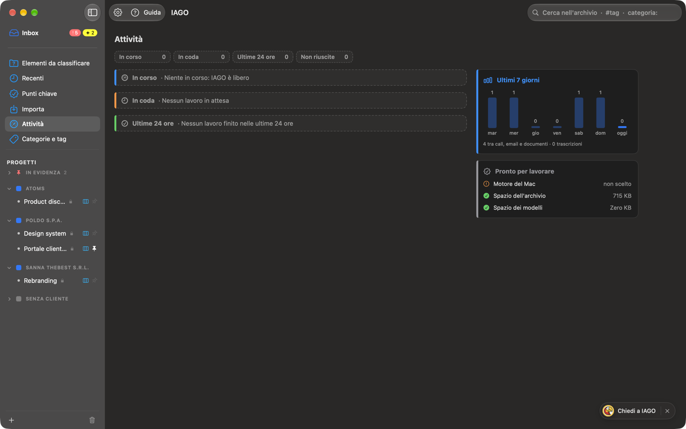

<!-- icona: gauge.with.dots.needle.67percent -->
# Attività

**Attività** nella barra laterale mostra tutto quello che IAGO sta facendo, con un numero quando c'è qualcosa in corso.

In alto le **tile** (In corso, In coda, Ultime 24 ore, Non riuscite) portano alla loro sezione; una sezione vuota è solo un'intestazione tratteggiata. Attività occupa tutta la finestra: *Apri* mostra l'elemento nel pannello a destra.

- **In corso:** registrazione (durata, microfono, mute), trascrizione, sintesi, proposte, indicizzazione per la ricerca, download dei modelli, importazioni, backup, esportazioni. Con barra, percentuale e tempo rimasto quando si può stimare.
- **In coda:** i lavori in attesa, con **Fai prima questo** e **Annulla**.
- **Ultime 24 ore:** fatti, annullati e non riusciti (con il motivo), con **Apri** e **Riprova**.

A destra, o sotto con la finestra stretta:
- **Ultimi 7 giorni:** call, email e documenti di ogni giorno, e quante trascrizioni sono state fatte.
- **Pronto per lavorare:** il motore del Mac scelto, lo spazio dell'archivio e quello dei modelli.

I lavori pesanti vanno uno alla volta e in secondo piano: IAGO resta usabile. Durante una registrazione aspettano.
