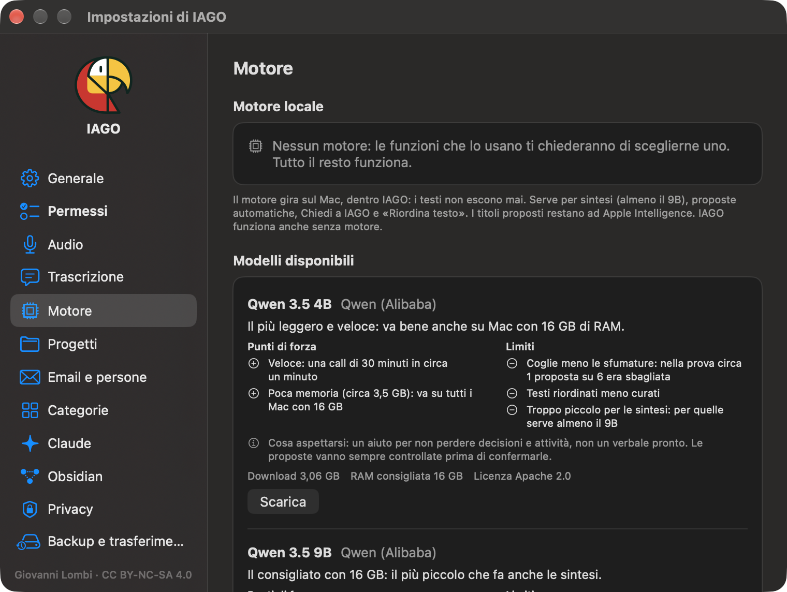

<!-- icona: cpu -->
# Il motore locale

Sintesi, proposte, Chiedi e *Riordina testo* usano un **modello linguistico che gira sul Mac**. Lo scarichi una volta (Impostazioni › Motore); i testi non escono mai. I titoli brevi usano Apple Intelligence se disponibile.

| Modello | Memoria | Per chi | Note |
| --- | --- | --- | --- |
| Qwen 3.5 4B | circa 3,5 GB | Mac con meno di 16 GB | veloce; **non fa le sintesi** |
| Qwen 3.5 9B | circa 6 GB | **consigliato con 16 GB** | il più piccolo che fa le sintesi |
| Gemma 4 12B | circa 12,5 GB | **consigliato con 32 GB o più** | il più preciso, più lento |

## Ricerca per significato
Il **modello di ricerca** (Qwen3 Embedding, 0,35 GB) si scarica con il primo motore e indicizza in secondo piano.

## Cosa aspettarsi
Un aiuto per non perdere niente e partire da una bozza, non un verbale pronto: proposte e sintesi vanno sempre rilette.
