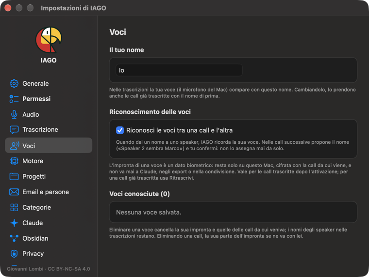

<!-- icona: gearshape -->
# Impostazioni

L'**aspetto** (automatico, chiaro o scuro) non è qui: si sceglie dall'icona accanto alle Impostazioni, nella finestra principale.

- **Generale:** lingua (italiano o inglese: IAGO si riavvia per cambiarla, e anche sintesi e proposte passano alla nuova lingua), nome ("Io"), Kanban, dettaglio elemento (sezioni aperte o chiuse all'inizio, ripristino dell'ordine delle sezioni, momenti nella trascrizione e sul player), notifica del mattino, avvio al login, aggiornamenti, scorciatoie in tutte le app, schermate (uno o tutti gli schermi).
- **Permessi:** cosa è attivo e cosa manca, con l'attivazione guidata.
- **Audio:** microfono, riunioni (proposte, calendario, mute di Teams).
- **Trascrizione:** motore, lingua, glossario, cosa fare dopo lo Stop, solo con alimentazione, modelli.
- **Voci:** in cima *Il tuo nome*, cioè come compare la tua voce nelle trascrizioni (è anche in Generale). Si salva con Invio, *Salva* o uscendo dal campo, e le call già trascritte con il nome di prima prendono quello nuovo, tranne quelle in cui hai dato alla tua voce un altro nome. Poi il riconoscimento delle stesse voci tra una call e l'altra (**acceso di default**) e le voci conosciute, da eliminare una per una o tutte.

- **Motore:** modello locale, ricerca per significato, lavori automatici (proposte e sintesi; spenti di default sotto i 32 GB di memoria).
- **Progetti:** rinomina, archivia, elimina (nel Cestino per 30 giorni, oppure definitivamente scrivendo DELETE: vedi *Organizzare*); la modalità di ciascuno, *Modalità Raccogli*, *Modalità Traccia* o *Modalità Gestisci* (predefinita).
- **Email e persone:** i tuoi indirizzi, contatti, cartelle sorvegliate, regole.
- **Categorie:** principali e famiglie, colori, ordine, modelli di sintesi.
- **Claude:** progetti abilitati, scrittura, immagini delle schermate, registro delle modifiche.
- **Obsidian:** copia dell'archivio come note Markdown in un vault.
- **Privacy:** cosa resta sul Mac, Time Machine, registro accessi.
- **Backup e trasferimento:** backup cifrato, ripristino su un altro Mac, esportazione degli audio.
- **Spazio:** quanto occupano archivio e modelli.
- **Aiuto:** questa guida e l'introduzione.
