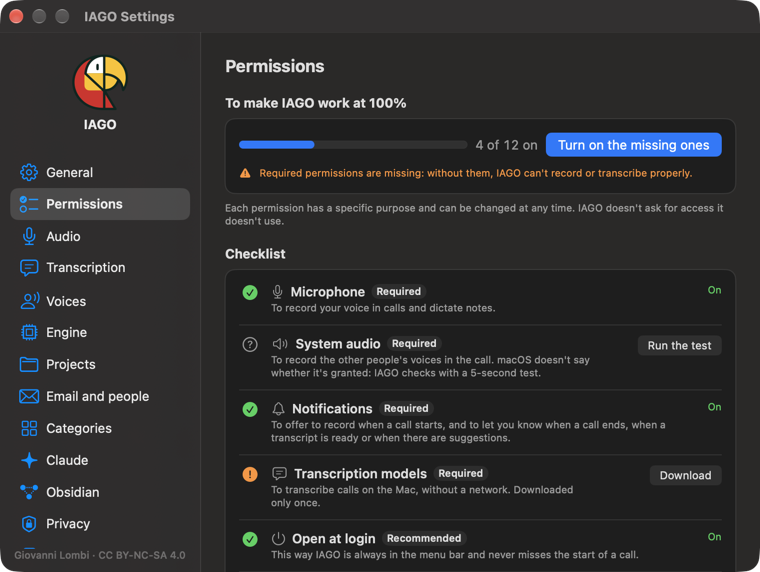

<!-- icona: arrow.down.app -->
# Installation

You need a Mac with Apple Silicon (M1 or later) and macOS 15 or newer. Space: 1.6 GB for transcription, 2 to 7 GB more for the local engine.

## Install
1. Download `IAGO-x.y.z.dmg` from the releases page and open it.
2. Drag **IAGO** onto the **Applications** folder next to it, then open it from Applications.

## "Open Anyway" (first time only)
IAGO is not distributed through the App Store and is not notarized by Apple. The first time you open it, macOS may block it:
1. Click **Done**, not "Move to Trash".
2. Open **System Settings › Privacy & Security**, scroll down to **Security** and click **Open Anyway** next to IAGO.
3. Confirm with your password or Touch ID, then click **Open**.

## Guided setup
The first time it starts, IAGO first asks for the **language**, Italian or English (you can change it any time in Settings › General), then for your name (it becomes "Me" in transcripts), tests the microphone and the Mac's audio, asks for notifications and downloads the transcription models. Then the introduction opens (see Getting started).

## Permissions
In **Settings › Permissions** you see what is on; **Turn on the missing ones** walks you through them one at a time.

| Permission | Needed for | Level |
| --- | --- | --- |
| Microphone | your track | required |
| System audio | the others' track | required |
| Notifications | transcription finished, summaries ready | recommended |
| Open at login | being ready for every call | recommended |
| Calendar | meeting titles | optional |
| Accessibility | following Teams mute | optional |
| Local engine | summaries, suggestions, Ask | optional |
