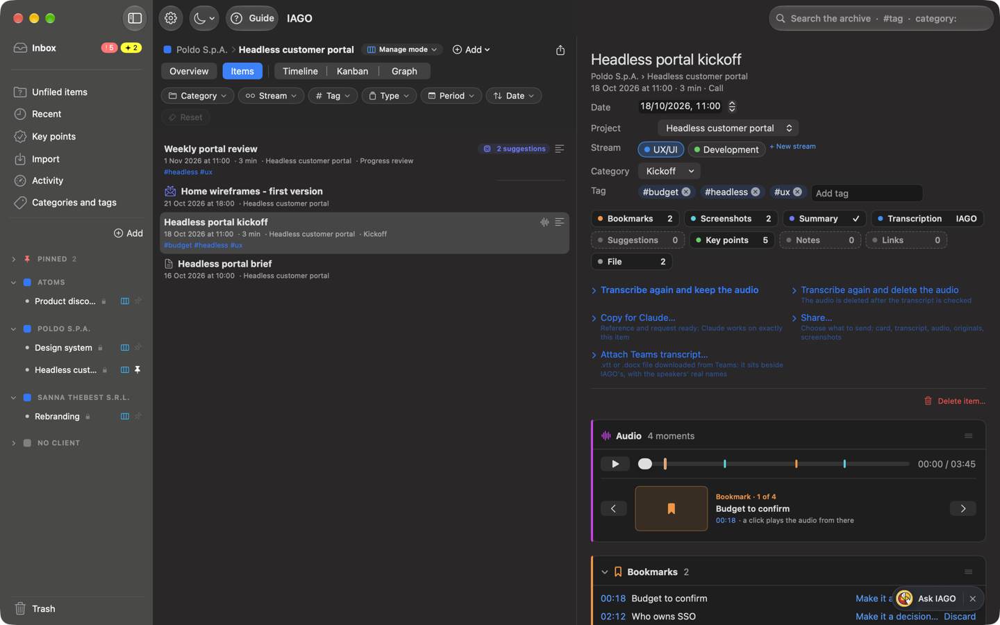
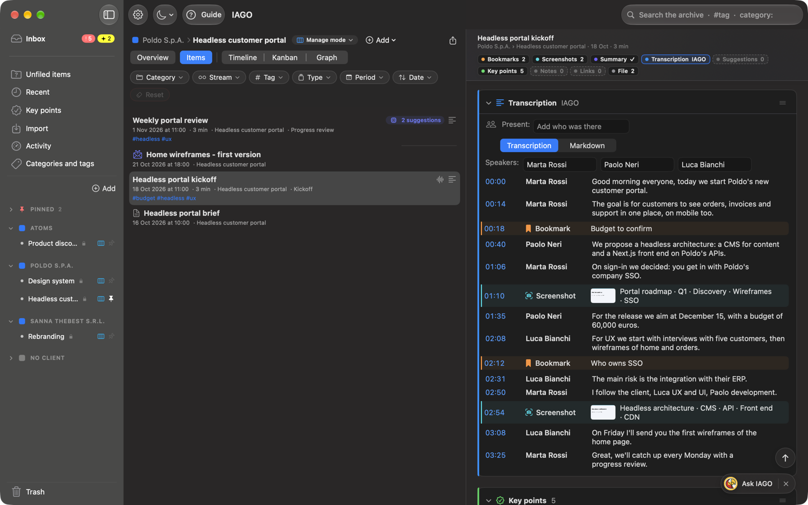
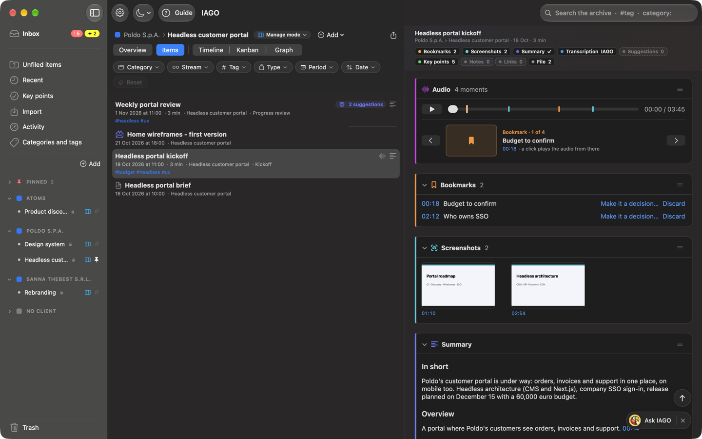

<!-- icona: doc.richtext -->
# The item card

An item is a **call**, an **email** or a **document**. The card gathers everything:

- **Header:** title, below it client › project and date · duration · type; then date, project, stream, category, tags, all editable.
- **Actions:** transcribe, transcribe again, **Share…**, export, delete, **Copy for Claude** (see the chapter *Claude*).
Then the sections, in this order unless you change it:
- **Audio:** player with a choice of track (both, microphone only, system only) and the call's **moments** (see below).
- **Bookmarks** of the moments marked during the call.
- **Screenshots** captured with *Mark moment with screenshot*, with the minute and the text that was read.
- **Summary:** see the chapter *Summary*.
- **Transcript** with who is speaking and the minute: a click on a minute plays the audio from there; right-click a sentence to turn it into a key point. Bookmarks and screenshots appear at their minute, on a faint veil of their colour (screenshots with their thumbnail too). For documents and emails the **Content** takes its place (with the original image and the recognized text).
- **Suggestions:** what the engine suggests, to confirm or dismiss.
- **Key points** that came from this item.
- Dated **notes**, dictated by voice too.
- **Links** to other items (replies, attachments, related documents).
- **Files:** the item's assets, with their size.

## Tiles and sticky bar
Under the title are the **tiles**: one per section, with a single value. The number of bookmarks, screenshots, notes, key points, suggestions, links and files; **✓** if there is a summary; for the transcript, where it comes from: **IAGO**, **Teams** or **IAGO + Teams** («…» while transcribing). A click opens the section and takes you there. A dashed tile is an empty section.

When you scroll down, a **sticky bar** appears at the top: title, client › project · date · duration and the same tiles in small, with the section you are in highlighted. At the bottom right, above *Ask IAGO*, **↑** appears to go back to the top.

## Changing the order of the sections
On the right of each section's title there is a small handle (≡). **Drag a section's title**: all the sections close, so you see the order at a glance, and the others move as you pass. Drop it where you want it: the sections go back to open or closed as before. The order applies to **every item** and stays for the next time; the tiles follow it too. **Settings › General › Item detail › Restore the section order** goes back to the standard one.

## Open and closed sections
- A click on the title opens or closes a section. **Each item remembers** its open and closed sections.
- How they start in an item you have not touched yet is chosen in **Settings › General › Item detail**; *Reapply to all items…* forgets the choices made in single items.
- **Audio** and **Files** are always open.
- An **empty** section is just a dashed header, with a sentence saying what is missing and, when useful, the button to add (for example *Add note* or *Link to…*).

## Moments on the player
Bookmarks and screenshots are the call's **moments**. On the player each moment is a coloured **tick** (orange for bookmarks, light blue for screenshots). Below there is **one moment at a time**, with the thumbnail, the title and the minute: on opening it is the next one after where you are, while listening it follows the audio, and with **‹ ›** you move to the others. A click on the minute plays the audio from there. Without moments only the player remains.

Ticks on the player and moments in the transcript can be turned off in Settings › General › Item detail.

## Sharing an item
*Share…* among the actions opens the list of what the item has, with the size: tick what to send.
- **Card (Markdown):** date, project, summary, key points and notes.
- **Transcript** (or the text of emails and documents), the **other transcript** if the call has two, the **audio**, the **separate tracks**, the **original file** (email, document, Teams transcript) and the **screenshots**.
- *Share…* opens the Mac's Share menu: Mail, Messages, AirDrop and the other apps. *Save to a folder…* copies them where you choose. With *A single .zip file* everything arrives in one file.
- Shared files are not encrypted: whoever receives them can read and listen to them. Voice prints never leave, and every share stays in the access log.

## The listening bar

When you play some audio, the **listening bar** appears below the bar at the top of the window. It stays visible in every section, so you can move around while you listen and stop the audio whenever you want.

- **What you are listening to:** Client › Project › Stream › Item. A click opens the item again.
- **Controls:** pause and resume, 15 seconds back and forward, position, track being played.
- **X:** stops the audio and closes the bar. If you only pause, the bar stays, so you can resume.
- If you record while listening, the recording bar is on top and the listening bar below it.
- Closing the IAGO window stops the audio.
- If you open another item while listening, the audio keeps playing; press Play in that item to switch to its audio.
