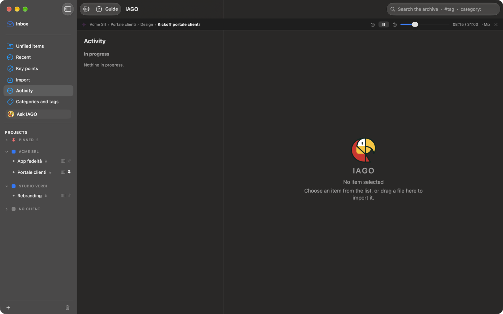

<!-- icona: doc.richtext -->
# The item card

An item is a **call**, an **email** or a **document**. The card gathers everything:

- **Header:** title, date, project, stream, category, tags. All editable.
- **Actions:** transcribe, transcribe again, export, delete, **Copy for Claude** (see the chapter *Claude*).
- **Summary:** see the chapter *Summary*.
- **Suggestions:** what the engine suggests, to confirm or dismiss.
- **Audio:** player with a choice of track (both, microphone only, system only).
- **Bookmarks** of the moments marked during the call.
- **Screenshots** captured with *Mark moment with screenshot*, with the minute and the text that was read.
- **Transcript** with who is speaking and the minute: a click on a minute plays the audio from there; right-click a sentence to turn it into a key point. Screenshots appear at their minute, with the text that was read.
- **Content** for documents and emails (with the original image and the recognized text).
- Dated **notes**, dictated by voice too.
- **Key points** that came from this item.
- **Links** to other items (replies, attachments, related documents).
- **Files:** the item's assets, with their size.

Sections can be collapsed (the choice applies to all cards).

## The listening bar

When you play some audio, the **listening bar** appears below the bar at the top of the window. It stays visible in every section, so you can move around while you listen and stop the audio whenever you want.

- **What you are listening to:** Client › Project › Stream › Item. A click opens the item again.
- **Controls:** pause and resume, 15 seconds back and forward, position, track being played.
- **X:** stops the audio and closes the bar. If you only pause, the bar stays, so you can resume.
- If you record while listening, the recording bar is on top and the listening bar below it.
- Closing the IAGO window stops the audio.
- If you open another item while listening, the audio keeps playing; press Play in that item to switch to its audio.
