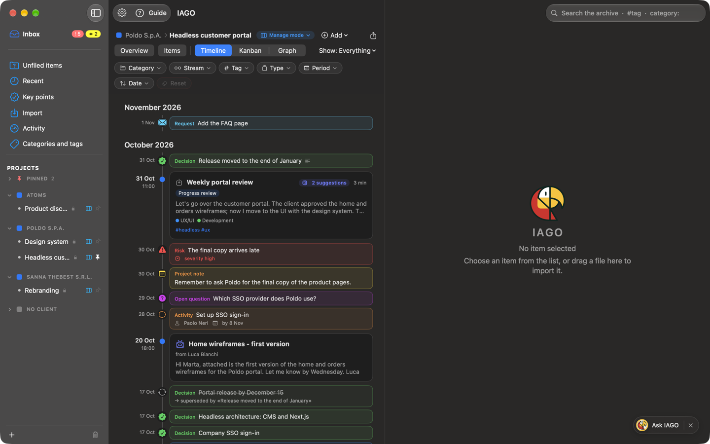
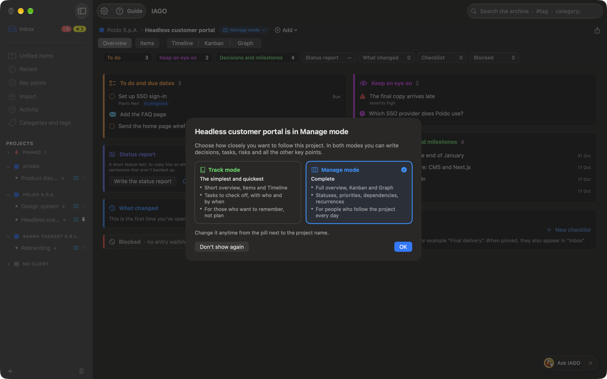
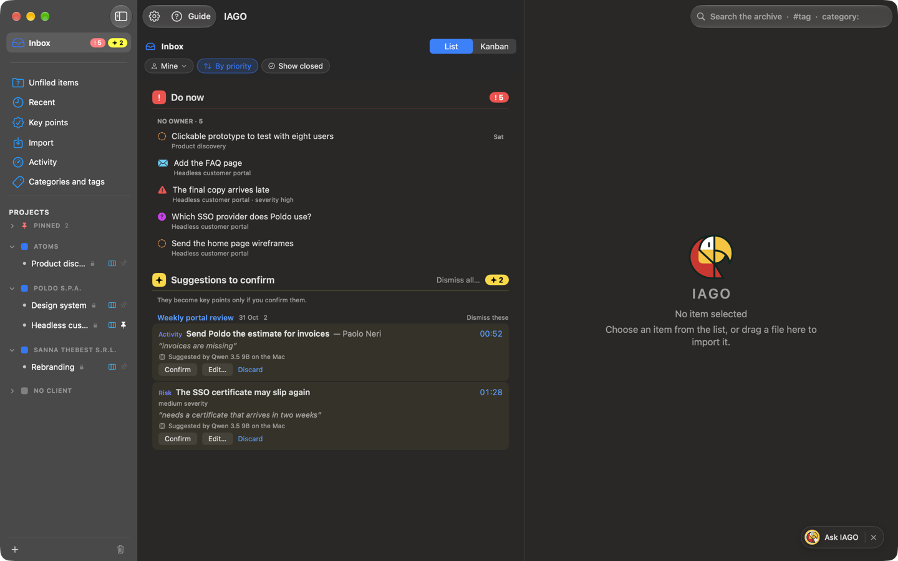
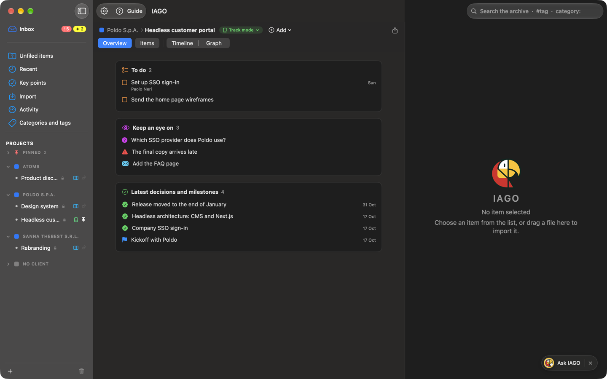
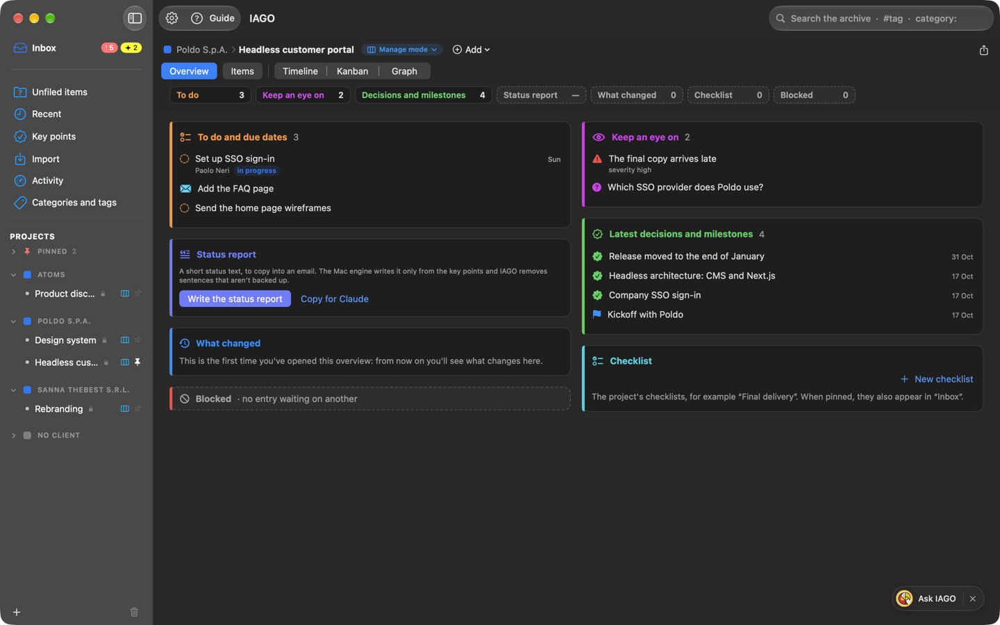
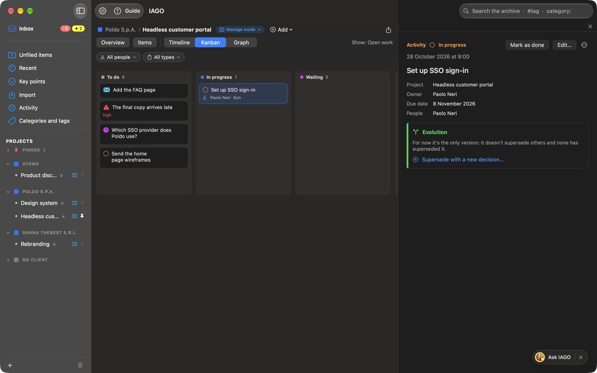

<!-- icona: checkmark.seal -->
# Key points and open work

There are six kinds of key points, in two families.

**Memory:** things that happened, and stay.
- **Decision:** something decided. It holds until another one replaces it.
- **Milestone:** an important fact (signing, delivery, kickoff).

**Open work:** things to close.
- **Task:** what to do, with whom and by when; it can have a **checklist** of sub-items to tick off.
- **Open question:** a question waiting for an answer.
- **Risk:** what can go wrong, with its severity (high, medium, low). If it happens, you mark it *Became an issue*.
- **Request:** what the client asks for; you accept it, reject it or convert it.

## Track mode and Manage mode
Each project has its own mode, chosen with the pill next to the project name (**Manage mode ▾**) or in Settings › Projects. Both have all the kinds; the data is the same, and switching from one to the other you lose nothing.
- **Track mode**, *simple and quick*: keep track of the project. Short overview, Items, Timeline and Graph (which you can turn off from the pill). A task is a **checkbox to tick**, with who, by when, "waiting for" and checklist; open questions, risks and requests are written down and closed with their outcome. No Kanban and no *Show* menu.
- **Manage mode**, *complete* (the default): all statuses, including *In progress* and *Blocked*; priority, dependencies ("depends on"), risk severity, *Became an issue*, "derived from", estimate, start date, recurrences; the **Kanban** and the full **Overview**.

A Manage field already filled in stays saved in Track too: a small icon says so, and it becomes visible again in Manage.

**The first time** you open a project, a window tells you which mode it is in and what changes; a click on the other tab switches mode. *OK* closes it and the window comes back next time; *Don't show again* removes it for that project. A **client** shows it too: there you choose the mode of its new projects and of those you have not set yourself.

Inbox, Key points and the all-projects Kanban gather the work of **all projects**, in any mode: each entry is shown in the mode of its project.

## Creating them
From a bookmark, from a sentence in the transcript (right-click), from a document, from a note (*Promote*), by hand (*Add* in the timeline), or by confirming a **suggestion** from the engine or from Claude. Each one has a title, description, date, people, tags, streams and the **source** (with the minute of the call).

For the **owner**, choose among the people IAGO knows, or type a new one; if it looks like a known name IAGO asks "Did you mean Marco Rossi?". When you write someone in **Waiting for**, the entry moves to *Waiting*.

## Closing them
- **Task:** *Mark as done*. A recurring one (every day, week, month, year) creates the next one on its own.
- **Open question:** *Answer…* with the answer; with *Make it a decision* the answer also becomes a decision.
- **Request:** *Accept…* (creates one or more tasks derived from it), *Reject…* with the reason, *Convert to…* another kind.
- **Risk:** *Became an issue*, *Resolved* or *No longer relevant*.
- On any entry: *Reopen* and, in Manage, *New task from this*.
- In **Track mode** a task is closed by ticking its checkbox, in the timeline, in the Overview or in the Inbox; ticked again, it is open again.

## Superseding and closing with another entry
An entry can **close others**, even of a different kind: a milestone "Contract signed" completes a task, a decision answers an open question or accepts a request. The line says so with the right verb: *replaces*, *answers*, *accepts*, *completes*. Closed entries open again if you remove the link. The **Evolution** section shows all the linked entries in order; you can give the chain a name.

## How they look
- Open: the kind's icon and color, with owner and due date; the due date turns red when it has passed.
- Waiting: "waiting for Anna · by Nov 5". Blocked: the *blocked* label.
- Done: green ✓, gray text. Answered, accepted or rejected: a line with the outcome.
- Superseded or cancelled: struck-through text.
- An entry closed by another one on the same day sits below it.

## Inbox
The **Inbox**, at the top of the sidebar, gathers the open work of all projects, in any mode. Next to its name it has two badges, and each one counts a block of the Inbox, with the same colour and the same sign in the header:
- **Do now**, **red** badge with the exclamation mark: what needs action now.
  - your entries that are **late** and those due **today**;
  - the entries with **no owner**, to assign;
  - the **overdue waits**: you have waited past the promised date, time to follow up.
- **Suggestions to confirm**, **yellow** badge with the sparkle: the engine's suggestions, grouped by the item they come from. Each one has the sentence it comes from and the minute, and you confirm, edit or dismiss it right there. Three are shown per item, then *Show the other*. *Dismiss these* dismisses those of one item, *Dismiss all…* all of them.
- **Later**, with no badge: your entries for this week, after it and with no date, **Waiting on others** (the waits not yet overdue) and the projects' **pinned checklists**, to tick off here.

A badge at zero does not appear, and neither does an empty block.

*Show closed* also shows the entries closed recently. In Manage you can sort by priority and filter by person.

If you want, a **morning notification** (Settings › General) tells you how many entries are due today, how many are overdue and how many waits have expired; a click opens the Inbox.

## Overview
Every project, client and stream has its **Overview**, the first button at the top: the first time, the project opens there.

In **Track mode** it is the **Short overview**, one column with three blocks: *To do* (the open tasks, to tick off there), *Keep an eye on* (open risks, open questions and requests) and *Latest decisions and milestones*. An empty block is not shown. The panel on the right is always there: empty until you open an entry.

In **Manage mode** it fills the whole window and is made of **boxes**: *To do and due dates*, *Keep an eye on* (risks by severity and open questions), *Waiting on others*, *Latest decisions and milestones*, *Upcoming milestones*, *Status report*, *What changed*, *Checklist* and *Blocked*.

- The boxes sit in two columns and each one goes in the shorter: a long box leaves no holes beside it. With a narrow window, or with the panel on the right open, they become one column.
- At the top, always in view, the boxes' **tiles** with their number: a click takes you to the box and makes it glow for a moment. A dashed tile is an empty box, reduced to its header.
- A click on an entry opens it in the panel on the right; right-click changes its status.
- The **Status report** is a text written by the local engine from the key points, to copy into an email or pass to Claude. *What changed* starts from the last time you opened the overview. The **project checklists** (for example "Final delivery") you create, pin at the top and tick off.

## Kanban
In Manage, the **Kanban** of a project, client or stream (or of all of them, from the Inbox and from Key points) fills the whole window and puts open work in columns: *To do*, *In progress*, *Waiting*, *Blocked*, *Done*. Dragging a card to another column changes its status; in *Waiting* IAGO asks who you are waiting for and until when.

You can add **your own columns** (for example "To discuss on Friday"): they are for grouping and do not change the status. In the *Done* column, entries closed more than 14 days ago are archived: *Show all* brings them back, *Archive* hides them again, and IAGO remembers the choice. A click on a card opens it in the **panel on the right**; ✕ or Esc closes it. To go back to the list, choose *Items* or *Timeline*. The all-projects Kanban also includes the projects in Track, with the mode icon next to the name: a task moved there to *In progress* is still to be ticked off in the project. You can turn it off in Settings › General without losing columns and positions.

## Where to see them
- **Key points** in the sidebar: all of them, with filters for kind, status, person, owner, tag.
- In a project, **Show: Key points** with the Timeline or the Graph (see Organizing).
- **Inbox**, **Overview** and **Kanban**, as above.
- The **timeline**, together with calls, emails and notes.
