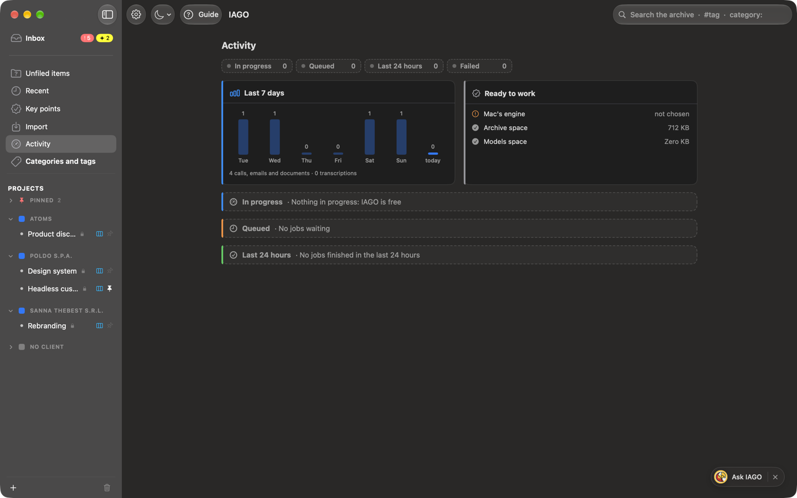

<!-- icona: gauge.with.dots.needle.67percent -->
# Activity

**Activity** in the sidebar shows everything IAGO is doing, with a number when something is in progress.

At the top the **tiles** (In progress, Queued, Last 24 hours, Failed) take you to their section; an empty section is just a dashed header. Activity fills the whole window: *Open* shows the item in the panel on the right.

- **In progress:** recording (duration, microphone, mute), transcription, summaries, suggestions, indexing for search, model downloads, imports, backups, exports. With a bar, percentage and time left when it can be estimated.
- **Queued:** the jobs waiting, with **Do this first** and **Cancel**.
- **Last 24 hours:** done, cancelled and failed (with the reason), with **Open** and **Retry**.

At the top, side by side (one under the other with a narrow window):
- **Last 7 days:** calls, emails and documents of each day, and how many transcriptions were done.
- **Ready to work:** the Mac engine chosen, the space of the archive and that of the models.

Heavy jobs run one at a time and in the background: IAGO stays usable. During a recording they wait.
