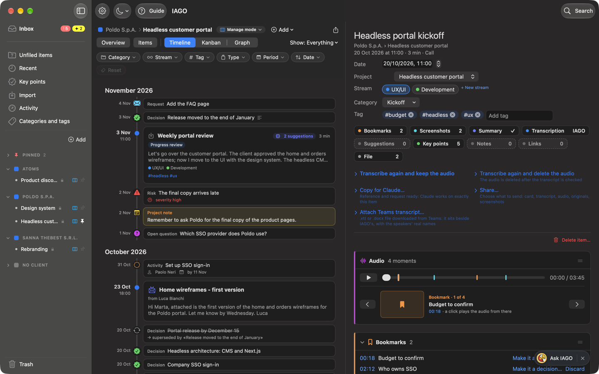
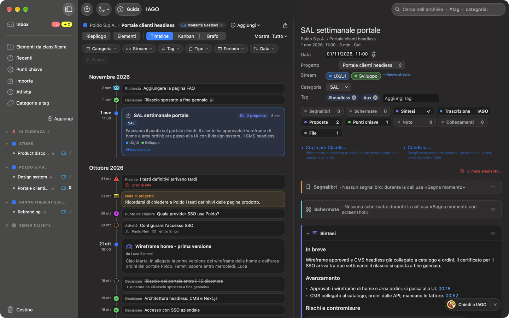
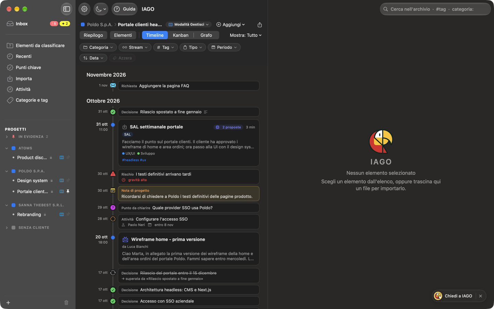
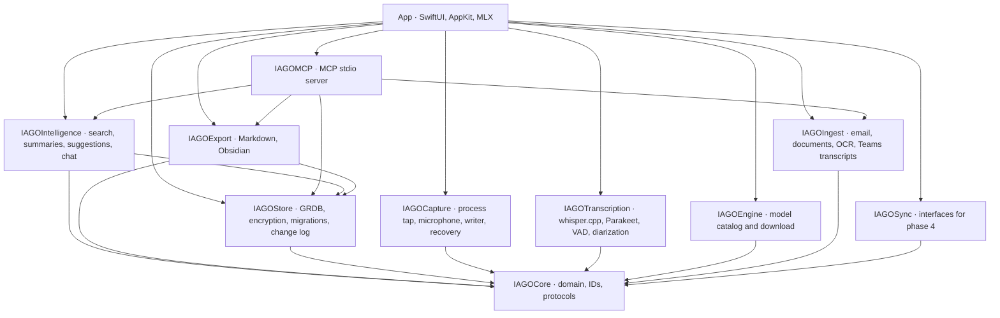

<p align="center">
  
</p>

<h1 align="center">IAGO</h1>

<p align="center"><strong>The brain of your work, ready to answer.</strong><br>
Calls, emails, documents, notes and decisions of every project in a single memory. Ask what was decided, who has to do what, how a choice changed: IAGO answers with your own content and takes you to the source.</p>

<p align="center">
  macOS 15+ · Apple Silicon · Swift 6 · local engine · optional Claude · CC BY-NC-SA 4.0 license
</p>

<p align="center">
  📖 <strong><a href="https://giovannilombi.github.io/iago/en/">Official documentation</a></strong>: how to use it (<em>Usage</em> level) and how it is built (<em>Technical</em> level).<br>
  <sub>It is the reference: this README is only its summary. Online once the repository is public; until then locally with <code>npm install && npm run docs:dev</code> (VitePress site in <code>docs/</code>).</sub>
</p>

> **To use or understand IAGO, start from the [official documentation](https://giovannilombi.github.io/iago/en/)** (locally: `npm run docs:dev`). The user guide, installation, shortcuts and the technical level are there, always updated with every version.
>
> 🇮🇹 **Italiano:** the Italian version of this README is [`README.md`](README.md); the Italian documentation is at the root of the site ([giovannilombi.github.io/iago](https://giovannilombi.github.io/iago/)). IAGO, its guide and all its documents are in Italian and English (ADR-0077).



> The screenshots come from a demo archive with made-up people and companies.

## Contents
- [Why IAGO](#why-iago)
- [What it does](#what-it-does)
- [Your data, your choices](#your-data-your-choices)
- [Installation](#installation)
- [User guide](#user-guide)
- [Architecture](#architecture)
- [The engines](#the-engines)
- [Reliability](#reliability)
- [Design decisions](#design-decisions)
- [Quality and tests](#quality-and-tests)
- [Development](#development)
- [Roadmap](#roadmap)
- [Versions](#versions)
- [Credits and licenses](#credits-and-licenses)

## Why IAGO
In project work, knowledge is scattered:
- you decide in a call and confirm by email;
- you attach a PDF and jot something down in a hurry;
- two weeks later you change your mind.

Finding *what* was decided, *when* and *why* takes time, and often fails.

IAGO is a **queryable work memory**. It collects everything, organizes it the way you work (client › project › stream), extracts its meaning and answers your questions:
- **"What did we decide about the budget?"**: the answer, with numbered sources;
- **"Who has to send the wireframes, and by when?"**: the task, with who does it and the due date;
- **"How did the release date change?"**: the evolution of the decision, entry by entry;
- **"What did the client say about the contract?"**: the exact passage, with the audio starting again from that minute.

The name comes from the icon: a parrot with a memory of steel.

## What it does
### It answers
- **Ask IAGO** (⌘K): natural-language questions about a stream, a project, a client or the whole memory, with the context always in view, even several projects together chosen by you ("Change context"). It opens in the right pane or on the whole window. Answers use only your content and cite numbered sources, which open at the right item and minute. Conversations are kept, can be pinned, and can be saved as a note.
- **Full-text search** and **search by meaning**, with **Search** (⌘F) in the right pane: "how much the company pays in" finds "the employer contribution". The two searches are merged with *reciprocal rank fusion*.
- **Cross-cutting access:** every category and every tag spans all projects; `#tag` and `categoria:` straight from the search.

### It remembers what matters
- **Key points:** decisions and milestones (the memory) and open work (tasks with checklists, open questions, risks, requests), each with its source (down to the minute of the call), the people and the date; work items with owner, due date and "waiting for".
- **Open work under control:** the **Inbox**, at the top of the sidebar, collects what is open across all projects, whose it is and when it is due; the **Overview** tells where a project stands, with a status report to copy. Two modes on the same data, chosen per project: **Manage mode**, the complete and default one, with fine-grained statuses, priorities, dependencies, recurrences and a full-window **Kanban** with your own columns, and **Track mode**, simple and quick: Short overview, tasks to check off, all key point types.
- **The evolution of decisions:** an entry can supersede others, even of a different type, and IAGO keeps the history of how you got there.
- **Moments marked** during a call, also **with a screenshot** of the shared slide (the text read from it goes into the transcript, the search and the summaries), and dated **notes** on the project or the item, also dictated by voice. The shortcuts (⌃⌥M, ⌃⌥S, ⌃⌥R) work in any app.
- **Engine suggestions:** after each new piece of content IAGO suggests decisions, tasks (with who, by when, who is waited on), open questions, risks, requests, speaker names, tags, project and links, each with the sentence it comes from. Nothing is applied without your confirmation. Every summary and every suggestion says which model produced it.
- **It recognizes voices** (on by default, turned off in Settings › Voices): give a speaker a name and in later calls IAGO suggests that name when it hears the same voice. Voiceprints stay encrypted on the Mac, never go to Claude and can be deleted whenever you want.

### It understands
- **Summaries by meeting type:** a 1to1 has commitments and feedback, a progress review milestones, risks and decisions, a sales meeting needs, objections and next steps.
  - Every point carries the minute it comes from, verified against the transcript.
  - The summary templates come from Meetily and Hyprnote (MIT) and can be edited.
- **Transcription** with who is speaking: your voice has the name you choose, with the "You" mark; the others are separated by person and are renamed with suggestions of names already known; a glossary helps with difficult names.
- **Project views:** the **Overview**, the project's **Items**, and the shapes of the story (**Timeline**, **Kanban**, **Graph** of people and linked decisions) with what to show (everything, only items or only key points). IAGO remembers the last view of each project. From a project, **Import files and items…** brings in audio, documents, emails and text directly there.
- **In Italian and in English:** the language is chosen at first launch and changed in Settings › General; guide, summaries, suggestions and answers follow the chosen language.

### It collects from every source
- **Calls:**
  - recording on two separate tracks (the Mac's audio and your microphone), aligned on the same clock;
  - IAGO notices meetings (Teams, Zoom, Webex, FaceTime, Slack, Calendar) and offers to record them with the right title;
  - it follows Teams mute;
  - if no audio comes from the microphone, the icon's dot turns yellow within a couple of seconds and a panel says so clearly.
- **Emails** (.eml, .msg), recognized by sender, conversation and attachments, also automatically from a **watched folder** (for example Outlook mail saved by Power Automate).
- **Documents:** PDF, Word, text and images, with text recognition.
- **Teams transcripts, audio and video.**
- **Any text**, from any app, with the "Add to IAGO" service.

### It organizes
- **Clients, projects and streams** in an accordion sidebar, with *Pinned* for the projects, categories and tags you use most.
- **Categories** as meeting types, on two levels:
  - the main ones always visible;
  - the families (Agile, Management, People, Operations) when needed.
- Cross-cutting **tags**, with **Categories and tags** in three columns to combine a category and several tags, and the **Activity** section, with everything IAGO is doing.

### It expands, if you want
- **Claude** (Claude Desktop or Claude Code) connected to IAGO via MCP, to reason about your projects with a more powerful model:
  - it reads only what you enable;
  - it writes notes, key points and documents only with a preview and your confirmation;
  - it can produce **summaries and suggestions instead of the Mac's engine**: under the summary a box shows the steps to do it, on every Mac, and "Copy for Claude" in the item card gives it the right item; IAGO verifies every quote as it does with its own engine;
  - every write can be undone.
- **Sharing with the team** *(coming, phase 4)*: shared projects in trusted spaces controlled by you or your company (OneDrive, SharePoint, Google Drive), without an IAGO server.
- **Obsidian**, per-project **exports** (also in Markdown for an LLM) and an **encrypted backup** to move to another Mac.

## Your data, your choices
**Nothing leaves your Mac unless you want it to.** You decide how far your content goes:

| Level | What happens | Who decides |
|---|---|---|
| **On the Mac**, by default | encrypted archive (one key per item, in the Keychain); transcription and local engine inside IAGO, with MLX | always on |
| **With Claude** | Claude reads the projects you enable and writes only with your confirmation | you, project by project |
| **In a shared space** *(phase 4)* | the project lives in a OneDrive, SharePoint or Google Drive folder controlled by you or the company, and the team works on it together | you, by choosing the space |

**Connections.** IAGO has no servers of its own and no telemetry. The only connections it makes on its own are few, fixed and recorded in the access log:
1. the download of the models you ask for, from addresses pinned to a commit, with SHA-256 verification;
2. the local Teams API (`127.0.0.1`), if you turn it on;
3. the check for signed updates on GitHub Releases.

A script (`scripts/check-network-apis.sh`, run with the tests) fails if a connection outside these points appears in the code.

## Installation
**Requirements:**
- a Mac with Apple Silicon (M1 or later) and macOS 15 or newer;
- 1.6 GB for the transcription models;
- 2 to 7 GB more for the local engine.

1. Download `IAGO-x.y.z.dmg` from the [releases page](https://github.com/giovannilombi/iago/releases/latest), open it and drag **IAGO** into **Applications**.
2. **First launch.** IAGO is not notarized by Apple, so macOS blocks it the first time:
   - press **Done**;
   - open **System Settings › Privacy & Security**;
   - press **Open Anyway** next to IAGO.
3. The **guided setup** walks you through:
   - name;
   - microphone;
   - system audio test;
   - notifications;
   - model download.

   Then the introduction: ten steps with the app's screenshots and the first steps to take.
4. In **Settings › Permissions** you see what is on and turn on the rest one item at a time.
5. **Optional:**
   - the work calendar (Exchange or Google in *Internet Accounts*), for meeting titles;
   - the **local engine** in Settings › Engine: Qwen 3.5 9B with 16 GB, Gemma 4 12B with 32 GB.

**Updates.** IAGO installed from the DMG checks once a day. Minor versions are offered; a new major version is required before recording again, without interrupting a recording in progress. A copy built from source code does not look for updates: it is updated with git.

Detailed instructions in [`docs/en/installazione.md`](docs/en/installazione.md).

## User guide
IAGO has a **complete guide inside the app**: the **? Guide** button in the window, or the menu of the IAGO icon. The same chapters can be read here:

| | |
|---|---|
| [Getting started](App/Resources/Guide/en/01-primi-passi.md) | [Installation](App/Resources/Guide/en/02-installazione.md) |
| [Recording a call](App/Resources/Guide/en/03-registrare.md) | [Meetings and calendar](App/Resources/Guide/en/04-riunioni.md) |
| [Transcription](App/Resources/Guide/en/05-trascrizione.md) | [Organizing](App/Resources/Guide/en/06-organizzare.md) |
| [The item card](App/Resources/Guide/en/07-scheda.md) | [Summaries](App/Resources/Guide/en/08-sintesi.md) |
| [Key points](App/Resources/Guide/en/09-punti-chiave.md) | [Engine suggestions](App/Resources/Guide/en/10-proposte.md) |
| [Searching and asking](App/Resources/Guide/en/11-cercare-chiedere.md) | [Emails and documents](App/Resources/Guide/en/12-email-documenti.md) |
| [Claude](App/Resources/Guide/en/13-claude.md) | [Activity](App/Resources/Guide/en/14-attivita.md) |
| [The local engine](App/Resources/Guide/en/15-motore.md) | [Settings](App/Resources/Guide/en/16-impostazioni.md) |
| [Privacy, Claude and sharing](App/Resources/Guide/en/17-privacy-backup.md) | [Updates](App/Resources/Guide/en/18-aggiornamenti.md) |
| [Common problems](App/Resources/Guide/en/19-problemi.md) | |

<p>
  
  
</p>

## Architecture
A native macOS app in **Swift 6** with strict concurrency:
- **SwiftUI**, plus AppKit where needed: `NSStatusItem` for the menu bar, `NSPanel` for suggestions;
- no webview;
- the app is not sandboxed, with *hardened runtime*.

The code is split into packages with a fixed dependency graph, verified on every build:



### From content to answer
Every piece of content follows the same path: it comes in, is stored encrypted, becomes text, is indexed, its meaning is extracted, and from there it answers questions.
- **Emails and documents:** `IAGOIngest` extracts text, people and attachments (with OCR for images).
- **Notes:** they are written or dictated.
- **Calls:** they have one more step, capture and transcription.

1. **Call capture** (`IAGOCapture`):
   - a Core Audio *process tap* takes the system audio;
   - a HAL IOProc takes the microphone as it is, without touching the call app's one;
   - every buffer carries the system clock time (host time), so the tracks stay aligned even when you switch microphones or pause;
   - writing to disk is incremental.
2. **Storage:** at the end of the recording the tracks are encrypted in blocks in the archive (`Items/<id>/`), with one key per item.
3. **Transcription** (`IAGOTranscription`), in a job queue with QoS `.utility`, one at a time:
   - Silero VAD and splitting into chunks;
   - Whisper or Parakeet;
   - voice diarization;
   - merging of the two tracks and filtering of residual echo.
4. **Indexing:** full-text search (FTS5) right away; Qwen3 Embedding vectors in the background for search by meaning.
5. **Understanding** (`IAGOIntelligence`, with the app's MLX engine): summaries with the category's template, key point suggestions, Ask answers with sources. The same archive, read-only or with confirmed writes, is exposed to Claude by the MCP server (`IAGOMCP`).

### The data
- **SQLite with GRDB:**
  - versioned migrations (17 so far), each preceded by a backup when the user's archive is upgraded;
  - every row has `created_at`, `updated_at`, `deleted_at`, `version` and `device_id`;
  - every change ends up in `change_log`, the basis of future sync.
- **Files encrypted** in blocks (AES-GCM), with the keys in the Keychain. Permanent deletion destroys the key (*crypto-shredding*).
- **Access log** of downloads, Claude's reads and writes, exports, backups and updates.

## The engines
### Transcription
| Engine | Implementation | Measured speed | Quality |
|---|---|---|---|
| **Whisper large-v3-turbo** (default) | whisper.cpp 1.9.2, Metal, beam search 5, forced Italian | **19× real time**: one hour in about 3 minutes | more accurate on English terms and names |
| **Parakeet TDT 0.6B v3** | FluidAudio, CoreML on the Neural Engine | **87× real time**: one hour in about 40 seconds | good on colloquial Italian, more errors on names |

- Silero VAD and pyannote/WeSpeaker diarization via FluidAudio; diarization takes a few seconds per call (about 300× real time).
- Measurements on 2 h 44 min of real calls, on an M3 Pro: [`docs/en/benchmarks/2026-10-phase0.md`](docs/en/benchmarks/2026-10-phase0.md).

### Local engine (summaries, suggestions, Ask)
MLX Swift **inside the app**: no local server, no open port. The models are 4-bit quantized, pinned to a commit and verified.

| Model | Memory | Recommended | Summary of a 30-minute call |
|---|---|---|---|
| Qwen 3.5 4B | about 3.5 GB | below 16 GB | not used for summaries (too small) |
| Qwen 3.5 9B | about 6 GB | **16 GB** | 64-97 s, fair |
| Gemma 4 12B | about 12.5 GB | **32 GB or more** | 161-272 s, the richest |

- **Search by meaning:** Qwen3 Embedding 0.6B (0.35 GB), *last-token pooling*, hybrid search with FTS5.
- **Short titles:** Apple Foundation Models, when available.

**How IAGO checks the model**, instead of trusting it:
- every summary point and every suggestion must **quote the transcript**. IAGO finds the quote, with identical numbers, and links the point to its minute; if it does not find it, it discards it;
- calls are read in **10-minute chunks**, and no request to the engine exceeds a fixed text limit;
- transcription, engine and search work **one at a time**, with priority to Ask; below 32 GB automatic suggestions and summaries are off by default, and Gemma 4 12B is not used below 24 GB;
- sections without content say **"Not mentioned"**;
- "In brief" is written **only from verified points**;
- personal facts and spoken sentences copied instead of summarized are left out;
- truncated answers or answers with malformed JSON are **read section by section**.

Tests on real calls: [`docs/en/benchmarks/2026-10-21-sintesi-e-glossario.md`](docs/en/benchmarks/2026-10-21-sintesi-e-glossario.md).

## Reliability
- **A recording is never lost:**
  - incremental writing (*flush* every 2 seconds at most);
  - recovery at launch of sessions interrupted by a crash, restart or power loss;
- **Aligned tracks:** the same system clock for both, with a drift target below 50 ms over 2 hours.
- **Always responsive app:** heavy jobs one at a time, in the background, suspended during recordings and while you wait for an answer.
- **No silent writes:** engine suggestions and Claude's writes always go through your confirmation, and Claude's can be undone.
- **EdDSA-signed updates:** IAGO installs only versions signed with the same key.

## Design decisions
Every important choice is an **Architecture Decision Record** in [`docs/en/adr/`](docs/en/adr/README.md): 95 so far, with context, rejected alternatives and consequences. Some of them:

| ADR | Decision | Why |
|---|---|---|
| [0058](docs/en/adr/0058-principio-sui-dati.md) | Nothing leaves without the user's choice | on the Mac by default, Claude and shared spaces only if you choose them |
| [0002](docs/en/adr/0002-due-tracce-separate.md) | Two separate tracks | always know who you are, transcribe better, remove echo |
| [0005](docs/en/adr/0005-trascrizione-locale.md) | Local-only transcription | calls stay on the Mac |
| [0007](docs/en/adr/0007-sqlite-file-cifrati.md), [0028](docs/en/adr/0028-chiavi-portachiavi.md) | SQLite plus encrypted files, keys in the Keychain | a robust archive; a deleted item becomes unreadable even in copies |
| [0009](docs/en/adr/0009-suggerimenti-da-confermare.md) | The engine suggests, you confirm | nothing changes without you |
| [0023](docs/en/adr/0023-motore-asr-default.md) | Whisper by default, Parakeet for speed | accuracy first, speed by choice |
| [0043](docs/en/adr/0043-server-mcp-per-claude.md), [0044](docs/en/adr/0044-scrittura-tramite-claude-mcp.md) | Claude via MCP stdio, writes with preview | more power, control to the user, no open port |
| [0048](docs/en/adr/0048-motore-locale.md) | MLX engine inside the app, models by choice | no local servers, no Apple Intelligence for content |
| [0052](docs/en/adr/0052-superamenti-multipli.md) | Multiple supersessions, also across types | the history of decisions as it really is |
| [0054](docs/en/adr/0054-sintesi-per-categoria.md) | Summaries by category with verified quotes | useful and checkable summaries |
| [0069](docs/en/adr/0069-coda-unica-del-motore.md) | One heavy job at a time, chat first | the Mac does not fill up, answers do not wait |
| [0071](docs/en/adr/0071-claude-sintesi-e-proposte.md) | Summaries and suggestions also from Claude, with the same checks | high quality on small Macs, always checkable |
| [0072](docs/en/adr/0072-segna-momento-con-screenshot.md) | Screenshots only on request, read on the Mac | slides enter the memory without automatic captures |
| [0073](docs/en/adr/0073-riconoscere-le-voci.md) | Voices recognized across calls, only as a suggestion (on by default since ADR-0094) | fewer names to type, biometric data under control |
| [0074](docs/en/adr/0074-lavoro-aperto-traccia-gestisci.md) | Open work with two modes per project, Track and Manage, on the same data | simple where that is enough, complete where you manage |
| [0075](docs/en/adr/0075-viste-come-e-cosa.md) | Views as "how to look × what to show", Overview on its own, full-window Kanban | a bar with a clear hierarchy |
| [0076](docs/en/adr/0076-modalita-inbox-elementi.md) | Truly simple Track mode, Inbox at the top, Items and Graph, import from the project | two modes that stand apart, everyone's work in one place |
| [0077](docs/en/adr/0077-italiano-e-inglese.md) | Italian and English for app, guide, site and documents, kept aligned by an automatic check | two languages with no forgotten translations |
| [0056](docs/en/adr/0056-aggiornamenti.md) | Signed Sparkle updates, major ones required | everyone on the same safe version |
| [0057](docs/en/adr/0057-sync-onedrive.md) | Sharing through a cloud folder | collaborating without a new server |
| [0092](docs/en/adr/0092-ricerca-nella-spalla-e-chat-a-tutta-finestra.md) | Search always in the right pane, Ask IAGO also on the whole window | one place to search and ask |
| [0095](docs/en/adr/0095-claude-come-alternativa-e-riavvio.md) | Claude as an alternative on every Mac, with the steps | you see how to do it, without it being imposed |

## Quality and tests
- **321 automated tests** in the packages: Store 124, Capture 49, Intelligence 34, Transcription 30, Ingest 22, MCP 20, Core 15, Engine 15, Export 11, Sync 1.
  - The audio pipeline is tested with **synthetic** fixtures (`say` voices), never with real recordings.
  - The engines are tested with fake responses, which also reproduce the real errors of the models.
- **Before every pull request**, on the Mac: all the tests and the network API check (`scripts/test-packages.sh`); the git hooks check real data, email addresses and languages. GitHub Actions CI runs only by hand, to save the GitHub Free minutes. The build with MLX (`scripts/test-engine.sh`) is done before PRs that touch the engine.
- **Field tests:** measurements on real calls (`docs/benchmarks/`) and a **tester checklist** ([`docs/en/prove-tester.md`](docs/en/prove-tester.md)), ordered and doable by someone who does not know the app.
- **Languages:** code, comments and commits in English; interface, guide and documents in Italian and English (ADR-0077).

## Development
```bash
scripts/bootstrap.sh          # generates IAGO.xcodeproj with XcodeGen (project.yml is the source)
scripts/check-private-data.sh --all   # no real data in the files (also as a hook before every commit)
scripts/check-commit-emails.sh main..HEAD   # no personal email address in the commits (hook before push)
scripts/test-packages.sh      # swift test on all packages
scripts/test-engine.sh        # app build with MLX and Metal shaders
scripts/install-app.sh        # signed Release installed in /Applications
scripts/release.sh 1.2.0 --notes "…" --github   # signed release, Sparkle appcast, GitHub Release
```
- **You need:** Xcode with Swift 6, XcodeGen and an Apple ID (even a free one) for signing. The Team ID goes in `Config/Local.xcconfig` (see `Config/Local.xcconfig.example`).
- **Documentation site:** VitePress in `docs/`, with the guide taken from `App/Resources/Guide` (`npm run docs:dev`); it will be at [giovannilombi.github.io/iago/en](https://giovannilombi.github.io/iago/en/) when the repository becomes public.
- **To collaborate:** [`README-collaborators.en.md`](README-collaborators.en.md) explains rules, documents, ADR status, tests and how to work with Claude Code.
- **Conventions:**
  - one branch per feature;
  - merge to `main` only via pull request, with the tests run locally;
  - conventional commits;
  - to change a decision, you write a new ADR.
- **Structure:** `App/` (macOS target and guide in `App/Resources/Guide`), `Packages/` (the ten packages), `docs/` (ADRs, benchmarks, designs, tests), `scripts/`.

## Roadmap
- **Phase 4, sharing:** shared projects in a trusted space, a cloud folder controlled by you or the company.
  - Each Mac writes only to its own log and the materials stay readable outside IAGO too.
  - One coordinator per space with signed actions.
  - Design under discussion: [`docs/en/design/sync-cartella-condivisa.md`](docs/en/design/sync-cartella-condivisa.md).
- **Then:**
  - in-depth transcription tests on real calls;
  - room voices in voice recognition;
  - graph refinements.

## Versions
The notes of each version are on the [releases page](https://github.com/giovannilombi/iago/releases). This list is updated with every release.

| Version | Date | What it contains |
|---|---|---|
| **1.2.15-beta** | November 5, 2026 | On `main` (tag `v1.2.15-beta`; going back to previous versions: see below). **Categories and tags** in three columns, with a category and several tags together. **Ask IAGO** with several projects chosen by you ("Change context") and on the whole window. **Search** (⌘F) in the right pane instead of the field at the top. **Yellow dot** at once when no audio comes from the microphone, and clear panels. **Voices recognized** by default, speaker names with suggestions and saved also when leaving the field, the "You" mark, your name also in Settings › Voices. **Claude** as an alternative on every Mac, with the steps and the restart alert. Guide screenshots retaken |
| **1.2.14-beta** | November 3, 2026 | Tag `v1.2.14-beta`. **Inbox in two halves:** *Do now* at the top and *Suggestions to confirm* at the bottom, each with its own scroll and a handle to change their height; suggestions in one box per item that opens on the right, with *Confirm all*. **Columns half and half** and the width saved per place. **Item card:** first audio, bookmarks and screenshots, then summary and transcript; sections reordered by dragging them, with the order for every item. **Sidebar:** *Add* client or project above the projects, Trash at the bottom, a client's + creating the project with the client already chosen, the whole project name after two seconds. Guide screenshots retaken |
| **1.2.13-beta** | November 2, 2026 | Tag `v1.2.13-beta`. **New "colour as a signal" style:** neutral text, the kind's colour only where useful, red only for urgency, a thread under box titles. **Light, dark or automatic** from the icon next to Settings; light with cool greys, no full white. "Add" sheet with the kind in a tile, Kanban with columns in boxes, Activity rearranged. Every guide screenshot retaken |
| **1.2.12-beta** | November 2, 2026 | Tag `v1.2.12-beta`. **Overview revised:** in Manage boxes in two columns that rearrange themselves, the boxes' tiles always at the top, latest decisions and milestones; in Track a page already split with the panel on the right. **Activity** across the window with the last 7 days. Clickable mode icon. Fixes: «Categories and tags» selectable again, key point sheet no longer cut off |
| **1.2.11-beta** | November 2, 2026 | Tag `v1.2.11-beta`. **Item detail revised:** under the title client and project, then small tiles with one value each that take you to the section; when scrolling, a sticky bar with the tiles in miniature and ↑ above «Ask IAGO»; open or closed sections remembered per item, with defaults in Settings; empty sections reduced to their header; bookmarks and screenshots as ticks on the player, one moment at a time, and in the transcript at their minute. New guide screenshots |
| **1.2.10-beta** | October 31, 2026 | Tag `v1.2.10-beta`. **Example projects:** a new archive starts with an invented agency (Poldo S.p.A., Sanna TheBest s.r.l., Atoms) with calls, emails, documents, summaries and key points about UX, UI, product design, branding and headless development; removed with one click. Every guide screenshot retaken with this example |
| **1.2.9-beta** | October 30, 2026 | Tag `v1.2.9-beta`. **Getting-started introduction:** «IAGO, always on your shoulder. Meeting after meeting.», ten steps with the app's real screenshots and a button to try them, and first steps that tick themselves. Instead of the welcome tour |
| **1.2.8-beta** | October 30, 2026 | Tag `v1.2.8-beta`. **Several people in the room without knowing beforehand:** in meetings in person IAGO separates the microphone's voices by itself, in a call it offers *Separate the voices*, and while recording there is *Several people here in the room*. **Present** to write when you want, offered as speaker names; room voices are recognized in later calls. **Mandatory updates with 2 days of margin** |
| **1.2.7-beta** | October 30, 2026 | Tag `v1.2.7-beta`. **Share an item:** choose what to send (card with summary and key points, transcripts, audio, tracks, originals, screenshots) and hand it to the Mac's Share menu or a folder, also in a single zip. New Inbox screenshot in the guide |
| **1.2.6-beta** | October 30, 2026 | Tag `v1.2.6-beta`. **Main transcript with the ★** on its tab and *Make main* with a confirmation; **search also looks in the other transcript**, with the call shown once and the label «in the Teams transcript»; the summary says which transcript it was written from and offers *Regenerate* when the main one changes |
| **1.2.5-beta** | October 30, 2026 | Tag `v1.2.5-beta`. **IAGO's and Teams' transcripts side by side:** Teams is added without replacing, its minutes are not links to the audio, one of the two is the main one and each can be deleted. **«Use Claude» tip** for summaries and suggestions on Macs up to 16 GB, and Claude can be chosen in Settings › Engine. ADR-0079 (other assistants) proposed |
| **1.2.4-beta** | October 30, 2026 | Tag `v1.2.4-beta`. **Inbox with two badges:** red for what asks for an action now (late, today, no owner, overdue waits), yellow for the suggestions to confirm. The Inbox is split into three blocks with the same number in the header, and suggestions are confirmed or dismissed there. **Speaker names:** confirmed with Return (red field until saved), IAGO asks about similar names and nicknames (Lello/Antonello), two speakers with the same name can be joined and separated, and before the summary it asks whether to name them |
| **1.2.3-beta** | October 29, 2026 | Tag `v1.2.3-beta`. **Smooth window again:** the engine's background work no longer restarts without pause and reading Teams mute no longer blocks the window. **Tags suggested only from the item:** every tag has the sentence it comes from, or its words in the text. Rights updated: Giovanni Lombi up to 1.3.x-beta, Giovanni Lombi and Gianluca Sestito from 1.4.0-beta |
| **1.2.2-beta** | October 29, 2026 | Tag `v1.2.2-beta`. **Italian and English** (ADR-0077): language chosen at first launch and in Settings › General; interface, guide with its own screenshots, documentation site and all documents, ADRs included, in both languages; summaries, suggestions and answers in the app's language; automatic check that blocks commits with missing translations |
| **1.2.1-beta** | October 29, 2026 | Tag `v1.2.1-beta`. Fixes after checking the screenshots: sidebar in its place when opening "Ask IAGO" on Overview, Kanban or Graph; whole buttons in the Kanban panel; guide completed (import from the project, main window) |
| **1.2.0-beta** | October 29, 2026 | Tag `v1.2.0-beta`. Open work revised after testing (ADR-0076): **Track mode** simple and quick (Short overview, tasks to check off, all types, no Kanban) and **Manage mode** complete and default, with name, icon and color, a window on the first visit to a project or client, and the client's mode for new projects; **Inbox** at the top of the sidebar with the red badge; "Unfiled items"; view bar Overview · Items · Timeline, Kanban, Graph; "Import files and items…" from inside a project; everyone's Kanban with all projects |
| **1.1.0-beta** | October 28, 2026 | First version of open work (tag `v1.1.0-beta`), revised after testing in 1.2.0-beta. Open work: open questions, risks, requests; owner, due dates, waiting, checklists; Track mode (simple and quick, Short overview, tasks to check off) and Manage mode (complete, default) per project, with the window on the first visit; view bar with Overview, Items, Timeline, Kanban and Graph, with Overview, Kanban and Graph full-window; Inbox at the top of the sidebar with the work of all projects; import from inside a project; Overview with status report, Kanban with free columns; dependencies and recurrences; morning notification; suggestions of all types from the engine and from Claude; MCP tools for open work. Documentation site with the version in the header |
| **1.0.1-beta** | October 28, 2026 | Restore point before 1.1.0-beta. JSON and other text files importable, Edit menu (⌘C, ⌘V…); single engine queue and memory management, automatic settings below 32 GB; who produced summaries and suggestions (model or Claude); summaries and suggestions made by Claude with "Copy for Claude"; "Mark moment with screenshot" and shortcuts in all apps; distribution with DMG; recognition of the same voices across different calls |
| **1.0.0-beta** | October 24, 2026 | Beta, not yet distributed: everything described here (phases 0-3). 1.0.0 will be the first distributable version |

### Going back to a previous version
Every version has a tag on GitHub (`v1.0.1-beta`, `v1.1.0-beta`, `v1.2.0-beta`, `v1.2.1-beta`, `v1.2.2-beta`, `v1.2.3-beta`, `v1.2.4-beta`, `v1.2.5-beta`, `v1.2.6-beta`, `v1.2.7-beta`, `v1.2.8-beta`, `v1.2.9-beta`, `v1.2.10-beta`, `v1.2.11-beta`, `v1.2.12-beta`, `v1.2.13-beta`, `v1.2.14-beta`, `v1.2.15-beta`…) with the list of features in the message: code, guide and documentation of that version are all there.
- **Code and documentation:** `git checkout v1.0.1-beta`, then `xcodegen generate` and a build; `npm run docs:dev` shows the site of that version. If a version is abandoned, development resumes from the branch of the previous version (for example `release/1.0.x`) with the numbers of that series (1.0.2-beta…).
- **Archive:** database migrations only go forward. An older version may not read an archive already opened by a newer one. To go back, restore the **backup** made before the update (Settings › Backup and transfer), or try the new version on a **copy** of the archive (`scripts/try-branch.sh`).

<details>
<summary>Development history before 1.0.0-beta</summary>

- **Phase 0:** capture on two tracks, test of the transcription engines.
- **Phase 1:** encrypted archive, transcription, organization by project and category, guided setup, settings.
- **Phase 2:**
  - search;
  - decision log;
  - client › project › stream hierarchy;
  - project and voice notes;
  - emails and people;
  - exports, Obsidian and backup.
- **Phase 3:**
  - MCP server for Claude (read and write) and graph;
  - local engine;
  - search by meaning, suggestions and Ask;
  - watched folders;
  - Teams meetings and mute;
  - summaries by category;
  - Activity, guide and updates.

</details>

## Credits and licenses
IAGO stands on excellent open source software:
- [whisper.cpp](https://github.com/ggml-org/whisper.cpp) (MIT) and [FluidAudio](https://github.com/FluidInference/FluidAudio) (Apache-2.0) for transcription;
- [MLX Swift](https://github.com/ml-explore/mlx-swift) (MIT) and [swift-transformers](https://github.com/huggingface/swift-transformers) (Apache-2.0) for the local engine;
- [GRDB.swift](https://github.com/groue/GRDB.swift) (MIT) for the archive;
- [Sparkle](https://github.com/sparkle-project/Sparkle) (MIT) for updates;
- the Whisper (OpenAI, MIT), Parakeet (NVIDIA, CC-BY-4.0), Qwen (Alibaba, Apache-2.0) and Gemma (Google, Gemma Terms of Use) models;
- the summary templates adapted from [Meetily](https://github.com/Zackriya-Solutions/meeting-minutes) and [Hyprnote](https://github.com/fastrepl/hyprnote) (MIT).

Full list, with verified versions and licenses: [`docs/en/licenses.md`](docs/en/licenses.md).

**IAGO** © 2026 Giovanni Lombi (until sharing starts, phase 4), Giovanni Lombi and Gianluca Sestito (from the first version with sharing). [Creative Commons BY-NC-SA 4.0](LICENSE) license.
