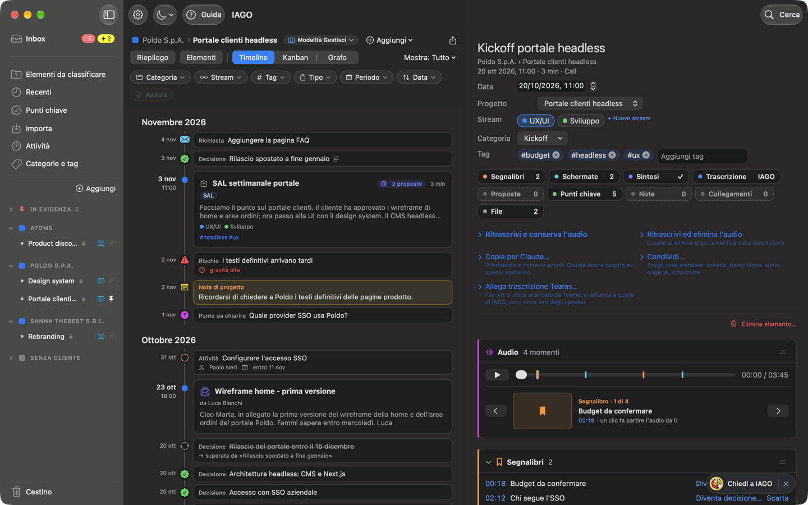
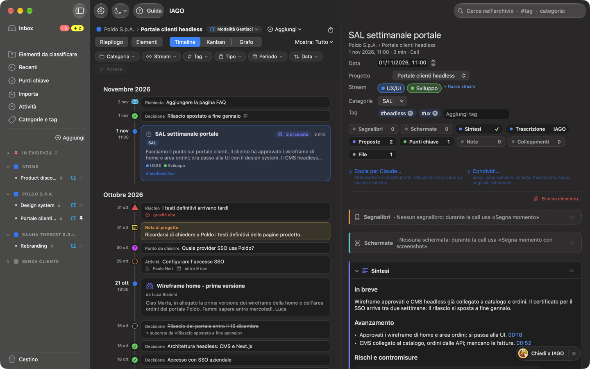
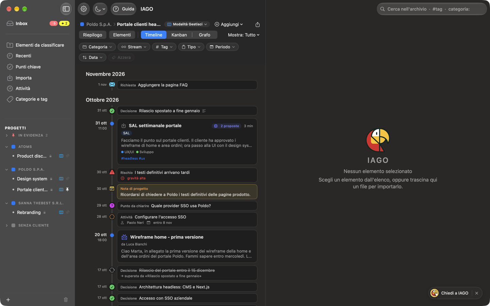
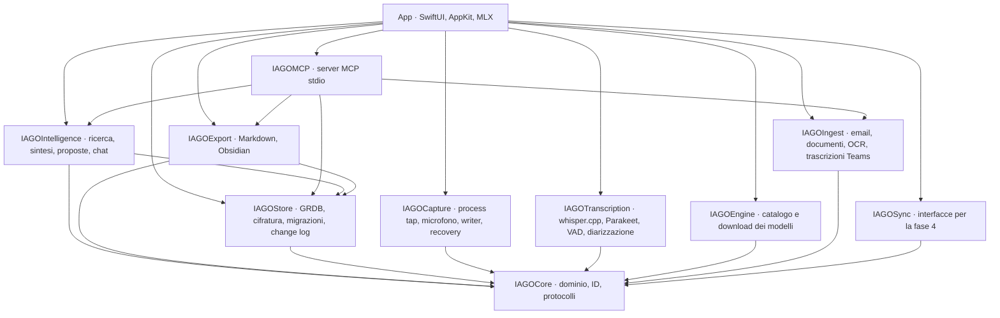

<p align="center">
  
</p>

<h1 align="center">IAGO</h1>

<p align="center"><strong>Il cervello del tuo lavoro, da interrogare.</strong><br>
Call, email, documenti, note e decisioni di ogni progetto in un'unica memoria. Chiedi cosa si è deciso, chi deve fare cosa, com'è cambiata una scelta: IAGO risponde con i tuoi contenuti e ti porta alla fonte.</p>

<p align="center">
  macOS 15+ · Apple Silicon · Swift 6 · motore locale · Claude facoltativo · licenza CC BY-NC-SA 4.0
</p>

<p align="center">
  📖 <strong><a href="https://giovannilombi.github.io/iago/">Documentazione ufficiale</a></strong>: come si usa (livello <em>Uso</em>) e come è fatto (livello <em>Tecnico</em>).<br>
  <sub>È il riferimento: questo README ne è solo il riassunto. Online quando il repository sarà pubblico; fino ad allora in locale con <code>npm install && npm run docs:dev</code> (sito VitePress in <code>docs/</code>).</sub>
</p>

> **Per usare o capire IAGO parti dalla [documentazione ufficiale](https://giovannilombi.github.io/iago/)** (in locale: `npm run docs:dev`). Guida d'uso, installazione, scorciatoie e il livello tecnico sono lì, sempre aggiornati a ogni versione.



> Gli screenshot vengono da un archivio dimostrativo con persone e aziende inventate.

## Indice
- [Perché IAGO](#perché-iago)
- [Cosa fa](#cosa-fa)
- [I tuoi dati, le tue scelte](#i-tuoi-dati-le-tue-scelte)
- [Installazione](#installazione)
- [Guida d'uso](#guida-duso)
- [Architettura](#architettura)
- [I motori](#i-motori)
- [Affidabilità](#affidabilità)
- [Le decisioni di progetto](#le-decisioni-di-progetto)
- [Qualità e test](#qualità-e-test)
- [Sviluppo](#sviluppo)
- [Roadmap](#roadmap)
- [Versioni](#versioni)
- [Crediti e licenze](#crediti-e-licenze)

## Perché IAGO
Nel lavoro per progetti la conoscenza è sparsa:
- si decide in call e si conferma per email;
- si allega un PDF e si annota qualcosa in fretta;
- due settimane dopo si cambia idea.

Ritrovare *cosa* si è deciso, *quando* e *perché* costa tempo, e spesso non riesce.

IAGO è una **memoria di lavoro interrogabile**. Raccoglie tutto, lo ordina come lavori tu (cliente › progetto › stream), ne estrae il significato e risponde alle tue domande:
- **«Cosa abbiamo deciso sul budget?»**: la risposta, con le fonti numerate;
- **«Chi deve mandare i wireframe, ed entro quando?»**: l'attività, con chi la fa e la scadenza;
- **«Com'è cambiata la data di rilascio?»**: l'evoluzione della decisione, voce per voce;
- **«Cosa ha detto il cliente sul contratto?»**: il passaggio esatto, con l'audio che riparte da quel minuto.

Il nome viene dall'icona: un pappagallo con la memoria di ferro.

## Cosa fa
### Risponde
- **Chiedi a IAGO** (⌘K): domande in linguaggio naturale su uno stream, un progetto, un cliente o tutta la memoria, con il contesto sempre in vista e "Allarga contesto" per cercare più in largo. Le risposte usano solo i tuoi contenuti e citano le fonti numerate, che si aprono all'elemento e al minuto giusto. Le conversazioni si conservano, si fissano, si salvano come nota.
- **Ricerca** a testo pieno e **per significato**: "quanto versa l'azienda" trova "il contributo del datore di lavoro". Le due ricerche sono unite con *reciprocal rank fusion*.
- **Accesso trasversale:** ogni categoria e ogni tag attraversa tutti i progetti; `#tag` e `categoria:` direttamente dalla ricerca.

### Ricorda ciò che conta
- **Punti chiave:** decisioni e tappe (la memoria) e lavoro aperto (attività con checklist, punti da chiarire, rischi, richieste), ognuno con la fonte (fino al minuto della call), le persone e la data; il lavoro con responsabile, scadenza e «in attesa di».
- **Il lavoro aperto sotto controllo:** l'**Inbox**, in cima alla barra laterale, raccoglie cosa è aperto in tutti i progetti, di chi è e per quando; il **Riepilogo** dice a che punto è un progetto, con una sintesi di stato da copiare. Due modalità sugli stessi dati, scelte per progetto: **Modalità Gestisci**, la completa e predefinita, con stati fini, priorità, dipendenze, ricorrenze e **Kanban** a tutta finestra con colonne tue, e **Modalità Traccia**, semplice e veloce: Riepilogo breve, attività da spuntare, tutti i tipi di punto chiave.
- **L'evoluzione delle decisioni:** una voce può superarne altre, anche di tipo diverso, e IAGO tiene la storia di come ci si è arrivati.
- **Momenti segnati** durante una call, anche **con lo screenshot** della slide condivisa (il testo letto entra nella trascrizione, nella ricerca e nelle sintesi), e **note** datate sul progetto o sull'elemento, anche dettate a voce. Le scorciatoie (⌃⌥M, ⌃⌥S, ⌃⌥R) funzionano in qualsiasi app.
- **Proposte del motore:** dopo ogni nuovo contenuto IAGO propone decisioni, attività (con chi, entro quando, chi si aspetta), punti da chiarire, rischi, richieste, nomi degli speaker, tag, progetto e collegamenti, ognuna con la frase da cui viene. Niente viene applicato senza la tua conferma. Ogni sintesi e ogni proposta dice quale modello l'ha prodotta.
- **Riconosce le voci** (se lo attivi): dai un nome a uno speaker e nelle call successive IAGO propone quel nome quando sente la stessa voce. Le impronte restano cifrate sul Mac, non vanno mai a Claude e si eliminano quando vuoi.

### Capisce
- **Sintesi per tipo di riunione:** un 1to1 ha impegni e feedback, un SAL tappe, rischi e decisioni, un incontro commerciale esigenze, obiezioni e prossimi passi.
  - Ogni punto porta il minuto da cui viene, verificato sulla trascrizione.
  - I modelli di sintesi vengono da Meetily e Hyprnote (MIT) e sono modificabili.
- **Trascrizione** con chi parla: la tua voce è "Io", gli altri vengono separati per persona e si possono rinominare; un glossario aiuta con i nomi difficili.
- **Viste di progetto:** il **Riepilogo**, gli **Elementi** del progetto, e le forme della storia (**Timeline**, **Kanban**, **Grafo** delle persone e delle decisioni collegate) con cosa mostrare (tutto, solo gli elementi o solo i punti chiave). IAGO ricorda l'ultima vista di ogni progetto. Da un progetto **Importa file ed elementi…** porta dentro audio, documenti, email e testo direttamente lì.

### Raccoglie da ogni fonte
- **Call:**
  - registrazione su due tracce separate (l'audio del Mac e il tuo microfono), allineate sullo stesso orologio;
  - IAGO si accorge delle riunioni (Teams, Zoom, Webex, FaceTime, Slack, Calendario) e propone di registrarle con il titolo giusto;
  - segue il mute di Teams.
- **Email** (.eml, .msg), riconosciute per mittente, conversazione e allegati, anche in automatico da una **cartella sorvegliata** (per esempio la posta di Outlook salvata da Power Automate).
- **Documenti:** PDF, Word, testi e immagini, con il riconoscimento del testo.
- **Trascrizioni di Teams, audio e video.**
- **Qualsiasi testo**, da qualsiasi app, con il servizio "Aggiungi a IAGO".

### Ordina
- **Clienti, progetti e stream** in una barra laterale a fisarmonica, con *In evidenza* per progetti, categorie e tag che usi di più.
- **Categorie** come tipo di riunione, su due livelli:
  - le principali sempre visibili;
  - le famiglie (Agile, Direzione, Persone, Operazioni) quando servono.
- **Tag** trasversali e la sezione **Attività**, con tutto quello che IAGO sta facendo.

### Si espande, se vuoi
- **Claude** (Claude Desktop o Claude Code) collegato a IAGO via MCP, per ragionare sui tuoi progetti con un modello più potente:
  - legge solo ciò che abiliti;
  - scrive note, punti chiave e documenti solo con anteprima e tua conferma;
  - può fare **sintesi e proposte al posto del motore del Mac**: «Copia per Claude» nella scheda gli dà l'elemento giusto, e IAGO verifica ogni citazione come con il suo motore;
  - ogni scrittura si può annullare.
- **Condivisione con il gruppo** *(in arrivo, fase 4)*: progetti condivisi in spazi fidati che controlli tu o la tua azienda (OneDrive, SharePoint, Google Drive), senza un server di IAGO.
- **Obsidian**, **esportazioni** per progetto (anche in Markdown per un LLM) e **backup cifrato** per passare a un altro Mac.

## I tuoi dati, le tue scelte
**Niente lascia il tuo Mac a meno che tu non lo voglia.** Sei tu a decidere fin dove arrivano i tuoi contenuti:

| Livello | Cosa succede | Chi lo decide |
|---|---|---|
| **Sul Mac**, di base | archivio cifrato (una chiave per elemento, nel Portachiavi); trascrizione e motore locale dentro IAGO, con MLX | sempre attivo |
| **Con Claude** | Claude legge i progetti che abiliti e scrive solo con la tua conferma | tu, progetto per progetto |
| **In uno spazio condiviso** *(fase 4)* | il progetto vive in una cartella di OneDrive, SharePoint o Google Drive controllata da te o dall'azienda, e il gruppo ci lavora insieme | tu, scegliendo lo spazio |

**Connessioni.** IAGO non ha server suoi né telemetria. Le sole connessioni che fa da solo sono poche, fisse e registrate nel registro accessi:
1. il download dei modelli che chiedi, da indirizzi fissati a un commit, con verifica SHA-256;
2. l'API locale di Teams (`127.0.0.1`), se la attivi;
3. il controllo degli aggiornamenti firmati su GitHub Releases.

Uno script in CI (`scripts/check-network-apis.sh`) fallisce se nel codice compare una connessione fuori da questi punti.

## Installazione
**Requisiti:**
- Mac con Apple Silicon (M1 o successivi) e macOS 15 o più recente;
- 1,6 GB per i modelli di trascrizione;
- da 2 a 7 GB in più per il motore locale.

1. Scarica `IAGO-x.y.z.dmg` dalla [pagina delle release](https://github.com/giovannilombi/iago/releases/latest), aprilo e trascina **IAGO** in **Applicazioni**.
2. **Primo avvio.** IAGO non è notarizzato da Apple, quindi macOS lo blocca la prima volta:
   - premi **Fine**;
   - apri **Impostazioni di Sistema › Privacy e sicurezza**;
   - premi **Apri comunque** accanto a IAGO.
3. La **configurazione guidata** ti accompagna:
   - nome;
   - microfono;
   - prova dell'audio di sistema;
   - notifiche;
   - download dei modelli.

   Poi un tour di benvenuto di sette schermate.
4. In **Impostazioni › Permessi** vedi cosa è attivo e attivi il resto una voce alla volta.
5. **Facoltativi:**
   - il calendario di lavoro (Exchange o Google in *Account Internet*), per i titoli delle riunioni;
   - il **motore locale** in Impostazioni › Motore: Qwen 3.5 9B con 16 GB, Gemma 4 12B con 32 GB.

**Aggiornamenti.** IAGO installato dal DMG controlla una volta al giorno. Le versioni minori sono proposte; una nuova versione maggiore è obbligatoria prima di registrare di nuovo, senza interrompere una registrazione in corso. Una copia compilata dal codice sorgente non cerca aggiornamenti: si aggiorna con git.

Istruzioni dettagliate in [`docs/installazione.md`](docs/installazione.md).

## Guida d'uso
IAGO ha una **guida completa dentro l'app**: pulsante **? Guida** nella finestra, oppure il menu dell'icona di IAGO. Gli stessi capitoli sono leggibili qui:

| | |
|---|---|
| [Primi passi](App/Resources/Guide/01-primi-passi.md) | [Installazione](App/Resources/Guide/02-installazione.md) |
| [Registrare una call](App/Resources/Guide/03-registrare.md) | [Riunioni e calendario](App/Resources/Guide/04-riunioni.md) |
| [Trascrizione](App/Resources/Guide/05-trascrizione.md) | [Organizzare](App/Resources/Guide/06-organizzare.md) |
| [La scheda di un elemento](App/Resources/Guide/07-scheda.md) | [Sintesi](App/Resources/Guide/08-sintesi.md) |
| [Punti chiave](App/Resources/Guide/09-punti-chiave.md) | [Proposte del motore](App/Resources/Guide/10-proposte.md) |
| [Cercare e chiedere](App/Resources/Guide/11-cercare-chiedere.md) | [Email e documenti](App/Resources/Guide/12-email-documenti.md) |
| [Claude](App/Resources/Guide/13-claude.md) | [Attività](App/Resources/Guide/14-attivita.md) |
| [Il motore locale](App/Resources/Guide/15-motore.md) | [Impostazioni](App/Resources/Guide/16-impostazioni.md) |
| [Privacy, Claude e condivisione](App/Resources/Guide/17-privacy-backup.md) | [Aggiornamenti](App/Resources/Guide/18-aggiornamenti.md) |
| [Problemi comuni](App/Resources/Guide/19-problemi.md) | |

<p>
  
  
</p>

## Architettura
App macOS nativa in **Swift 6** con concorrenza rigorosa:
- **SwiftUI**, più AppKit dove serve: `NSStatusItem` per la barra dei menu, `NSPanel` per le proposte;
- nessuna webview;
- l'app non è in sandbox, con *hardened runtime*.

Il codice è diviso in pacchetti con un grafo di dipendenze fisso, verificato a ogni build:



### Dal contenuto alla risposta
Ogni contenuto segue lo stesso percorso: entra, viene archiviato cifrato, diventa testo, viene indicizzato, se ne estrae il significato, e da lì risponde alle domande.
- **Email e documenti:** `IAGOIngest` estrae testo, persone e allegati (con OCR per le immagini).
- **Note:** si scrivono o si dettano.
- **Call:** hanno un passo in più, la cattura e la trascrizione.

1. **Cattura delle call** (`IAGOCapture`):
   - un *process tap* di Core Audio prende l'audio di sistema;
   - un IOProc HAL prende il microfono così com'è, senza toccare quello dell'app di call;
   - ogni buffer porta l'ora dell'orologio di sistema (host time), così le tracce restano allineate anche quando cambi microfono o fai pausa;
   - la scrittura è incrementale su disco.
2. **Archiviazione:** a fine registrazione le tracce vengono cifrate a blocchi nell'archivio (`Items/<id>/`), con una chiave per elemento.
3. **Trascrizione** (`IAGOTranscription`), in una coda di lavori con QoS `.utility`, uno alla volta:
   - VAD Silero e suddivisione in blocchi;
   - Whisper o Parakeet;
   - diarizzazione delle voci;
   - unione delle due tracce e filtro dell'eco residua.
4. **Indicizzazione:** ricerca a testo pieno (FTS5) subito; vettori Qwen3 Embedding in secondo piano per la ricerca per significato.
5. **Comprensione** (`IAGOIntelligence`, con il motore MLX dell'app): sintesi con il modello della categoria, proposte di punti chiave, risposte di Chiedi con le fonti. Lo stesso archivio, in sola lettura o con scritture confermate, è esposto a Claude dal server MCP (`IAGOMCP`).

### I dati
- **SQLite con GRDB:**
  - migrazioni versionate (17 finora), ognuna preceduta da un backup quando si aggiorna l'archivio dell'utente;
  - ogni riga ha `created_at`, `updated_at`, `deleted_at`, `version` e `device_id`;
  - ogni modifica finisce in `change_log`, la base della sincronizzazione futura.
- **File cifrati** a blocchi (AES-GCM), con le chiavi nel Portachiavi. L'eliminazione definitiva distrugge la chiave (*crypto-shredding*).
- **Registro accessi** di download, letture e scritture di Claude, esportazioni, backup e aggiornamenti.

## I motori
### Trascrizione
| Motore | Implementazione | Velocità misurata | Qualità |
|---|---|---|---|
| **Whisper large-v3-turbo** (predefinito) | whisper.cpp 1.9.2, Metal, beam search 5, italiano forzato | **19× il tempo reale**: un'ora in circa 3 minuti | più preciso su termini inglesi e nomi |
| **Parakeet TDT 0.6B v3** | FluidAudio, CoreML sul Neural Engine | **87× il tempo reale**: un'ora in circa 40 secondi | buona sull'italiano colloquiale, più errori sui nomi |

- VAD Silero e diarizzazione pyannote/WeSpeaker via FluidAudio; la diarizzazione impiega pochi secondi per call (circa 300× il tempo reale).
- Misure su 2 h 44 min di call reali, su un M3 Pro: [`docs/benchmarks/2026-10-phase0.md`](docs/benchmarks/2026-10-phase0.md).

### Motore locale (sintesi, proposte, Chiedi)
MLX Swift **dentro l'app**: nessun server locale, nessuna porta aperta. I modelli sono quantizzati a 4 bit, fissati a un commit e verificati.

| Modello | Memoria | Consigliato | Sintesi di una call di 30 minuti |
|---|---|---|---|
| Qwen 3.5 4B | circa 3,5 GB | sotto i 16 GB | non usato per le sintesi (troppo piccolo) |
| Qwen 3.5 9B | circa 6 GB | **16 GB** | 64-97 s, discreta |
| Gemma 4 12B | circa 12,5 GB | **32 GB o più** | 161-272 s, la più ricca |

- **Ricerca per significato:** Qwen3 Embedding 0.6B (0,35 GB), *last-token pooling*, ricerca ibrida con FTS5.
- **Titoli brevi:** Apple Foundation Models, quando disponibili.

**Come IAGO controlla il modello**, invece di fidarsi:
- ogni punto di sintesi e ogni proposta deve **citare la trascrizione**. IAGO trova la citazione, con i numeri identici, e collega il punto al suo minuto; se non la trova, lo scarta;
- le call vengono lette a **blocchi di 10 minuti**, e nessuna richiesta al motore supera un limite fisso di testo;
- trascrizione, motore e ricerca lavorano **uno alla volta**, con la precedenza a Chiedi; sotto i 32 GB proposte e sintesi automatiche sono spente di default, e Gemma 4 12B non si usa sotto i 24 GB;
- le sezioni senza contenuto dicono **"Non emerso"**;
- "In breve" è scritto **solo dai punti verificati**;
- restano fuori i fatti personali e le frasi parlate copiate invece che riassunte;
- le risposte troncate o con JSON malformato vengono **lette sezione per sezione**.

Prove su call reali: [`docs/benchmarks/2026-10-21-sintesi-e-glossario.md`](docs/benchmarks/2026-10-21-sintesi-e-glossario.md).

## Affidabilità
- **Una registrazione non si perde:**
  - scrittura incrementale (*flush* ogni 2 secondi al massimo);
  - recupero all'avvio delle sessioni interrotte da crash, riavvio o mancanza di corrente;
- **Tracce allineate:** stesso orologio di sistema per entrambe, obiettivo di deriva sotto i 50 ms in 2 ore.
- **App sempre reattiva:** lavori pesanti uno alla volta, in secondo piano, sospesi durante le registrazioni e quando aspetti una risposta.
- **Niente scritture silenziose:** le proposte del motore e le scritture di Claude passano sempre dalla tua conferma, e quelle di Claude si possono annullare.
- **Aggiornamenti firmati** EdDSA: IAGO installa solo versioni firmate dalla stessa chiave.

## Le decisioni di progetto
Ogni scelta importante è un **Architecture Decision Record** in [`docs/adr/`](docs/adr/README.md): 68 finora, con contesto, alternative scartate e conseguenze. Alcune:

| ADR | Decisione | Perché |
|---|---|---|
| [0058](docs/adr/0058-principio-sui-dati.md) | Niente esce senza la scelta dell'utente | sul Mac di base, Claude e spazi condivisi solo se li scegli |
| [0002](docs/adr/0002-due-tracce-separate.md) | Due tracce separate | sapere sempre chi sei tu, trascrivere meglio, togliere l'eco |
| [0005](docs/adr/0005-trascrizione-locale.md) | Trascrizione solo locale | le call restano sul Mac |
| [0007](docs/adr/0007-sqlite-file-cifrati.md), [0028](docs/adr/0028-chiavi-portachiavi.md) | SQLite più file cifrati, chiavi nel Portachiavi | un archivio robusto; un elemento eliminato diventa illeggibile anche nelle copie |
| [0009](docs/adr/0009-suggerimenti-da-confermare.md) | Il motore propone, tu confermi | niente cambia senza di te |
| [0023](docs/adr/0023-motore-asr-default.md) | Whisper predefinito, Parakeet veloce | precisione prima, velocità a scelta |
| [0043](docs/adr/0043-server-mcp-per-claude.md), [0044](docs/adr/0044-scrittura-tramite-claude-mcp.md) | Claude via MCP stdio, scritture con anteprima | potenza in più, controllo all'utente, nessuna porta aperta |
| [0048](docs/adr/0048-motore-locale.md) | Motore MLX dentro l'app, modelli a scelta | niente server locali, niente Apple Intelligence per i contenuti |
| [0052](docs/adr/0052-superamenti-multipli.md) | Superamenti multipli e tra tipi diversi | la storia delle decisioni com'è davvero |
| [0054](docs/adr/0054-sintesi-per-categoria.md) | Sintesi per categoria con citazioni verificate | sintesi utili e controllabili |
| [0069](docs/adr/0069-coda-unica-del-motore.md) | Un lavoro pesante alla volta, la chat per prima | il Mac non si riempie, le risposte non aspettano |
| [0071](docs/adr/0071-claude-sintesi-e-proposte.md) | Sintesi e proposte anche da Claude, con le stesse verifiche | qualità alta sui Mac piccoli, sempre controllabile |
| [0072](docs/adr/0072-segna-momento-con-screenshot.md) | Screenshot solo su richiesta, letti sul Mac | le slide entrano nella memoria senza catture automatiche |
| [0073](docs/adr/0073-riconoscere-le-voci.md) | Voci riconosciute tra le call, solo se attivo e solo come proposta | meno nomi da scrivere, dati biometrici sotto controllo |
| [0074](docs/adr/0074-lavoro-aperto-traccia-gestisci.md) | Lavoro aperto con due modi per progetto, Traccia e Gestisci, sugli stessi dati | semplice dove basta, completo dove si gestisce |
| [0075](docs/adr/0075-viste-come-e-cosa.md) | Viste come «come guardare × cosa mostrare», Riepilogo a parte, Kanban a tutta finestra | una barra con una gerarchia chiara |
| [0076](docs/adr/0076-modalita-inbox-elementi.md) | Modalità Traccia davvero semplice, Inbox in cima, Elementi e Grafo, import dal progetto | due modalità che si distinguono, il lavoro di tutti in un posto |
| [0056](docs/adr/0056-aggiornamenti.md) | Aggiornamenti Sparkle firmati, maggiori obbligatori | tutti sulla stessa versione sicura |
| [0057](docs/adr/0057-sync-onedrive.md) | Condivisione tramite una cartella cloud | collaborare senza un server nuovo |

## Qualità e test
- **301 test automatici** nei pacchetti: Store 109, Capture 48, Intelligence 32, Transcription 29, Ingest 22, MCP 20, Core 15, Engine 15, Export 10, Sync 1.
  - La pipeline audio si prova con fixture **sintetiche** (voci di `say`), mai con registrazioni reali.
  - I motori si provano con risposte finte, che riproducono anche gli errori reali dei modelli.
- **CI** su ogni pull request (GitHub Actions, macOS): tutti i test e il controllo delle API di rete. Su Ubuntu, a ogni PR e push su `main`, il controllo che nessun indirizzo email personale entri nel repository. La build con MLX (`scripts/test-engine.sh`) si fa prima delle PR che toccano il motore.
- **Prove sul campo:** misure su call reali (`docs/benchmarks/`) e una **lista di prove per tester** ([`docs/prove-tester.md`](docs/prove-tester.md)), ordinata e fattibile da chi non conosce l'app.
- **Lingue:** codice, commenti e commit in inglese; interfaccia in italiano (String Catalog, predisposto per l'inglese).

## Sviluppo
```bash
scripts/bootstrap.sh          # genera IAGO.xcodeproj con XcodeGen (project.yml è la fonte)
scripts/check-private-data.sh --all   # nessun dato reale nei file (anche come hook prima di ogni commit)
scripts/check-commit-emails.sh main..HEAD   # nessun indirizzo email personale nei commit (hook prima del push e CI)
scripts/test-packages.sh      # swift test su tutti i pacchetti
scripts/test-engine.sh        # build dell'app con MLX e shader Metal
scripts/install-app.sh        # Release firmata installata in /Applications
scripts/release.sh 1.2.0 --notes "…" --github   # release firmata, appcast Sparkle, GitHub Release
```
- **Serve:** Xcode con Swift 6, XcodeGen e un Apple ID (anche gratuito) per la firma. Il Team ID va in `Config/Local.xcconfig` (vedi `Config/Local.xcconfig.example`).
- **Sito di documentazione:** VitePress in `docs/`, con la guida presa da `App/Resources/Guide` (`npm run docs:dev`); sarà su [giovannilombi.github.io/iago](https://giovannilombi.github.io/iago/) quando il repository diventerà pubblico.
- **Per collaborare:** [`README-collaborators.md`](README-collaborators.md) spiega regole, documenti, stato degli ADR, prove e come lavorare con Claude Code.
- **Convenzioni:**
  - un branch per funzione;
  - merge su `main` solo via pull request con CI verde;
  - commit convenzionali;
  - per cambiare una decisione si scrive un nuovo ADR.
- **Struttura:** `App/` (target macOS e guida in `App/Resources/Guide`), `Packages/` (i dieci pacchetti), `docs/` (ADR, benchmark, progetti, prove), `scripts/`.

## Roadmap
- **Fase 4, condivisione:** progetti condivisi in uno spazio fidato, una cartella cloud controllata da te o dall'azienda.
  - Ogni Mac scrive solo nel proprio registro e i materiali restano leggibili anche fuori da IAGO.
  - Una regia per spazio con azioni firmate.
  - Progetto in discussione: [`docs/design/sync-cartella-condivisa.md`](docs/design/sync-cartella-condivisa.md).
- **Poi:**
  - prove approfondite della trascrizione su call reali;
  - voci della stanza nel riconoscimento delle voci;
  - rifiniture del grafo.

## Versioni
Le note di ogni versione sono sulla [pagina delle release](https://github.com/giovannilombi/iago/releases). Questo elenco si aggiorna a ogni pubblicazione.

| Versione | Data | Cosa contiene |
|---|---|---|
| **1.2.1-beta** | 29 ottobre 2026 | Su `main` (tag `v1.2.1-beta`; si torna alle versioni precedenti: vedi sotto). Correzioni dopo il controllo delle schermate: barra laterale al suo posto aprendo «Chiedi a IAGO» su Riepilogo, Kanban o Grafo; pulsanti interi nel pannello della Kanban; guida completata (import dal progetto, finestra principale) |
| **1.2.0-beta** | 29 ottobre 2026 | Tag `v1.2.0-beta`. Lavoro aperto rivisto dopo la prova (ADR-0076): **Modalità Traccia** semplice e veloce (Riepilogo breve, attività da spuntare, tutti i tipi, niente Kanban) e **Modalità Gestisci** completa e predefinita, con nome, icona e colore, finestra alla prima visita di un progetto o cliente e modalità del cliente per i progetti nuovi; **Inbox** in cima alla barra laterale con il bollino rosso; «Elementi da classificare»; barra delle viste Riepilogo · Elementi · Timeline, Kanban, Grafo; «Importa file ed elementi…» da dentro un progetto; Kanban di tutti con tutti i progetti |
| **1.1.0-beta** | 28 ottobre 2026 | Prima versione del lavoro aperto (tag `v1.1.0-beta`), rivista dopo la prova nella 1.2.0-beta. Lavoro aperto: punti da chiarire, rischi, richieste; responsabile, scadenze, attese, checklist; Modalità Traccia (semplice e veloce, Riepilogo breve, attività da spuntare) e Modalità Gestisci (completa, predefinita) per progetto, con la finestra alla prima visita; barra delle viste con Riepilogo, Elementi, Timeline, Kanban e Grafo, a tutta finestra Riepilogo, Kanban e Grafo; Inbox in cima alla barra laterale con il lavoro di tutti i progetti; import da dentro un progetto; Riepilogo con sintesi di stato, Kanban con colonne libere; dipendenze e ricorrenze; notifica del mattino; proposte di tutti i tipi dal motore e da Claude; strumenti MCP per il lavoro aperto. Sito della documentazione con la versione nell'header |
| **1.0.1-beta** | 28 ottobre 2026 | Punto di ripristino prima della 1.1.0-beta. JSON e altri file di testo importabili, menu Modifica (⌘C, ⌘V…); coda unica del motore e gestione della memoria, impostazioni automatiche sotto i 32 GB; chi ha prodotto sintesi e proposte (modello o Claude); sintesi e proposte fatte da Claude con «Copia per Claude»; «Segna momento con screenshot» e scorciatoie in tutte le app; distribuzione con DMG; riconoscimento delle stesse voci tra call diverse |
| **1.0.0-beta** | 24 ottobre 2026 | Beta, non ancora distribuita: tutto quello che è descritto qui (fasi 0-3). La 1.0.0 sarà la prima versione distribuibile |

### Tornare a una versione precedente
Ogni versione ha un tag su GitHub (`v1.0.1-beta`, `v1.1.0-beta`, `v1.2.0-beta`, `v1.2.1-beta`…) con l'elenco delle funzioni nel messaggio: codice, guida e documentazione di quella versione sono tutti lì.
- **Codice e documentazione:** `git checkout v1.0.1-beta`, poi `xcodegen generate` e una build; `npm run docs:dev` mostra il sito di quella versione. Se si abbandona una versione, lo sviluppo riprende dal ramo della versione precedente (per esempio `release/1.0.x`) con i numeri di quella serie (1.0.2-beta…).
- **Archivio:** le migrazioni del database vanno solo avanti. Una versione più vecchia potrebbe non leggere un archivio già aperto da una più nuova. Per tornare indietro si ripristina il **backup** fatto prima dell'aggiornamento (Impostazioni › Backup e trasferimento), oppure si prova la versione nuova su una **copia** dell'archivio (`scripts/try-branch.sh`).

<details>
<summary>Storia dello sviluppo prima della 1.0.0-beta</summary>

- **Fase 0:** cattura su due tracce, prova dei motori di trascrizione.
- **Fase 1:** archivio cifrato, trascrizione, organizzazione per progetto e categoria, configurazione guidata, impostazioni.
- **Fase 2:**
  - ricerca;
  - registro delle decisioni;
  - gerarchia cliente › progetto › stream;
  - note di progetto e vocali;
  - email e persone;
  - esportazioni, Obsidian e backup.
- **Fase 3:**
  - server MCP per Claude (lettura e scrittura) e grafo;
  - motore locale;
  - ricerca per significato, proposte e Chiedi;
  - cartelle sorvegliate;
  - riunioni Teams e mute;
  - sintesi per categoria;
  - Attività, guida e aggiornamenti.

</details>

## Crediti e licenze
IAGO si regge su ottimo software open source:
- [whisper.cpp](https://github.com/ggml-org/whisper.cpp) (MIT) e [FluidAudio](https://github.com/FluidInference/FluidAudio) (Apache-2.0) per la trascrizione;
- [MLX Swift](https://github.com/ml-explore/mlx-swift) (MIT) e [swift-transformers](https://github.com/huggingface/swift-transformers) (Apache-2.0) per il motore locale;
- [GRDB.swift](https://github.com/groue/GRDB.swift) (MIT) per l'archivio;
- [Sparkle](https://github.com/sparkle-project/Sparkle) (MIT) per gli aggiornamenti;
- i modelli Whisper (OpenAI, MIT), Parakeet (NVIDIA, CC-BY-4.0), Qwen (Alibaba, Apache-2.0) e Gemma (Google, Gemma Terms of Use);
- i modelli di sintesi adattati da [Meetily](https://github.com/Zackriya-Solutions/meeting-minutes) e [Hyprnote](https://github.com/fastrepl/hyprnote) (MIT).

Elenco completo, con versioni e licenze verificate: [`docs/licenses.md`](docs/licenses.md).

**IAGO** © 2026 Giovanni Lombi (fino alla 1.0.0-beta) e Giovanni Lombi con Gianluca Sestito (dalle versioni successive), licenza [Creative Commons BY-NC-SA 4.0](LICENSE): puoi usarlo, studiarlo e modificarlo citando l'autore, non per scopi commerciali, condividendo le modifiche con la stessa licenza.
