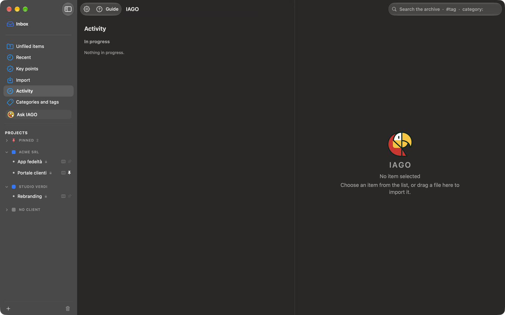

# Activity

**Activity** in the sidebar shows everything IAGO is doing, with a number when something is in progress.

- **In progress:** recording (duration, microphone, mute), transcription, summaries, suggestions, indexing for search, model downloads, imports, backups, exports. With a bar, percentage and time left when it can be estimated.
- **Queued:** the jobs waiting, with **Do this first** and **Cancel**.
- **Last 24 hours:** done, cancelled and failed (with the reason), with **Open** and **Retry**.

Heavy jobs run one at a time and in the background: IAGO stays usable. During a recording they wait.
