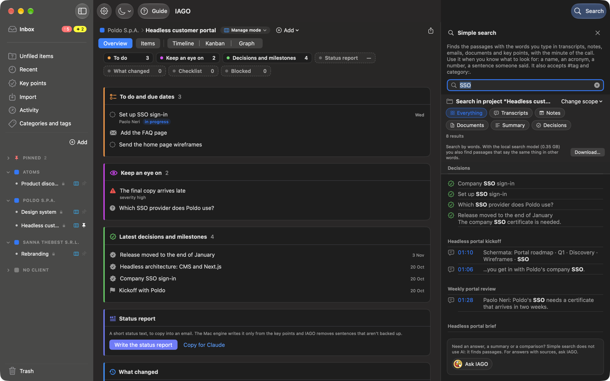
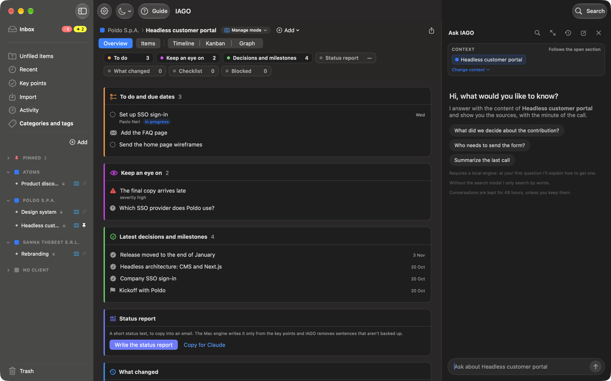
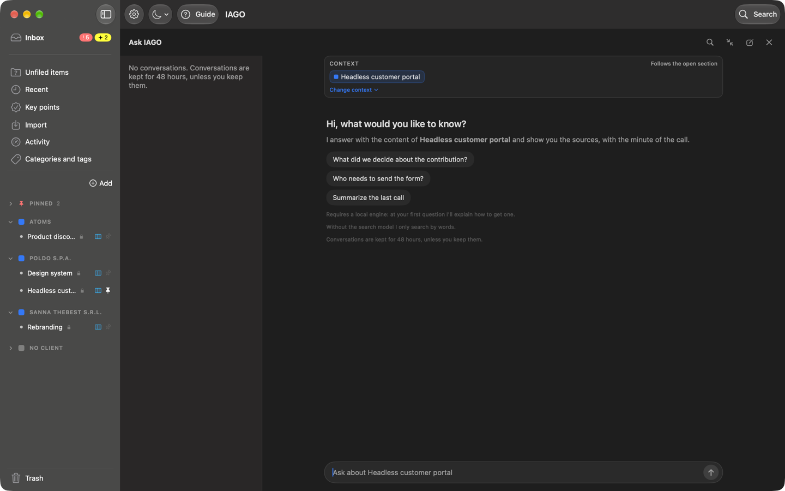

# Searching and asking

## Search
The **Search** button at the top right (or ⌘F) opens **Simple search** in the right pane of the window, with the cursor already in the field. At the top it says what it does and when to use it: it finds the passages with the words you type in transcripts, notes, emails, documents, summaries and key points, in the project you are looking at or everywhere, with the minute of the call. Use it when you know what to look for: a name, an acronym, a number, a sentence someone said.

- Results can be filtered by type. A click on a result opens the item in the card next to it, and the results stay in the pane until you close it; a click on a passage of a call opens the audio at that point.
- With the **search model** (Settings › Engine) it also finds sentences said with different words ("how much the company pays in" finds "the employer contribution").
- In a call with both IAGO's and Teams' transcripts it searches both. The call shows once; if the words are only in the other transcript, the passage says «in the Teams transcript» (or IAGO) and opens that tab.
- `#tag` and `category:Name` suggest and open a tag or a category.
- The ✕ at the top, or Esc, closes the pane.
- Simple search does not use AI: it finds passages. If you need an answer, a summary or a comparison, the box at the bottom has the **Ask IAGO** button, which opens the conversation in the same pane.

## Ask IAGO
The **Ask IAGO** button at the bottom right (or ⌘K) opens a conversation about the section you are in: a stream, a project, a client or the whole memory. Search and conversation share the same pane, one at a time: in the conversation's header the **magnifying glass** (*Switch to simple search*) goes back to search.

### The context
The **Context** strip at the top says where the answers come from: Client › Project › Stream, one or more projects, or Whole memory. Below, it says whether it **follows the open section** (it changes when you choose another entry in the sidebar) or is **chosen by you** (it stays when you change section, even when IAGO opens again).

The **Change context** menu offers:
1. **Add projects…**: tick more projects, grouped by client, with a search;
2. **Narrow context…**: untick the projects to leave out (it needs more than one project);
3. **Global context**: the whole memory, all projects;
4. **Follow the open section**: the context changes with the sidebar again.

With several projects in the context, each has its own tile with a **✕** to remove it. If you have already asked something, changing the context makes IAGO open a new conversation and repeat your last question; the earlier one stays in the list.

### Full window
The button with the two arrows in the header takes the conversation **full window**: the sidebar, the list of conversations and the conversation in the middle remain. A source opens in a pane on the right, with its own ✕. **Back to a pane** puts it back in the right pane; a click on an entry of the sidebar leaves the full-window view.

### Answers and conversations
- Answers use **only your content** and cite numbered sources, which open at the right item and minute.
- Conversations are **temporary** (48 hours): **Keep** to hold on to them, **Pin** to have them at the top, **Delete**.
- Closing the pane keeps the open conversation: when you open Ask IAGO again, it is there.
- If you add material in the meantime, IAGO points it out and suggests asking again.
- **Save as note** puts the answer among the project's notes.
