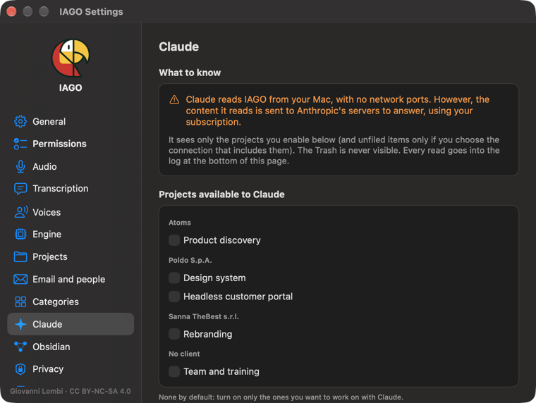

# Claude

You can connect **Claude Desktop** (or Claude Code) to the projects you choose. Claude reads nothing you have not enabled.

1. **Settings › Claude**: choose the projects (or a client) and press **Add to Claude Desktop**; restart Claude. When you make a project readable while Claude Desktop is open, IAGO shows **Restart Claude Desktop**: Claude Desktop and Claude Code read shared projects only when they open. **Restart Claude** quits it and opens it again for you; *Later* leaves it to you (⌘Q and open it again). A project that already has the **Claude icon** in the sidebar is already shared.
2. Claude can **read**: search, open items, the timeline, key points, notes, export a project.
3. With **Can write**, Claude can add notes, key points, documents, emails and files: every write goes through a **preview** and your confirmation, appears with the label *via Claude* and can be **undone** from Settings › Claude.

## Summaries and suggestions made by Claude
You can ask Claude for an item's summary or suggestions, instead of the Mac's engine.

Under *Summary*, when the item has no summary yet, and on one line under *Suggestions*, a box about Claude appears. In the summary it sits **at the bottom**, after *Generate summary*: first comes the way with the Mac's engine, then Claude.
- **On Macs up to 16 GB** it is a **Tip**, in orange: the local engine takes a long time and slows everything else down.
- **On Macs with more memory** it is an **Alternative**, in grey: the Mac's engine works well, Claude is another way.

### To do it with Claude: the four steps
The box lists four steps. Those already done have a green mark, and next to those still to do there is the button you need. **how?** opens this page.
1. **The item is in a project.** Claude writes only in projects: if the item has none, choose it from the Project menu at the top of the card.
2. **Claude is connected to IAGO.** You do it just once: *Connect Claude…* takes you to Settings › Claude, where you add the connection (see above). If the connection you have is limited to other projects, add one that includes this one too.
3. **The project is allowed to Claude.** *Allow* makes it readable and writable by Claude, for that project only; then **restart Claude Desktop or Claude Code**, because they see the project only after a restart. If the project already has the **Claude icon** in the sidebar, it is all set.
4. **Ask Claude for the summary.** IAGO copies the request and opens Claude: you paste it in the chat with ⌘V. When Claude has finished, you check the result in the preview and, with your OK, it appears in the card.

IAGO never enables anything by itself.

### Hiding the box
At the bottom of the box, **Not here: I use the Mac's engine** hides it on that project, **Don't show again** on the whole Mac. In its place a thin strip remains, *Alternative: you can also make the summary with Claude.*, with **See how**, which opens the whole box again for the item you are looking at.

In **Settings › Engine › Summaries and suggestions** you can choose **Claude**: the Mac's engine no longer starts by itself and the box always appears, on any Mac.

At any time you can also do this:
1. In the item card press **Copy for Claude…** and choose *For the summary*, *For suggestions* or *Reference only*. If Claude cannot read (or write to) the project yet, IAGO tells you and turns it on with one click.
2. Paste into Claude: it works on exactly that item, without searching for it.
3. Claude shows you a preview; after your OK the summary appears as **Summarized by Claude** and the suggestions as **Recommended by Claude**, to confirm like the engine's. Claude also suggests open questions, risks and requests, with owner, due date and waits.

With **Can write**, Claude also manages open work: it creates and updates tasks, open questions, risks and requests with owner, due date, priority, dependencies and checklists, and closes them with their outcome. As always it goes through the preview and can be undone.

You can also ask Claude for "yesterday's call with …": it finds the latest items on its own. If there is more than one, it asks you which.

Claude's summary follows the **category template**, and IAGO checks every quote just as it does with its own engine: points without a real sentence from the text are dropped. **Regenerate** with the Mac's engine asks for confirmation before replacing it, and everything can be undone from Settings › Claude.

## Screenshots
Claude always reads the **text** of a call's screenshots, like the transcript. It sees the **images** (slides, tables, charts, which Claude understands better than the text) only if you turn on **Also share screenshot images with Claude** in Settings › Claude: a screenshot contains everything that was on the screen.

Transcripts, audio and originals can never be changed by Claude.
