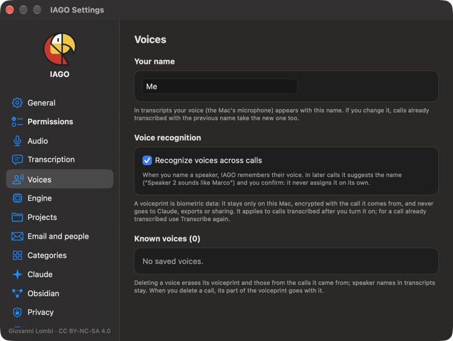

# Settings

The **appearance** (automatic, light or dark) is not here: you choose it from the icon next to Settings, in the main window.

- **General:** language (Italian or English: IAGO restarts to change it, and summaries and suggestions switch to the new language too), name ("Me"), Kanban, item detail (sections open or closed at first, restoring the section order, moments in the transcript and on the player), morning notification, open at login, updates, shortcuts in all apps, screenshots (one or all screens).
- **Permissions:** what is on and what is missing, with guided activation.
- **Audio:** microphone, meetings (suggestions, calendar, Teams mute).
- **Transcription:** engine, language, glossary, what to do after Stop, only when plugged in, models.
- **Voices:** at the top *Your name*, that is how your voice appears in transcripts (it is also in General). It is saved with Return, *Save* or by leaving the field, and calls already transcribed with the previous name take the new one, except those where you gave your voice another name. Then recognizing the same voices across calls (**on by default**) and known voices, to delete one by one or all at once.

- **Engine:** local model, search by meaning, automatic jobs (suggestions and summaries; off by default below 32 GB of memory).
- **Projects:** rename, archive, delete (in three steps); the mode of each one, *Collect mode*, *Track mode* or *Manage mode* (the default).
- **Email and people:** your addresses, contacts, watched folders, rules.
- **Categories:** main ones and families, colors, order, summary templates.
- **Claude:** enabled projects, writing, screenshot images, change log.
- **Obsidian:** a copy of the archive as Markdown notes in a vault.
- **Privacy:** what stays on the Mac, Time Machine, access log.
- **Backup and transfer:** encrypted backup, restore on another Mac, audio export.
- **Storage:** how much space the archive and models take.
- **Help:** this guide and the introduction.
