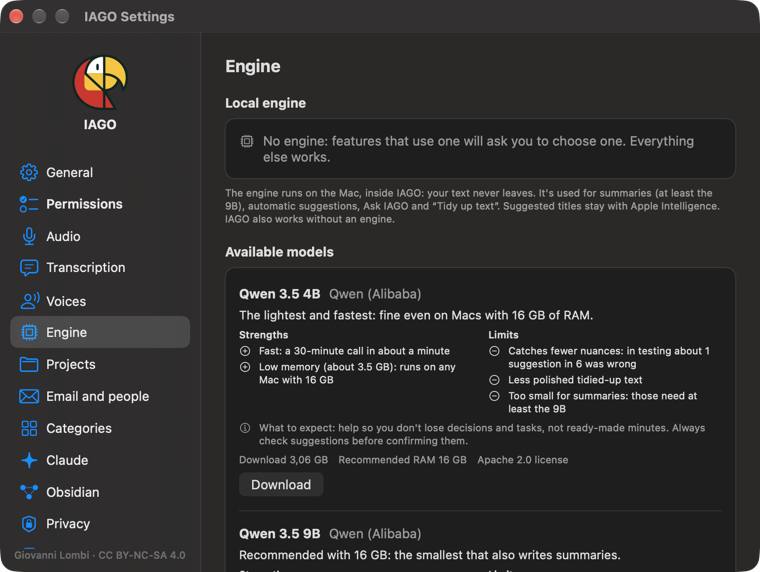

# The local engine

Summaries, suggestions, Ask and *Tidy up text* use a **language model that runs on the Mac**. You download it once (Settings › Engine); the texts never leave. Short titles use Apple Intelligence when available.

| Model | Memory | For whom | Notes |
| --- | --- | --- | --- |
| Qwen 3.5 4B | about 3.5 GB | Macs with less than 16 GB | fast; **does not write summaries** |
| Qwen 3.5 9B | about 6 GB | **recommended with 16 GB** | the smallest that writes summaries |
| Gemma 4 12B | about 12.5 GB | **recommended with 32 GB or more** | the most accurate, slower; **cannot be used below 24 GB** |

## One thing at a time
Transcription, engine and search by meaning work **one at a time**, so the Mac does not fill up. When you ask a question in *Ask*, background work pauses and starts again right after the answer. A transcription, instead, has to finish: on Macs with less than 32 GB the question waits until it ends.

## Macs with less than 32 GB
- **Automatic suggestions and summaries are off by default**: ask for them from the item card (*Find suggestions*, *Generate summary*), or turn them on in Settings › Engine › *Automatic jobs*. While they work, the Mac slows down.
- The model is released from memory at the end of each job.
- **Up to 16 GB** the item card suggests having **Claude** do summaries and suggestions; with more memory it offers it as an alternative. In Settings › Engine › *Summaries and suggestions* you can choose it for everything (see the *Claude* chapter).
- If macOS reports low memory, IAGO pauses background work for a few minutes.

## Search by meaning
The **search model** (Qwen3 Embedding, 0.35 GB) is downloaded with the first engine and indexes in the background.

## What to expect
A help so you do not miss anything and can start from a draft, not ready-made minutes: suggestions and summaries always need rereading.
