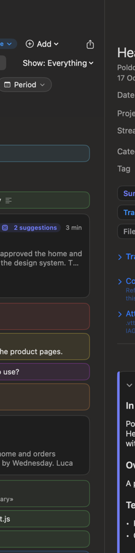
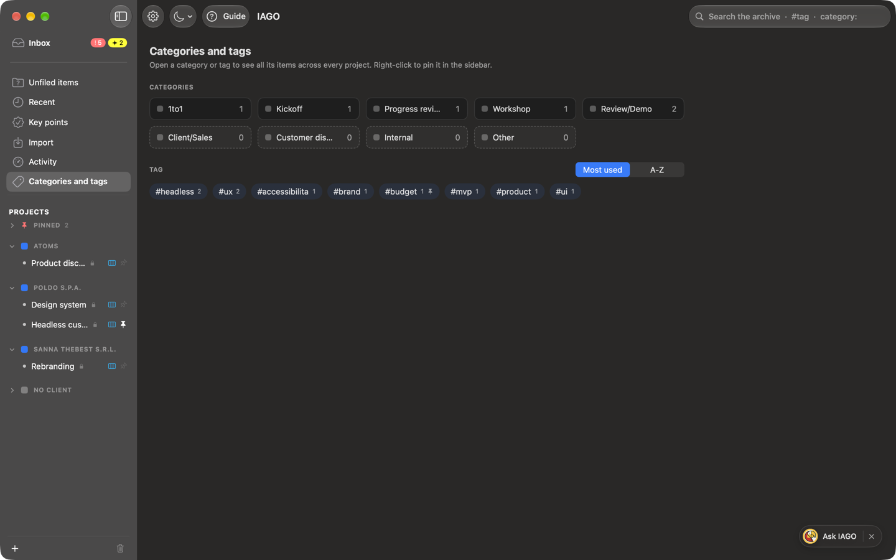
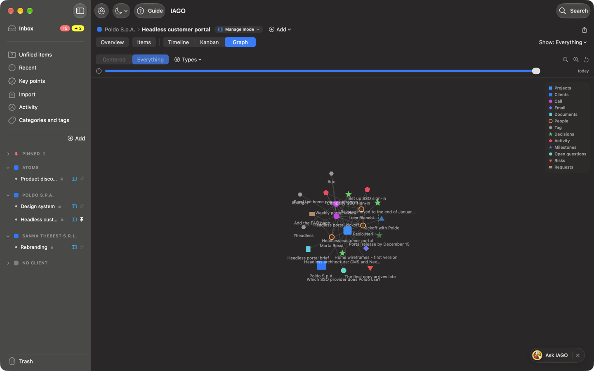
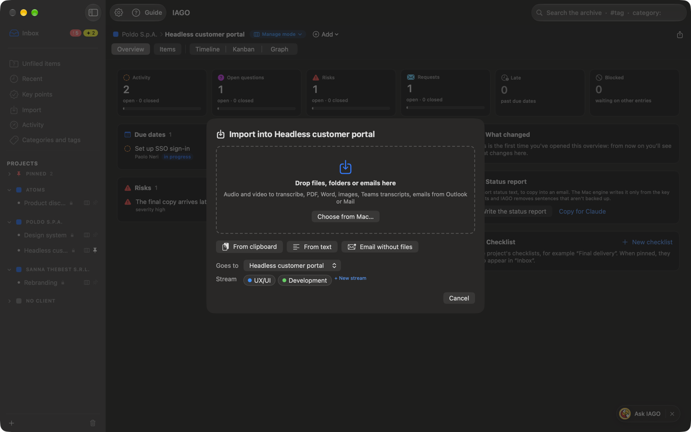

# Organizing

## The sidebar
- **At the top, the Inbox**, in bold and set apart from the rest: the open work waiting for you. It has two badges: the **red** one (!) counts what needs action now, the **yellow** one (✦) the suggestions to confirm (see Key points and open work).
- **Below, always there:** *Unfiled items*, *Recent*, *Key points*, *Import*, *Activity*, *Categories and tags*.
- **Clients and projects** (the only part that scrolls). At the top, on the right, **Add** opens the *Add:* menu with **Client…** and **Project…**. If a name is too long for the sidebar, stay **two seconds** on the name: the whole name appears.
  - **Pinned** (red pin): projects, streams, categories and tags you pin.
  - **Clients**, each with its projects. Next to each project a small icon shows its mode: an orange box for *Collect mode*, a green notebook for *Track mode*, three blue columns for *Manage mode*; a click on the icon lets you choose another one, like the pill next to the project's name. A click on the name opens or closes the client; **⌥-click** opens only that one and closes the others. On hover **+** appears: it creates a project of that client, already chosen and not editable. All the client's items open with right-click › *Open*.
  - **No client** (small gray square), always last, with **Undefined** at the bottom: items filed without a project.
- **At the bottom:** the **Trash**, with the number of items.
- With more than 15 projects, **Filter projects** appears.

**The columns.** Next to the sidebar, the middle column (the list) and the right one (what you open) start half and half. Drag the divider between them to change them: the width stays for that place only, also the next time. Inbox, Unfiled items, Recent, Key points and the others each have their own; projects, clients, streams, categories and tags share one per view.

## Projects and streams
A project belongs to a client (or to none). A **stream** is a line of work inside the project (e.g. Design, Development, Legal): items, notes and key points can belong to one or more streams. Drag a project onto a client to move it. Right-click: settings, new stream, rename, move, pin. A stream can also be pinned at the top with a right-click.

## The starting example
In a new archive IAGO creates **example projects** of an invented digital agency, to show every part of the app: the clients **Poldo S.p.A.** (*Headless customer portal*, with the streams *UX/UI* and *Development*, and *Design system*), **Sanna TheBest s.r.l.** (*Rebranding*) and **Atoms** (*Product discovery*), with transcribed calls, emails, documents, summaries, key points and suggestions. The examples do not count in the introduction's first steps. When you no longer need them, **Settings › Projects › Remove the example** deletes them with all their content. They do not come back.

## Unfiled items
All the calls, emails and documents that do not have a project yet. The engine's suggestions can point to the right project. If you import from inside a project (*Add › Import files and items…*), the items go straight there and do not pass through here.

## Categories
The **category** is the type of meeting (1to1, Kickoff, Progress review, Workshop, Review/Demo, Client/Sales, Customer discovery, Internal, Other) and decides the **shape of the summary**. In **Settings › Categories** you can rename, color, reorder and archive them, and create new ones; other **families** (Agile, Management, People, Operations) can be turned on when needed and appear as submenus.

## Tags
Free labels that cut across projects (e.g. `#budget`, `#fornitore-x`). You add them in an item's card.

## Categories and tags, across projects
The **Categories and tags** view has three columns:
- **on the left** the labels, in two boxes that open and close: *Categories*, with their number of items, and *Tags*, most used first. Choose a category and one or more tags: items must have all of them. The tag search field adds the first match with Return; chosen tags become blue tiles with a ✕, and **Reset** clears everything. Right-click to **pin** a label;
- **in the middle** the items of all projects with those labels;
- **on the right** the card of the chosen item.

Drag the dividers to widen the columns; a double click on a divider puts them back as they were. In search, type `#` or `category:` to open a label on the fly; in the item card, a click on a tag does the same.

## Views: how to look and what to show
A project has a single story (calls, emails, documents, notes, key points); at the top you choose how to look at it.
- **Overview**: the project page, with open work, due dates and the latest decisions. In *Track mode* it is the Short overview.
- **Items**: all the project's calls, emails and documents, with filters for category, tag, type and period.
- Then, after a separator line, the shapes of the story: **Timeline** (day by day), **Kanban** (open work in columns, only in *Manage mode*) and **Graph** (people, items and key points linked together; in *Track mode* you can turn it off from the mode pill).
- On the right, for Timeline and Graph, **Show**: *Everything*, only *Items* or only *Key points*. In *Track mode* it is not there: you see everything.
- In *Collect mode* there are only **Items** and **Timeline**, with the items alone.

Overview, Kanban and Graph fill the whole window: what you open appears in the panel on the right, which you close with ✕ or Esc. IAGO remembers the last view you chose for each project.

## Adding and importing into a project
**Add**, next to the project name, creates a note or a key point. The last entry, **Import files and items…**, opens a window with an area where you drop files, folders or emails and the *Choose from Mac…* button; below it, *From clipboard*, *From text* (the field for typing or pasting opens) and *Email without files*. Everything goes into the project (and the streams) shown in *Goes to*.

