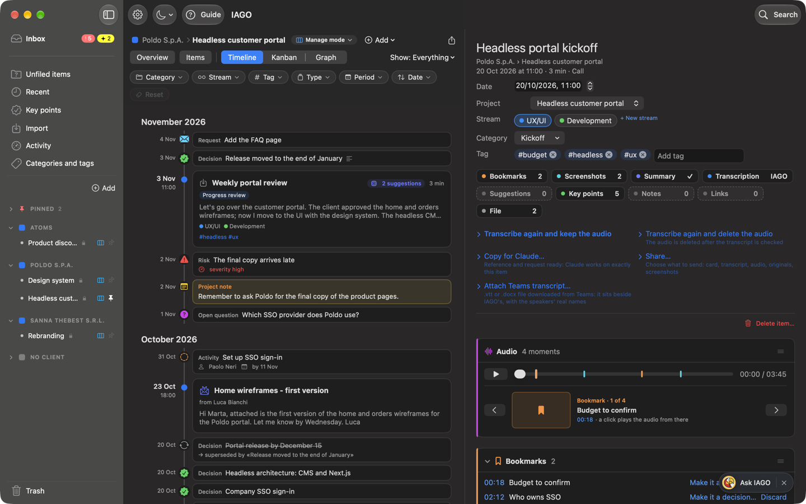

# Getting started

IAGO is the **memory of your work**. It collects what happens in each project and gives it back to you when you need it:
- the calls you record;
- the emails, PDFs, documents and transcripts you import;
- the notes and moments you mark.

You can ask it what was decided, who has to do what, how a choice changed over time: it answers with your own content and takes you to the source, down to the minute of the call.

## The introduction
*IAGO, always on your shoulder. Meeting after meeting.* After the first-launch setup the **introduction** opens: ten steps with the app's screenshots, from recognized meetings to importing, from the project's views to Claude. Every step has a button that takes you to that place in the app.
- On the right there are the **First steps**: record a call, import an email or a document, name a speaker, put an item in a project, confirm a suggestion, ask IAGO a question. They tick themselves when you really do them.
- It appears at every launch until you choose *Don't show again* or complete the first steps. You reopen it from here, with *See the introduction again*, or from Settings › Help.

## What it does for you
1. **Collects.** It records calls from the IAGO icon  in the menu bar (our parrot with a memory of steel). It imports emails, PDFs, documents, images, audio and Teams transcripts, even on its own from a folder.
2. **Sorts.** Everything finds its client, project and stream. The category says what kind of meeting it was, and tags cut across projects.
3. **Understands.** It transcribes, writes the **summary** in the right shape for the type of meeting, and extracts **decisions, milestones and open work** (tasks, open questions, risks, requests), linked to each other when one closes another.
4. **Keeps track.** The **Inbox**, at the top of the sidebar, gathers what is open, whose it is and when it is due; the **Overview** tells you where a project stands. Every project starts in *Manage mode*, the complete one, which also has the Kanban; put a simple one in *Track mode*, simple and quick; a collection of materials to search and query, without management, in *Collect mode* (see Key points and open work).
5. **Answers.** Search by words or by meaning, or ask IAGO (⌘K): it answers only with your content and cites its sources.

## Where things are
- **IAGO icon**  in the menu bar, at the top right of the screen:
  - a click opens the menu: *Start recording*, *Mark moment*, *Voice note*, *Import files…*, Guide, Settings;
  - a right-click (or Control-click) starts, pauses and resumes a recording on the fly;
  - while recording, the icon shows the time; while transcribing, the percentage.
- **Main window:** on the left, the **Inbox** at the top, then the other views and the projects; in the middle, the project (Overview, Items, Timeline, Kanban or Graph); on the right, the item card. At the top, next to Settings, choose the **appearance**: *Automatic* (like the Mac, the starting choice), *Light* or *Dark*.
- **Settings** (⌘,): everything you can configure, including **Permissions**.
- **Guide:** the **? Guide** button at the top left of the window, next to Settings, or the menu of the IAGO icon .

## Your data, your choices
Nothing leaves your Mac unless you decide so:
- the archive is encrypted and the **local engine** works on the Mac;
- if you want more power, you can connect **Claude** to the projects you choose;
- to work as a team, you will be able to share projects in **spaces controlled by you or your company**, such as OneDrive, SharePoint or Google Drive.

See the chapter *Privacy, Claude and sharing*.
