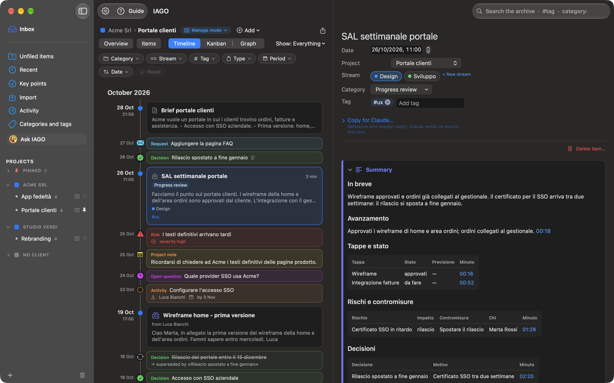

# Summary

With the local engine, IAGO writes the **summary** of a call in the shape of its **category**: a 1to1 has commitments and feedback, a Progress review has milestones, risks and decisions, a Client/Sales has needs, objections and next steps.

## How to get one
- **On its own:** if the call already has a category and **automatic summaries** are on, the summary arrives when transcription ends, with a notification. On Macs with less than 32 GB of memory they are off by default: turn them on in Settings › Engine.
- **By hand:** press **Generate summary** in the *Summary* block. Without a category the block says "not available yet": choose the category first.
- While it is writing you see the progress, in **Activity** too.

## How to read it
- **In brief:** three lines at the top, written only from verified points.
- **Date and participants** come from IAGO's data.
- **Every point carries the minute** it comes from: one click and you listen to that passage again. IAGO checks that the quoted sentence is really there and that the numbers are identical; points it cannot find are dropped.
- A section with no content says **Not mentioned**: the engine does not fill it in for the sake of it.
- Personal facts and small talk are left out.

## Editing and regenerating
- **Edit…** to correct it by hand (it stays marked as "edited").
- **Regenerate** rewrites it; if you had edited it, it asks for confirmation.
- If you change the category, IAGO suggests regenerating with the new template, but does not do it on its own.

## Summary templates
Each category has a **template** (the sections to fill in). The templates come from two open source projects, **Meetily** and **Hyprnote** (MIT license), translated and adapted. In **Settings › Categories** you can choose the template, edit it (sections, instructions, table columns), restore it, export it or import one in Meetily's format.

## Which engine
Summaries need at least **Qwen 3.5 9B**; **Gemma 4 12B** (Macs with 32 GB) writes the richest summaries. The 4B is too small. Times for a 30-minute call: about 1 to 1.5 minutes with the 9B, 2.5 to 4.5 minutes with Gemma.

Below the summary it always says who wrote it: "Summarized with Qwen 3.5 9B on the Mac", or "Summarized by Claude" if you had Claude do it.

They are **drafts to reread**: the quality depends on the transcript.
