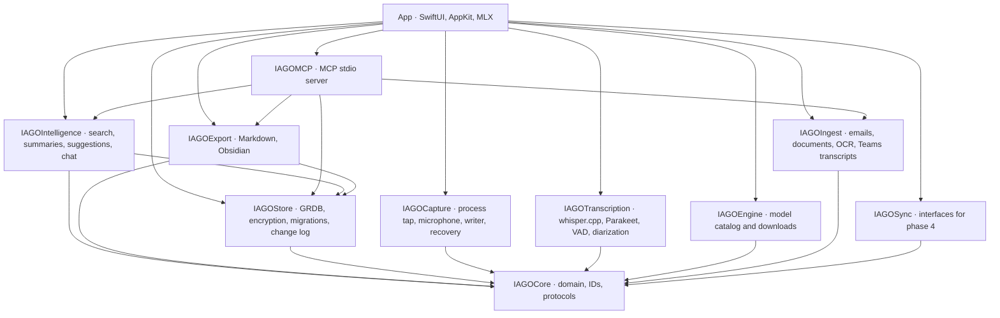
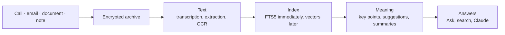

# Architecture

## Platform
- **macOS 15+**, Apple Silicon only (ADR-0022). Swift 6 with *strict concurrency*.
- **SwiftUI** for windows; **AppKit** where needed: `NSStatusItem` for the menu bar icon (not `MenuBarExtra`), `NSPanel` for recording suggestions, title bar accessories for the recording and playback bars. No webviews (ADR-0001).
- **Not sandboxed**, with the *hardened runtime*: the sandbox does not allow a *process tap* on the audio of other apps. Bundle ID `com.giovannilombi.iago`, Apple Development signing.
- Xcode project generated with **XcodeGen** from `project.yml` (the `.xcodeproj` is not committed).

## Packages
The code is split into Swift packages with a fixed graph: no dependencies beyond those listed.

| Package | Responsibility | Tests |
|---|---|---|
| `IAGOCore` | domain types, time-sortable IDs, errors, protocols (e.g. `LanguageModel`), meeting matching | 15 |
| `IAGOStore` | GRDB, migrations, encrypted files, Keychain, change log, FTS5 search, hierarchy, decisions, emails | 80 |
| `IAGOCapture` | process tap, microphone, incremental writer, recovery, markers | 48 |
| `IAGOTranscription` | whisper.cpp, Parakeet, VAD, diarization, track merging, glossary, `iago-bench` | 28 |
| `IAGOIngest` | MIME and .msg emails, documents, Vision OCR, Teams transcripts, import rules | 19 |
| `IAGOIntelligence` | hybrid search, embeddings, suggestions, summaries, Ask, graph | 17 |
| `IAGOEngine` | model catalog, verified downloads, selection by memory | 4 |
| `IAGOExport` | Markdown, project export, Obsidian | 7 |
| `IAGOMCP` | MCP stdio server (`iago-mcp`) | 16 |
| `IAGOSync` | interfaces only, until phase 4 | 1 |

The MLX adapter lives in the app (`App/Sources/Engine`), because Metal shaders do not compile with `swift test`: it is tested with `scripts/test-engine.sh`.

## From content to answer
Every piece of content follows the same path:

1. **Input:** recording (`IAGOCapture`), import (`IAGOIngest`), written or dictated notes.
2. **Storage** in `Items/<id>/`, block-encrypted (`IAGOStore`).
3. **Text:** queued transcription (`IAGOTranscription`) or extraction/OCR.
4. **Indexing:** FTS5 on save; Qwen3 Embedding vectors in the background.
5. **Understanding** (`IAGOIntelligence` with the MLX engine): suggestions, summaries by category.
6. **Answers:** Ask, hybrid search, MCP server for Claude.

## Job queue and responsiveness
- Heavy jobs (transcription, indexing, suggestions, summaries, downloads) go through a **queue** persisted in the database (`Job`), with QoS `.utility`, **one at a time**.
- They are **suspended during recordings** and while the user is waiting for an answer from Ask; the interface always stays responsive.
- Every long job appears in **Activity** (ADR-0055) with the percentage when possible; this is a rule for every new feature.

## The app model
- `AppModel` (observable, `@MainActor`) holds the selection, filters, lists and the shared audio player; views read from it.
- `WindowManager` opens the main window, Settings, Guide, tour and panels; the main window carries the recording bar and the playback bar as title bar accessories.
- `StatusItemController` manages the icon and the menu in the menu bar.
- **Item card** (`ItemDetailView`, `ItemDetailNavigation.swift`, ADR-0084): each section is a `SectionBox`. Open or closed is remembered per item (`SectionMemory`, in `UserDefaults` under `section.item.<id>`), with the defaults of Settings › General in `section.collapsed.<section>`. Sections report where they start (`SectionTopsKey`, in the content's coordinate space); `onScrollGeometryChange` decides when to show the sticky bar and which section to highlight, and `ScrollPosition` brings the section's title just under the bar. The «back to top» button sits in the same layer as «Ask IAGO» (`AppModel.backToTop`). Moments (bookmarks and screenshots) go on the player, as ticks and one card at a time, and in the transcript at their minute.
- **Overview** (`WorkOverview.swift`, ADR-0085): in Manage the boxes sit in a `MasonryLayout`, which measures each box at the column's width and places it in the shorter column; the boxes' tiles are in the top inset, with `ScrollViewReader` and a short outline. In Track `AppModel.keepsInspector` keeps the right panel open even without a selection. **Activity** is a wide view (`isWide`) without a detail column.
- **Style and appearance** (`AppAppearance.swift`, ADR-0086): `AppAppearance` applies *Automatic*, *Light* or *Dark* to `NSApp.appearance` (`appearance` key in `UserDefaults`, menu in the toolbar). `IAGOColor` gathers the colours that change with the appearance: page, box, bars, panel, sheets, the sidebar tint and the thread under titles (`BoxTitleDivider`); in dark it returns the system's colours. Row icons use `DecisionRow.signal`: grey, red only for overdue, blocked or high risk.
