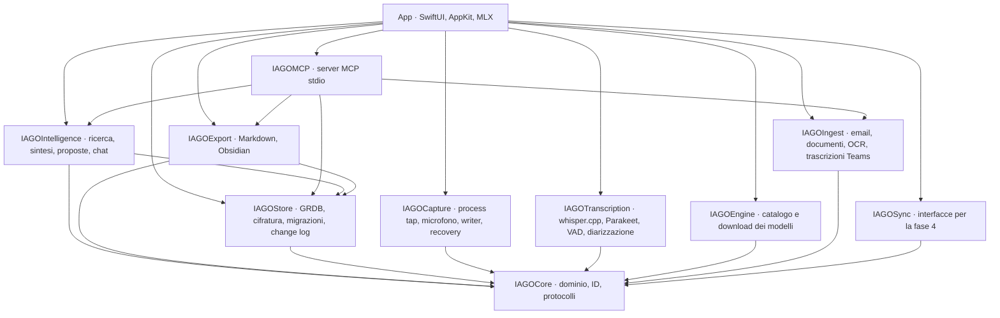
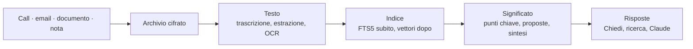

# Architettura

## Piattaforma
- **macOS 15+**, solo Apple Silicon (ADR-0022). Swift 6 con *strict concurrency*.
- **SwiftUI** per le finestre; **AppKit** dove serve: `NSStatusItem` per l'icona nella barra dei menu (non `MenuBarExtra`), `NSPanel` per le proposte di registrazione, accessori della barra del titolo per le barre di registrazione e di ascolto. Nessuna webview (ADR-0001).
- **Non in sandbox**, con *hardened runtime*: la sandbox non permette il *process tap* sull'audio delle altre app. Bundle ID `com.giovannilombi.iago`, firma Apple Development.
- Progetto Xcode generato con **XcodeGen** da `project.yml` (il `.xcodeproj` non si committa).

## Pacchetti
Il codice è diviso in pacchetti Swift con un grafo fisso: nessuna dipendenza fuori da quelle elencate.

| Pacchetto | Responsabilità | Test |
|---|---|---|
| `IAGOCore` | tipi di dominio, ID ordinabili nel tempo, errori, protocolli (es. `LanguageModel`), abbinamento delle riunioni | 15 |
| `IAGOStore` | GRDB, migrazioni, file cifrati, Portachiavi, change log, ricerca FTS5, gerarchia, decisioni, email | 80 |
| `IAGOCapture` | process tap, microfono, writer incrementale, recovery, marcatori | 48 |
| `IAGOTranscription` | whisper.cpp, Parakeet, VAD, diarizzazione, unione delle tracce, glossario, `iago-bench` | 28 |
| `IAGOIngest` | email MIME e .msg, documenti, OCR Vision, trascrizioni Teams, regole di importazione | 19 |
| `IAGOIntelligence` | ricerca ibrida, embedding, proposte, sintesi, Chiedi, grafo | 17 |
| `IAGOEngine` | catalogo dei modelli, download verificati, scelta per memoria | 4 |
| `IAGOExport` | Markdown, export di progetto, Obsidian | 7 |
| `IAGOMCP` | server MCP stdio (`iago-mcp`) | 16 |
| `IAGOSync` | solo interfacce, fino alla fase 4 | 1 |

L'adattatore MLX vive nell'app (`App/Sources/Engine`), perché gli shader Metal non si compilano con `swift test`: si prova con `scripts/test-engine.sh`.

## Dal contenuto alla risposta
Ogni contenuto segue lo stesso percorso:

1. **Ingresso:** registrazione (`IAGOCapture`), importazione (`IAGOIngest`), note scritte o dettate.
2. **Archiviazione** in `Items/<id>/`, cifrata a blocchi (`IAGOStore`).
3. **Testo:** trascrizione in coda (`IAGOTranscription`) o estrazione/OCR.
4. **Indicizzazione:** FTS5 al salvataggio; i vettori di Qwen3 Embedding in secondo piano.
5. **Comprensione** (`IAGOIntelligence` con il motore MLX): proposte, sintesi per categoria.
6. **Risposte:** Chiedi, ricerca ibrida, server MCP per Claude.

## Coda dei lavori e reattività
- I lavori pesanti (trascrizione, indicizzazione, proposte, sintesi, download) passano da una **coda** persistita nel database (`Job`), con QoS `.utility`, **uno alla volta**.
- Si **sospendono durante le registrazioni** e mentre l'utente aspetta una risposta di Chiedi; l'interfaccia resta sempre reattiva.
- Ogni lavoro lungo compare in **Attività** (ADR-0055) con la percentuale quando si può; è una regola per ogni funzione nuova.

## Il modello dell'app
- `AppModel` (osservabile, `@MainActor`) tiene selezione, filtri, elenchi e il lettore audio condiviso; le viste leggono da lì.
- `WindowManager` apre finestra principale, Impostazioni, Guida, tour, pannelli; la finestra principale porta la barra di registrazione e quella di ascolto come accessori della barra del titolo.
- `StatusItemController` gestisce l'icona e il menu nella barra dei menu.
- **Scheda di un elemento** (`ItemDetailView`, `ItemDetailNavigation.swift`, ADR-0084): ogni sezione è una `SectionBox`. Aperta o chiusa si ricorda per elemento (`SectionMemory`, in `UserDefaults` sotto `section.item.<id>`), con i default di Impostazioni › Generale in `section.collapsed.<sezione>`. Le sezioni riportano dove iniziano (`SectionTopsKey`, nello spazio di coordinate del contenuto); `onScrollGeometryChange` decide quando mostrare la barra fissa e quale sezione evidenziare, e `ScrollPosition` porta il titolo della sezione appena sotto la barra. Il pulsante «torna su» sta nello stesso livello di «Chiedi a IAGO» (`AppModel.backToTop`). I momenti (segnalibri e schermate) vanno sul player, come tacche e una scheda alla volta, e nella trascrizione al loro minuto. L'ordine delle sezioni (ADR-0088) è uno per tutti gli elementi, in `detail.sectionOrder` (`DetailOrder`); `SectionReorder` gestisce il trascinamento dal titolo della `SectionBox`, che mentre dura mostra solo le intestazioni, e lo chiude anche quando il rilascio avviene fuori dalle sezioni.
- **Colonne della finestra** (`ColumnWidths.swift`, ADR-0087, ADR-0088): `ContentColumnWidth` trova la vista divisa di `NavigationSplitView` e muove il divisore tra colonna centrale e destra: a metà finché l'utente non sceglie, poi la larghezza della sezione in `columns.contentWidth`. Accorcia anche il divisore con una maschera, perché non attraversi la barra degli strumenti. Le finestre del nuovo progetto e del nuovo stream le mostra `MainView` (`AppModel.newProject`, `newStreamProject`).
- **Riepilogo** (`WorkOverview.swift`, ADR-0085): in Gestisci i box stanno in un `MasonryLayout`, che misura ogni box alla larghezza della colonna e lo mette nella più corta; le tile dei box sono nel riquadro in alto, con `ScrollViewReader` e un breve contorno. In Traccia `AppModel.keepsInspector` tiene aperto il pannello di destra anche senza selezione. **Attività** è una vista larga (`isWide`) senza colonna di dettaglio.
- **Stile e aspetto** (`AppAppearance.swift`, ADR-0086): `AppAppearance` applica *Automatico*, *Chiaro* o *Scuro* a `NSApp.appearance` (chiave `appearance` in `UserDefaults`, menu nella toolbar). `IAGOColor` raccoglie i colori che cambiano con l'aspetto: pagina, box, barre, pannello, fogli, velatura della barra laterale e filo sotto i titoli (`BoxTitleDivider`); in scuro restituisce i colori del sistema. Le icone delle righe usano `DecisionRow.signal`: grigio, rosso solo per scaduto, bloccato o rischio alto.
